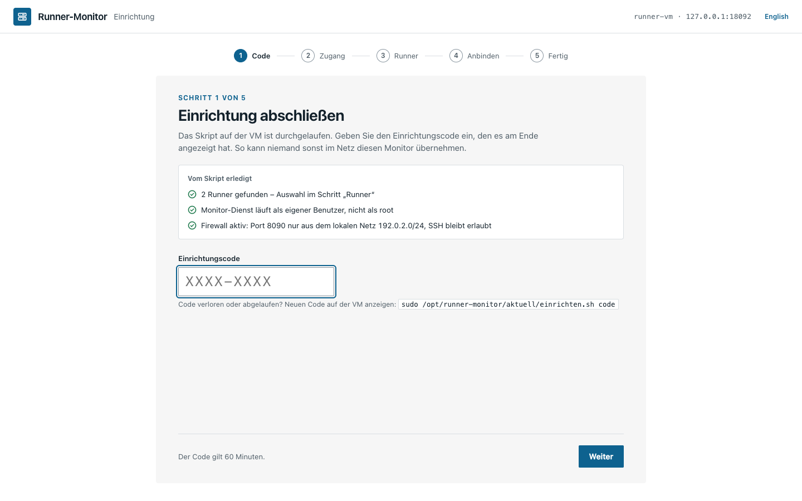
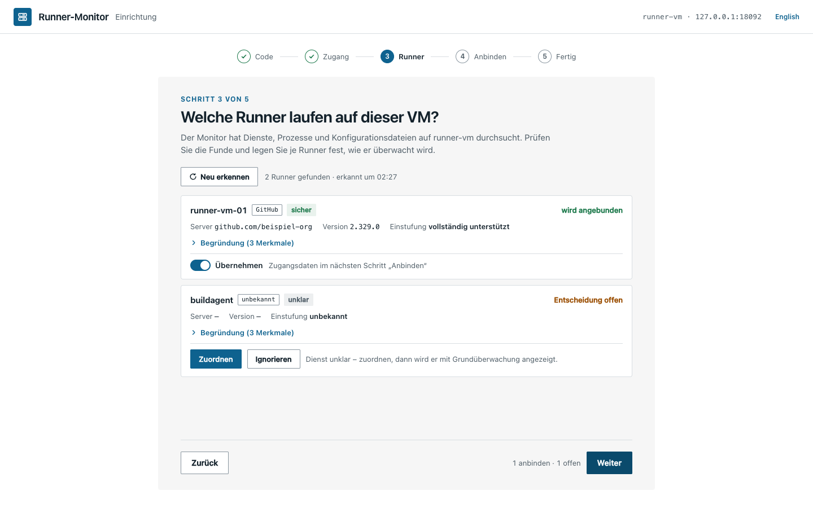
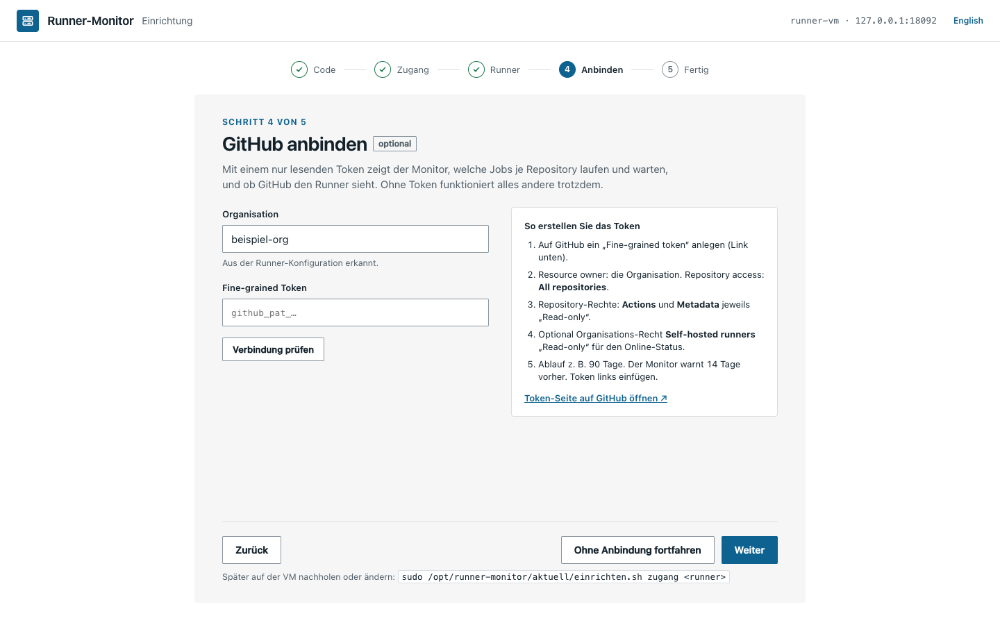

# Erstinstallation auf der VM

**Stand: 29.10.2026 · Version 0.8.1**

Dauer: etwa 5 Minuten. Alle Befehle auf der Runner-VM (per SSH), Platzhalter wie
`beispiel-org` durch die eigenen Werte ersetzen.

## Voraussetzungen

- Ubuntu 22.04 oder 24.04 (andere systemd-Linux mit Python ≥ 3.10 gehen meist auch)
- `sudo`-Rechte
- Netz: die VM erreicht `github.com` und `api.github.com` (HTTPS)
- Der GitHub-Runner ist installiert (`/opt/actions-runner`) – oder das Skript richtet ihn mit ein

## 1. Herunterladen und entpacken

```bash
V=0.8.1
curl -fsSLO https://github.com/Bamberger-IT-Services/Self-Hosted-Github-Runner-Monitor/releases/download/v$V/runner-monitor-$V.tar.gz
curl -fsSLO https://github.com/Bamberger-IT-Services/Self-Hosted-Github-Runner-Monitor/releases/download/v$V/runner-monitor-$V.tar.gz.sha256
sha256sum -c runner-monitor-$V.tar.gz.sha256     # muss „OK“ melden
tar xzf runner-monitor-$V.tar.gz && cd runner-monitor-$V
```

## 2. Einrichtungsskript

```bash
sudo ./einrichten.sh
```

Das Skript arbeitet in drei Abschnitten:

| Abschnitt | Was passiert |
|---|---|
| System prüfen | Betriebssystem, Python, Docker, Netz (Adresse, lokales Netz). Abschnitt **Runner auf dieser VM**: erkennt alle Runner – GitHub, Forgejo, Gitea, GitLab und unbekannte – über systemd-Units, Prozesse, `.runner`-Dateien und eine Abfrage beim Server ohne Zugangsdaten (Beispiel unten). Gefundene Runner bleiben unverändert. Ohne Fund fragt das Skript, ob es einen GitHub-Runner einrichten soll (siehe unten). |
| Monitor einrichten | Systembenutzer `runner-monitor` (kein root, keine Anmeldung, darf das Journal lesen), `/var/lib/runner-monitor`, `/etc/runner-monitor/konfig.env`, Programm nach `/opt/runner-monitor/versionen/0.8.0` mit Verweis `aktuell`, Dienste `runner-monitor`, `runner-monitor-sammler`, `runner-monitor-update.path`. Eine alte Terminalansicht (ttyd, `monitor-einrichten.sh`) wird ersetzt, ihr Token übernommen. |
| Firewall (ufw) | SSH bleibt erlaubt, Port 8090 nur aus dem lokalen Netz (z. B. `192.0.2.0/24`). Ist ufw aus, fragt das Skript, ob es ihn einschalten soll. |

Runner auf dieser VM, zum Beispiel mit drei Funden:

```
Runner auf dieser VM
  ✓ runner-vm-01   GitHub    github.com/beispiel-org   2.338.1   sicher
  ✓ runner-vm-02   Forgejo   git.example.org           13.0      sicher
  ? buildagent     unbekannt –                         –         unklar
      Hinweise: Dienst buildagent.service, Name enthält „agent“, startet
                Container
      → Im Browser zuordnen oder ignorieren (Schritt „Runner“)
    Die Runner bleiben unverändert, es wird nur der Monitor eingerichtet.
```

`sicher`: eindeutige Merkmale und der Server hat bestätigt. `wahrscheinlich` (`!`): Dienst erkannt,
aber der Server war nicht erreichbar – das Skript nennt den Grund. `unklar` (`?`): nur allgemeine
Hinweise; im Browser zuordnen oder ignorieren. Ohne Fund:

```
Runner auf dieser VM
  ! Kein Runner gefunden (geprüft: systemd-Units, Prozesse, .runner-Dateien).
    Der Monitor kann trotzdem die VM überwachen. Später Runner ergänzen:
      sudo /opt/runner-monitor/aktuell/einrichten.sh runner
    Jetzt einen Runner einrichten? [j/N] n
    → Im Browser: „Von Hand zuordnen“ oder „Ohne Runner fortfahren“
```

Nach der Installation sucht der Monitor beim Start und alle 6 Stunden erneut. Die Erkennung von Hand:
`sudo python3 -m runner_monitor.erkennung --text` im Ordner `/opt/runner-monitor/aktuell`
(`--json` für alle Merkmale).

Am Ende stehen Adresse und **Einrichtungscode** (60 Minuten gültig), zum Beispiel:

```
──────────────────────────────────────────────────────────
Fast geschafft. Schließen Sie die Einrichtung im Browser ab:

    http://192.0.2.25:8090

    Einrichtungscode:  K7QF-2M9D    (gilt 60 Minuten, danach: sudo /opt/runner-monitor/aktuell/einrichten.sh code)
```

## 3. Im Browser abschließen



1. **Code:** den angezeigten Code eingeben. Oben steht, was das Skript erledigt hat und wie viele
   Runner es gefunden hat.
2. **Zugang schützen:** Benutzername und Passwort (mindestens 12 Zeichen; ein Satz aus mehreren
   Wörtern ist gut). Es gibt genau einen Zugang.
3. **Runner:** die Funde der Runner-Erkennung, je Fund mit Dienst (`GitHub`, `Forgejo`, `Gitea`,
   `GitLab`, `unbekannt`), Sicherheitsgrad (sicher, wahrscheinlich, unklar), Server, Version, Einstufung und
   aufklappbarer Begründung. Je nach Einstufung:
   - *vollständig unterstützt* (GitHub, Forgejo, GitLab; seit #126): Schalter „Übernehmen“ – die Zugangsdaten folgen im nächsten
     Schritt; aus = ignoriert.
   - *erkannt, noch nicht unterstützt* (heute Gitea): „Grundüberwachung“ (Dienst, Auslastung, Log, Neustarts) oder „Ignorieren“.
   - *unbekannt*: „Zuordnen“ (Dienst, Anzeigename, systemd-Unit, Log-Pfad; leer = Journal der Unit) oder
     „Ignorieren“. Als Log-Pfad ist nur eine `*.log`-Datei unter `/var/log`, `/opt` oder `/srv` erlaubt.

   „Neu erkennen“ lässt den Sammler sofort neu suchen (höchstens alle 10 s). Ohne Fund gibt es drei Wege:
   Runner einrichten (`sudo /opt/runner-monitor/aktuell/einrichten.sh runner`, danach „Neu erkennen“), von
   Hand zuordnen oder „Nur VM überwachen“. Mit „Weiter“ landet die Wahl in `/etc/runner-monitor/runner.json`
   (der Sammler schreibt sie, der Webserver darf das nicht).
4. **Anbinden (optional):** je übernommenem Runner ein Block. Für den GitHub-Runner des Monitors wie bisher
   Organisation und **Fine-grained Token** (siehe unten); „Verbindung prüfen“ zeigt, welche Rechte ankommen
   (ohne eingegebenes Token prüft der Sammler das auf der VM hinterlegte), „Weiter“ prüft und speichert. Für
   alle anderen Runner (Forgejo, Gitea, GitLab, weitere GitHub-Runner) tragen Sie Zugangsdaten **auf der VM**
   ein – der Block zeigt den Befehl `sudo /opt/runner-monitor/aktuell/einrichten.sh zugang <runner>` (E-22). Der Befehl
   fragt bei Forgejo, Gitea und GitLab Server, Organisation (nicht bei GitLab) und Token ab, trägt alles ein
   und prüft gleich die Verbindung (siehe „Forgejo- oder Gitea-Runner anbinden“). „Verbindung prüfen“ im
   Browser fragt danach über den Sammler mit genau diesen Angaben.
   Jeder Runner lässt sich mit „Überspringen – nur Grundüberwachung“ auslassen; mit nur einem Runner heißt der
   Knopf „Ohne Anbindung fortfahren“. Ohne übernommenen Runner geht es von Schritt 3 direkt zu 5.
5. **Alles eingerichtet:** Zugang, Firewall und je Runner der Stand (angebunden, Grundüberwachung,
   ignoriert) → „Zum Monitor anmelden“. Erst dieser Knopf schließt die Einrichtung ab; bis dahin führt
   „Zurück“ noch in die vorigen Schritte. Danach nimmt die Oberfläche kein Token mehr an – auch nicht
   angemeldet; Zugangsdaten nur noch auf der VM.

Ab 390 px Breite (Telefon) zeigt der Stepper nur den aktiven Schritt, alles steht untereinander.





### GitHub-Token erstellen

github.com › Settings › Developer settings › Personal access tokens › **Fine-grained tokens** › „Generate new token“

| Feld | Wert |
|---|---|
| Resource owner | die Organisation |
| Expiration | z. B. 90 Tage (der Monitor warnt 14 Tage vorher) |
| Repository access | All repositories |
| Repository permissions | **Actions: Read-only**, **Metadata: Read-only** |
| Organization permissions | **Self-hosted runners: Read-only** (optional, für „Online bei GitHub“) |

Das Token wird auf der VM in `/etc/runner-monitor/zugang/<runner>.token` und – als Rückfall für
ältere Versionen und den Update-Hilfsdienst – in `/etc/runner-monitor/github-token` gespeichert (nur
root kann beide lesen, seit #92). Ein vorhandenes Token übernimmt das Update von selbst. Erneuern oder
nachholen, wenn GitHub übersprungen wurde:

```bash
sudo /opt/runner-monitor/aktuell/einrichten.sh token
```

Das Skript fragt das Token verdeckt und danach die Organisation ab (Enter behält die bisherige)
und startet die Dienste neu. Info › GitHub-Verbindung zeigt Ablauf und Rechte.

Kommt keine Verbindung zustande, auf GitHub prüfen: Resource owner des Tokens muss die
**Organisation** sein, und verlangt die Organisation eine Freigabe, steht das Token unter
Organisation › Settings › Personal access tokens › **Pending requests**.

### GitLab anbinden

Gilt für einen erkannten GitLab-Runner (`gitlab-runner.service`, `config.toml`); der Sammler fragt ihn
seit #115 ab ([Funktionsweise](FUNKTIONSWEISE.md#gitlab-adapter-99)), sobald Token und Server auf der VM
liegen. Zugangsdaten für GitLab (und Forgejo/Gitea) nimmt die Weboberfläche bewusst nicht an (E-22): Sie
gehören auf die VM. Er gilt seit #126 als vollständig unterstützt (E-20): Im Schritt „Runner“ lässt er sich übernehmen,
im Schritt „Anbinden“ steht der Befehl `einrichten.sh zugang`, und das Dashboard zeigt Jobs (ohne Schritte –
die GitLab-API hat keine Schrittliste). Eine Organisation gibt es bei GitLab nicht: „Verbindung prüfen“ nennt
den Dienst („Server erreichbar · GitLab“, „Token gültig“) und sagt, ob der Runner beim Server gefunden wurde.

1. **Token erstellen:** GitLab › Gruppe (oder Projekt) › Settings › **Access tokens** › „Add new token“ –
   Rolle **Maintainer** (bei Gruppen-Runnern ggf. **Owner**), Bereich **`read_api`** (nur lesen), Ablaufdatum z. B. 90 Tage (der Monitor warnt
   14 Tage vorher). Ein persönliches Token (Profil › Access tokens) mit `read_api` geht ebenso, wenn das Konto
   Zugriff auf den Runner hat.
2. **Eintragen** (die ID zeigt `sudo ./einrichten.sh zugang` ohne Angabe). Das Skript fragt den Server
   (z. B. `https://gitlab.example.org`, ohne `/api/v4`) und das Token ab und prüft danach die Verbindung –
   wie bei Forgejo, siehe unten:
   ```bash
   sudo /opt/runner-monitor/aktuell/einrichten.sh zugang <runner-id>
   ```
3. **Server:** Der Monitor folgt keiner Weiterleitung, die Adresse muss also die endgültige sein. Mit Token
   gilt nur **`https://`**. Einen Server nur mit `http://` (z. B. im LAN) nimmt das Skript erst nach einer
   ausdrücklichen Rückfrage an und setzt dann `"http_erlaubt": true`. Das Token läuft dann unverschlüsselt
   durchs Netz; `HTTP_PROXY` wird dabei bewusst nicht benutzt.
   Von Hand: `server` in `/etc/runner-monitor/runner.json` wie unten bei Forgejo, aber **ohne** `org`
   (GitLab braucht keine Organisation). Die Adresse aus der Erkennung wird nie ungefragt übernommen.
4. **Name:** der Runner wird bei GitLab über seine Beschreibung gefunden. Sie muss mit `name` in
   `/etc/gitlab-runner/config.toml` übereinstimmen und darf bei GitLab nur einmal vorkommen.

Was der Monitor von GitLab zeigt: Runner online/offline, aktueller Job (Projekt, Pipeline, Job, Stage),
letzte Jobs, laufende Jobs je Projekt. **Nicht verfügbar:** Schritte eines Jobs und wartende Jobs (die
GitLab-API liefert beides nicht). Ein bei GitLab pausierter Runner gilt als offline. **Instanz-Runner** (von der
Instanz-Verwaltung angelegt) kann der Monitor nicht abfragen (dafür braucht GitLab Administratorrechte).

### Forgejo- oder Gitea-Runner anbinden (#93)

Erkennt der Monitor einen Forgejo- oder Gitea-Runner (System prüfen › „Runner auf dieser VM“),
überwacht er einen **Gitea**-Runner nur über Dienst und Journal (er gilt als „teil“, bis der Adapter an einem
echten Server geprüft ist, E-23); ein **Forgejo**-Runner gilt seit #126 als vollständig unterstützt und
lässt sich in der Einrichtung übernehmen. Angebunden zeigt er zusätzlich, ob der
Runner beim Server online ist, Jobs je Repository, den laufenden Job mit Schritten (Forgejo ab 17,
Gitea) und die letzten Jobs. Server, Organisation und Token tragen Sie auf der VM ein, nicht im Browser (E-22):

**1. Token erstellen** – auf dem Server (z. B. `https://git.example.org`) anmelden: Einstellungen ›
Anwendungen › „Zugriffstoken erstellen“ (Gitea: „Neues Token generieren“).

| Feld | Wert |
|---|---|
| Name | z. B. `runner-monitor` |
| Repository- und Organisationszugriff | alle (öffentliche und private) |
| `repository` | **Lesen** – Repositories, Läufe, Jobs, Schritte, Log-Anfang |
| `organization` | **Lesen** – Organisation und Runner-Liste („Online“) |
| `user` | **Lesen**, nur wenn die Runner einem Benutzer statt einer Organisation gehören |
| alles andere | keine Rechte |

Die Runner-Liste der Organisation zeigt Forgejo und Gitea nur ihren **Besitzern**. Gehört das Konto
des Tokens nicht zu den Besitzern, bleibt „beim Dienst“ unbekannt, und bei Forgejo lassen sich
Jobs keinem Runner zuordnen (Jobs je Repository gibt es trotzdem). Ein eigenes Konto nur für den
Monitor im Team „Owners“ ist die sauberste Lösung. Forgejo und Gitea melden einen Ablauf des Tokens
nicht über die API; der Monitor kann deshalb nicht vorher warnen, sondern meldet erst „Token ungültig“.

**2. Auf der VM eintragen** (ID aus der Liste, z. B. `runner-vm-02`):

```bash
sudo /opt/runner-monitor/aktuell/einrichten.sh zugang                # erkannte Runner
sudo /opt/runner-monitor/aktuell/einrichten.sh zugang runner-vm-02   # Server, Organisation, Token
```

Das Skript fragt nacheinander:

| Frage | Eingabe |
|---|---|
| Server | Adresse des Servers, z. B. `https://git.example.org`, ohne `/api/v1` und ohne Zugangsdaten. Enter übernimmt den bisherigen Server; ist noch keiner eingetragen, schlägt das Skript die Adresse aus der Erkennung vor (nur bei einem Runner mit systemd-Dienst), die Sie bestätigen |
| Organisation | die Organisation (oder der Benutzer), der die Repositories gehören |
| Token | verdeckt, wird nicht angezeigt. Bei gleicher Adresse behält Enter das bisherige Token |

Nur diese Angaben bestimmen, wohin der Monitor mit dem Token fragt – die Adresse aus der Erkennung ist nur
ein Vorschlag. Mit Token gilt nur **`https://`**. Einen Server nur mit `http://` (z. B. im LAN) nimmt das
Skript erst nach einer ausdrücklichen Rückfrage an und setzt dann `"http_erlaubt": true` (E-21). Das Token
läuft dann unverschlüsselt durchs Netz; `HTTP_PROXY` wird dabei bewusst nicht benutzt.

**Neue Adresse, neues Token (E-22):** Hatte der Runner schon ein Token und ändert sich die Adresse,
verlangt das Skript ein neues Token und löscht das bisherige. Es geht nie an die neue Adresse. Ohne neues
Token bleibt alles, wie es war. Das gilt auch für ein Token, das Sie vor #120 ohne Server abgelegt haben
(erst Token, dann `runner.json`): Beim ersten Lauf mit Server fragt das Skript das Token neu ab und
verwirft das alte.

**Grundüberwachung:** Haben Sie den Runner in der Einrichtung im Browser auf „Grundüberwachung“ gelassen,
fragt das Skript, ob es diesen Stand aufheben soll (Enter = ja); sonst fragt der Monitor den Dienst
nicht ab. Ein „ignorierter“ Runner bleibt ignoriert. Wartet im Browser noch eine gespeicherte Auswahl, die
der Monitor noch nicht übernommen hat (Schritt „Runner“ › „Weiter“), kann sie „Grundüberwachung“ wieder
setzen; das Skript weist darauf hin. Dann den Befehl danach noch einmal ausführen.

**Runner noch nicht erkannt:** Kennt der Monitor den Runner noch nicht (weder in der Erkennung noch in
`runner.json`), sagt das Skript das und fragt, ob es trotzdem nur ein Token ablegen soll. Besser erst neu
suchen lassen (im Browser „Neu erkennen“ oder `sudo systemctl restart runner-monitor-sammler`) und den
Befehl dann erneut ausführen.

**3. Verbindung:** Nach dem Speichern prüft das Skript die Verbindung, nur lesend. Die Antwort ist eine
von: „Server erreichbar · Forgejo 13.0“ und „Token gültig, Organisation … gefunden“, „Token ungültig
oder abgelaufen“, „Keine Rechte“, „Server nicht erreichbar“ oder „Server nicht gefunden“ (unter der
Adresse antwortet kein Forgejo/Gitea). Nach einer Korrektur den Befehl einfach noch einmal ausführen.
Danach fragt der Sammler alle 30 s ab; das Ergebnis steht in `/run/runner-monitor/anbieter.json`
(`"abfrage": "ok"`) bzw. im Journal des Sammlers.

**Von Hand** geht es weiterhin: `/etc/runner-monitor/runner.json` (root, Gruppe `runner-monitor`, 0640)
und das Token in `/etc/runner-monitor/zugang/<runner>.token` (root, 0600):

```json
{ "version": 1,
  "runner": {
    "runner-vm-02": { "server": "https://git.example.org", "org": "beispiel-org" } } }
```

Wer die Adresse von Hand ändert, legt dabei auch ein neues Token ab – das Skript tut das von selbst.
Der Sammler liest Datei und Token in jeder Runde neu; ein Neustart ist nicht nötig.

**Sicherheit:** `http_erlaubt` nur in einem vertrauenswürdigen Netz
([Sicherheitsbericht](sicherheit/bericht.md), S-FORGEJO-01). Der Monitor folgt keiner Weiterleitung –
leitet der Server z. B. von `http` auf `https` um, die `https`-Adresse eintragen. Ein Konto im Team
„Owners“ hat volle Rechte an der Organisation – das Token selbst bekommt trotzdem nur Leserechte.

## Prüfen

```bash
sudo ./einrichten.sh status                       # Dienste und Version
journalctl -u runner-monitor -u runner-monitor-sammler -n 30
curl -s http://127.0.0.1:8090/api/health          # {"ok": true, "version": "0.8.1", "vm": "runner-vm"}
```

## Einstellungen

In `/etc/runner-monitor/konfig.env` ([Vorlage](../deploy/konfig.env.example)), danach
`sudo systemctl restart runner-monitor runner-monitor-sammler`:

| Schlüssel | Vorgabe | Bedeutung |
|---|---|---|
| `MONITOR_PORT` | 8090 | Port der Oberfläche (Firewall-Regel anpassen!) |
| `MONITOR_ORG` | – | Organisation (die Einrichtung im Browser hat Vorrang) |
| `MONITOR_RUNNER_VERZ` | `/opt/actions-runner` | Ordner des Runners |
| `MONITOR_SCHWELLE_FREI_GB` | 25 | Warnschwelle für „/“ |
| `MONITOR_VM_NAME` | Hostname | Anzeigename |
| `MONITOR_HTTPS` | aus | `1` nur hinter einem Reverse-Proxy mit TLS: Cookies mit `Secure`, HSTS ([HTTPS.md](HTTPS.md)) |
| `MONITOR_ADRESSE` | `0.0.0.0` | `127.0.0.1`, wenn ein Proxy davor sitzt |
| `MONITOR_UPDATE_HERKUNFT` | – | `pflicht`: Update nur mit bestätigter GitHub-Attestierung ([UPDATE.md](UPDATE.md)) |
| `RUNNER_LABELS` | `self-hosted,linux,x64` | Labels, falls GitHub nicht abgefragt werden kann |
| `MONITOR_RELEASE_REPO` | dieses Repository | Quelle für Updates (nur für Forks ändern) |

## Weitere Befehle

| Befehl | Wirkung |
|---|---|
| `sudo ./einrichten.sh code` | neuer Einrichtungscode (nur solange kein Zugang besteht) |
| `sudo ./einrichten.sh passwort` | Zugang zurücksetzen, alle abmelden, neuer Code – Token und Einstellungen bleiben |
| `sudo ./einrichten.sh token` | GitHub-Token eintragen oder erneuern |
| `sudo ./einrichten.sh zugang <runner>` | Zugangsdaten eines Runners eintragen oder erneuern (`<runner>` = ID aus der Erkennung; ohne Angabe: Liste). Schreibt `/etc/runner-monitor/zugang/<runner>.token`, beim GitHub-Runner auch `github-token`; bei Forgejo, Gitea und GitLab auch Server und Organisation in `runner.json`, danach Verbindungsprüfung |
| `sudo ./einrichten.sh runner` | GitHub-Runner einrichten |
| `sudo ./einrichten.sh aktualisieren` | neueste Version installieren ([UPDATE.md](UPDATE.md)) |
| `sudo ./einrichten.sh zurueck` | zur vorherigen Version |
| `sudo ./einrichten.sh entfernen` | Dienste und Firewall-Regel entfernen, Daten bleiben (`--alles` löscht auch Daten) |

Das Skript liegt nach der Installation auch unter `/opt/runner-monitor/aktuell/einrichten.sh`.
