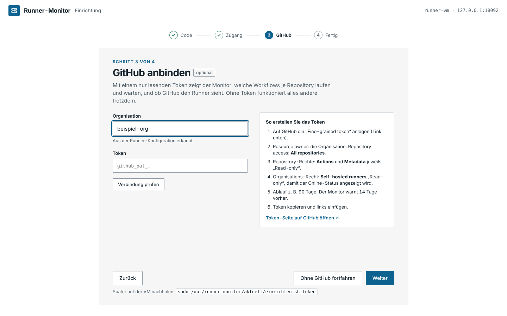

# Erstinstallation auf der VM

**Stand: 23.10.2026 · Version 0.1.2**

Dauer: etwa 5 Minuten. Alle Befehle auf der Runner-VM (per SSH), Platzhalter wie
`beispiel-org` durch die eigenen Werte ersetzen.

## Voraussetzungen

- Ubuntu 22.04 oder 24.04 (andere systemd-Linux mit Python ≥ 3.10 gehen meist auch)
- `sudo`-Rechte
- Netz: die VM erreicht `github.com` und `api.github.com` (HTTPS)
- Der GitHub-Runner ist installiert (`/opt/actions-runner`) – oder das Skript richtet ihn mit ein

## 1. Herunterladen und entpacken

```bash
V=0.1.2
curl -fsSLO https://github.com/Bamberger-IT-Services/Self-Hosted-Github-Runner-Monitor/releases/download/v$V/runner-monitor-$V.tar.gz
curl -fsSLO https://github.com/Bamberger-IT-Services/Self-Hosted-Github-Runner-Monitor/releases/download/v$V/runner-monitor-$V.tar.gz.sha256
sha256sum -c runner-monitor-$V.tar.gz.sha256     # muss „OK“ melden
tar xzf runner-monitor-$V.tar.gz && cd runner-monitor-$V
```

## 2. Einrichtungsskript

```bash
sudo ./einrichten.sh
```

Das Skript erledigt in sechs Schritten:

| Schritt | Was passiert |
|---|---|
| 1 Benutzer und Ordner | Systembenutzer `runner-monitor` (ohne Anmeldung, darf das Journal lesen), `/var/lib/runner-monitor`, `/etc/runner-monitor/konfig.env` |
| 2 Programm | Kopie nach `/opt/runner-monitor/versionen/0.1.2`, Verweis `aktuell`. Eine alte Terminalansicht (ttyd, `monitor-einrichten.sh`) wird erkannt und ersetzt; ihr Token wird übernommen. |
| 3 Runner | Sucht `/opt/actions-runner/.runner`. Fehlt der Runner, fragt das Skript, ob es ihn einrichten soll (siehe unten). |
| 4 Firewall | `ufw`: SSH bleibt offen, Port 8090 nur aus dem eigenen Netz (z. B. `192.0.2.0/24`). Ist ufw aus, fragt das Skript, ob es ihn einschalten soll. |
| 5 Dienste | `runner-monitor`, `runner-monitor-sammler`, `runner-monitor-update.path` – starten und beim Booten aktiv |
| 6 Einrichtung im Browser | Zeigt Adresse und **Einrichtungscode** (60 Minuten gültig) |

Am Ende steht da zum Beispiel:

```
Weiter im Browser:  http://192.0.2.20:8090
  Einrichtungscode:   K7QM-4XTB   (60 Minuten gültig, neuer Code: sudo ./einrichten.sh code)
```

### Runner gleich mit einrichten

Gibt es noch keinen Runner, beantwortet man die Frage mit `j` und braucht:

1. den Namen der Organisation, z. B. `beispiel-org`
2. einen **Registrierungs-Token**: GitHub › Organisation › Settings › Actions › Runners ›
   „New self-hosted runner“ – der Token steht im Befehl `./config.sh … --token …` und gilt eine Stunde.

Das Skript installiert Docker und den Runner, registriert ihn bei der Organisation und
richtet das automatische Aufräumen ein (unter 25 GB frei vor jedem Job, gründlich jede Nacht).
Später nachholen: `sudo ./einrichten.sh runner`.

## 3. Im Browser abschließen


1. **Code:** den angezeigten Code eingeben. Oben steht, was das Skript erkannt hat.
2. **Zugang:** Benutzername und Passwort (mindestens 12 Zeichen; ein Satz aus mehreren
   Wörtern ist gut). Es gibt genau einen Zugang.
3. **GitHub (optional):** Organisation und ein **Fine-grained Token**, siehe unten. „Verbindung
   prüfen“ zeigt, welche Rechte ankommen. „Überspringen“ geht auch – dann bleibt die Karte
   „Workflows“ leer, alles andere läuft.
4. **Fertig** → „Zum Monitor“ → anmelden.



### GitHub-Token erstellen

github.com › Settings › Developer settings › Personal access tokens › **Fine-grained tokens** › „Generate new token“

| Feld | Wert |
|---|---|
| Resource owner | die Organisation |
| Expiration | z. B. 90 Tage (der Monitor warnt 14 Tage vorher) |
| Repository access | All repositories |
| Repository permissions | **Actions: Read-only**, **Metadata: Read-only** |
| Organization permissions | **Self-hosted runners: Read-only** (optional, für „Online bei GitHub“) |

Das Token wird auf der VM in `/etc/runner-monitor/github-token` gespeichert (nur root kann
es lesen). Erneuern oder nachholen, wenn GitHub übersprungen wurde:

```bash
sudo /opt/runner-monitor/aktuell/einrichten.sh token
```

Das Skript fragt das Token verdeckt und danach die Organisation ab (Enter behält die bisherige)
und startet die Dienste neu. Info › GitHub-Verbindung zeigt Ablauf und Rechte.

Kommt keine Verbindung zustande, auf GitHub prüfen: Resource owner des Tokens muss die
**Organisation** sein, und verlangt die Organisation eine Freigabe, steht das Token unter
Organisation › Settings › Personal access tokens › **Pending requests**.

## Prüfen

```bash
sudo ./einrichten.sh status                       # Dienste und Version
journalctl -u runner-monitor -u runner-monitor-sammler -n 30
curl -s http://127.0.0.1:8090/api/health          # {"ok": true, "version": "0.1.2"}
```

## Einstellungen

In `/etc/runner-monitor/konfig.env` ([Vorlage](../deploy/konfig.env.example)), danach
`sudo systemctl restart runner-monitor runner-monitor-sammler`:

| Schlüssel | Vorgabe | Bedeutung |
|---|---|---|
| `MONITOR_PORT` | 8090 | Port der Oberfläche (Firewall-Regel anpassen!) |
| `MONITOR_ORG` | – | Organisation (die Einrichtung im Browser hat Vorrang) |
| `MONITOR_RUNNER_VERZ` | `/opt/actions-runner` | Ordner des Runners |
| `MONITOR_SCHWELLE_FREI_GB` | 25 | Warnschwelle für „/“ |
| `MONITOR_VM_NAME` | Hostname | Anzeigename |
| `RUNNER_LABELS` | `self-hosted,linux,x64` | Labels, falls GitHub nicht abgefragt werden kann |
| `MONITOR_RELEASE_REPO` | dieses Repository | Quelle für Updates (nur für Forks ändern) |

## Weitere Befehle

| Befehl | Wirkung |
|---|---|
| `sudo ./einrichten.sh code` | neuer Einrichtungscode (nur solange kein Zugang besteht) |
| `sudo ./einrichten.sh passwort` | Zugang zurücksetzen, alle abmelden, neuer Code – Token und Einstellungen bleiben |
| `sudo ./einrichten.sh token` | GitHub-Token eintragen oder erneuern |
| `sudo ./einrichten.sh runner` | GitHub-Runner einrichten |
| `sudo ./einrichten.sh aktualisieren` | neueste Version installieren ([UPDATE.md](UPDATE.md)) |
| `sudo ./einrichten.sh zurueck` | zur vorherigen Version |
| `sudo ./einrichten.sh entfernen` | Dienste und Firewall-Regel entfernen, Daten bleiben (`--alles` löscht auch Daten) |

Das Skript liegt nach der Installation auch unter `/opt/runner-monitor/aktuell/einrichten.sh`.
