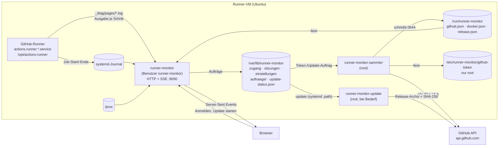

# Wie der Runner-Monitor funktioniert

**Stand: 23.10.2026 · Version 0.3.0**

Diese Seite erklärt den Aufbau: welche Teile es gibt, woher jede Zahl im Dashboard kommt,
welche Dateien wo liegen und wer was lesen und schreiben darf. Bedienung: [Handbuch](handbuch/README.md).

## Überblick

Drei systemd-Dienste, alle in Python 3 nur mit der Standardbibliothek ([ADR-0001](adr/0001-python-standardbibliothek.md)):

| Dienst | Läuft als | Aufgabe |
|---|---|---|
| `runner-monitor` | `runner-monitor` (ohne Anmeldung, Gruppe `systemd-journal`) | Webserver auf Port 8090: Seiten, Anmeldung, Server-Sent Events. Misst die VM, liest Journal und Schritt-Logs des Runners. |
| `runner-monitor-sammler` | root | Fragt GitHub (mit dem Token, das nur root lesen kann) und Docker ab, prüft auf neue Releases, übernimmt Aufträge der Oberfläche. |
| `runner-monitor-update` | root, nur bei Bedarf | Installiert ein Update ([ADR-0004](adr/0004-update-hilfsdienst.md)). Startet über `runner-monitor-update.path`, sobald ein Auftrag liegt. |

**Warum zwei Benutzer?** Der Webserver ist das, was aus dem Netz erreichbar ist. Er läuft
ohne Rechte und kann weder das GitHub-Token lesen noch Software installieren. Was root-Rechte
braucht, erledigen die beiden root-Dienste – sie nehmen von der Oberfläche nur eng umrissene
Aufträge an (ein Token zum Ablegen, eine Versionsnummer zum Aktualisieren, `release-pruefen` für
„Jetzt prüfen“ – der Sammler fragt dann sofort, höchstens einmal je Minute) und prüfen sie selbst.

## Woher die Daten kommen

| Bereich im Dashboard | Quelle | Takt |
|---|---|---|
| CPU gesamt, je Kern | `/proc/stat` (Differenz zweier Messungen, iowait zählt als frei) | 1 s |
| RAM, Swap | `/proc/meminfo` (belegt = gesamt − verfügbar) | 1 s |
| Last | `/proc/loadavg` | 1 s |
| Netz | `/proc/net/dev`, Bytes je Sekunde summiert über alle echten Schnittstellen (ohne `lo`, Docker-Brücken, `veth`, VPN-Tunnel – deren Verkehr läuft ohnehin über die echte Schnittstelle) | 1 s |
| Laufzeit der VM | `/proc/uptime` | 1 s |
| Verlauf 10 Minuten | die letzten 600 Sekundenwerte im Speicher des Dienstes | 1 s |
| Prozesse (Top 6) | `/proc/<pid>/stat`, `status`, `cmdline` | 2 s |
| Platten | `/proc/mounts` + `statvfs`; nur echte Dateisysteme ab 1 GiB, ohne Snap/Docker-Overlays | 10 s |
| Runner-Dienst aktiv/gestoppt | `systemctl show actions.runner.*` | 2 s |
| Runner-Name, Version | `/opt/actions-runner/.runner`, `bin/Runner.Listener --version` | beim Start, 10 min |
| Job gestartet/beendet, Ergebnis | Journal des Runner-Dienstes: „Running job: …“, „Job … completed with result: …“ | sofort |
| Live-Log | `/opt/actions-runner/_diag/pages/*.log` – der Runner schreibt je Schritt eine neue Datei; der Monitor liest sie wie `tail -f` | sofort |
| Repository, Workflow, Schritte des Jobs | GitHub-API: Läufe der Repositories, Jobs mit `runner_name` dieses Runners | 30 s |
| Online bei GitHub | GitHub-API `orgs/{org}/actions/runners` (Recht „Self-hosted runners: Read“, optional) | 30 s |
| Workflows je Repository | GitHub-API `orgs/{org}/repos`, dann je Repository `actions/runs?per_page=30` | 30 s |
| Token-Ablauf, API-Kontingent | Antwort-Header `github-authentication-token-expiration`, `x-ratelimit-*` | 30 s |
| Neue Version | GitHub-API `repos/<release-repo>/releases/latest` | 6 h |
| Docker-Container | `docker ps --format json` (wird gesammelt, in Version 0.1 nicht angezeigt) | 10 s |

**Ohne Token** laufen Runner-Status, Auslastung, Prozesse, Platten und Live-Log normal; Job-
Name und Ergebnis kommen dann allein aus dem Journal, Repository und Schrittnamen fehlen.

**Fällt GitHub aus**, behält der Sammler den letzten erfolgreichen Stand und markiert ihn; die
Oberfläche zeigt „Stand von hh:mm:ss“ und die Zeit bis zum nächsten Versuch.

## Vom Server in den Browser

Der Browser öffnet nach der Anmeldung **eine** Verbindung `GET /events` (Server-Sent Events).
Zuerst kommt der komplette aktuelle Stand, danach nur noch Änderungen. Jeder Bereich hat ein
eigenes Ereignis und ein eigenes Datenobjekt:

| Ereignis | Inhalt (Auszug) |
|---|---|
| `status` | `vm`, `runner`, `labels`, `version` (Runner), `monitorVersion`, `system` (z. B. „Ubuntu 24.04.1 LTS, Python 3.12“, für Fehlermeldungen), `dienst{zustand: aktiv\|gestoppt\|fehlt, seit}`, `github{zustand: online\|offline\|unbekannt, seit}`, `job{repo, workflow, name, ref, start, schritt, schritte[]}`, `letzteJobs[]` |
| `system` | `kerne[]` (%), `cpu`, `last[3]`, `ram{belegt, gesamt}`, `swap{…}`, `netz{empfangen, gesendet, schnittstellen[]}` (B/s), `start`; beim ersten Mal zusätzlich `verlauf{cpu[], ram[], netz[[empfangen, gesendet]], start}` (bis 600 Sekundenwerte, `start` = Zeit des ältesten Werts) |
| `prozesse` | `[{pid, benutzer, cpu, ram, befehl}]` |
| `platten` | `[{pfad, gesamt, frei, belegt, schwelleFrei}]` (Bytes; `schwelleFrei` nur für „/“) |
| `workflows` | `org`, `abfrage: ok\|kein-token\|token-ungueltig\|keine-rechte\|nicht-erreichbar\|kontingent\|fehler`, `abgefragt`, `naechste`, `tokenAblauf`, `kontingent{}`, `repos[{name, privat, laeuft, wartet}]` |
| `update` | `installiert`, `neueste{version, veroeffentlicht, notizen[], …}`, `status{zustand: laeuft\|fehler\|erfolg, schritt, meldung}`, `auto` |
| `container` | `[{name, image, zustand, seit}]` |
| `log` | `neu` (Ansicht leeren), `ereignisse[{art, zeit, repo, workflow, name, ergebnis, dauer}]`, `zeilen[{art: zeile\|schritt, zeit, text \| nr, name}]` (gebündelt, bis 1500 je Nachricht) |

Zeiten sind Unix-Sekunden. Alle 15 s kommt ein Kommentar `: lebt`, damit Proxys die Verbindung
offen lassen. Nach 5 s ohne Daten zeigt der Browser „Getrennt“ und den letzten Stand; nach 10 s
ohne Daten baut er die Verbindung selbst neu auf (Wartezeit wächst bis 30 s). Ist die Sitzung
abgelaufen (`GET /api/sitzung` → 401), geht es zur Anmeldung.

**Verlauf über Neustarts (seit 0.4.0):** Der Monitor sichert CPU-, RAM- und Netz-Verlauf alle 10 s
atomar nach `verlauf.json` (temp + rename). Beim Start übernimmt er ihn, wenn er jünger als 10 Minuten
ist und die Pause höchstens 60 s dauerte; die Lücke füllt der erste neue Messwert. Sonst beginnt der
Verlauf leer. Die Oberfläche streckt die vorhandenen Werte über die ganze Breite und schreibt links
„seit hh:mm“, bis 10 Minuten voll sind („vor 10 Min.“).

**Warteschlange je Browserfenster (seit 0.3.1):** Der Verteiler hält je Fenster eine Schlange mit
höchstens 2000 Nachrichten. Log-Zeilen gehen gebündelt raus: Der Log-Leser meldet je gelesenem Stück
(alle 0,3 s, bis 512 KB) **eine** Nachricht mit höchstens 1500 Zeilen. Läuft eine Schlange trotzdem
über, weil der Browser nicht hinterherkommt, wird sie geleert und der Server beendet den Strom
(Journal: „Live-Verbindung beendet …“). Der Browser verbindet sich dann neu und bekommt den
kompletten Stand. Ein `write()` an einen hängenden Browser bricht nach 60 s ab.
Bis 0.3.0 blieb ein übergelaufener Strom stumm offen, und das Dashboard stand bis zum Neustart des
Dienstes auf „Getrennt“.

Die Oberfläche (`web/`) ist statisches HTML, CSS und JavaScript ohne Framework. Federnde
Balken, ANSI-Farben im Log und alle Texte entstehen im Browser. Mit `?demo` erzeugt `demo.js`
dieselben Daten ohne Server (Entwicklung, Bildschirmfotos).

## Anmeldung und Sitzungen

- **Ohne Anmeldung** antwortet nur `/api/health` mit `{ok, version, vm}` – für Prüfungen und für
  die Anmeldeseite (VM-Name unter dem Titel, Version im Fuß).
- **Ersteinrichtung:** Das Skript legt einen Einrichtungscode `XXXX-XXXX` an (60 min gültig,
  10 Versuche, nur als SHA-256 gespeichert). Wer ihn im Browser eingibt, darf einmalig den
  Zugang anlegen. Abgeschlossen ist die Einrichtung erst mit „Zum Monitor anmelden“ in Schritt 4; danach ist `/einrichtung` gesperrt.
- **Passwort:** 12 bis 128 Zeichen, keine Zusammensetzungsregeln, häufige Passwörter und der
  Benutzername sind gesperrt. Gespeichert als scrypt-Hash (N = 2¹⁵, r = 8, p = 1).
- **Sitzung:** Cookie `rm_sitzung` (HttpOnly, SameSite=Strict), 12 Stunden oder mit
  „Angemeldet bleiben“ 30 Tage; nach 7 Tagen ohne Nutzung beendet. Gespeichert wird nur der
  Hash des Tokens.
- **Sperre:** 5 Fehlversuche je Konto oder 30 je IP in 15 Minuten → 5 Minuten gesperrt.
- **Schutz der Anfragen:** Jede POST-Anfrage muss JSON sein und vom selben Host kommen
  (`Origin`). Strenge Content-Security-Policy ohne Inline-Skripte und -Styles, `X-Frame-Options: DENY`,
  `no-store`.
- Zwei-Faktor-Anmeldung gibt es bewusst nicht ([ADR-0003](adr/0003-nur-passwort.md)).

## Update

1. Der Sammler fragt alle 6 Stunden `releases/latest` ab und legt das Ergebnis in
   `/run/runner-monitor/release.json` (nur root kann es schreiben).
2. Klick auf „Jetzt aktualisieren“ → der Webserver legt `auftraege/update` mit der Versionsnummer ab.
3. `runner-monitor-update.path` startet den root-Hilfsdienst. Er nimmt Archiv- und
   Prüfsummen-Adresse **nur** aus `release.json` und nur von
   `https://github.com/<release-repo>/releases/download/…`, prüft SHA-256, entpackt nach
   `/opt/runner-monitor/versionen/X.Y.Z`, hängt `aktuell` um und startet beide Dienste neu.
4. Meldet `/api/health` binnen 30 s nicht die neue Version, hängt er zurück auf die alte und
   meldet „Update fehlgeschlagen“. Drei Versionen bleiben liegen (`./einrichten.sh zurueck`).

Automatisch aktualisieren (Schalter in „Info“): nachts um 3 Uhr, nur wenn kein Job läuft.

## Dateien und Rechte

| Pfad | Besitzer, Rechte | Inhalt |
|---|---|---|
| `/opt/runner-monitor/versionen/X.Y.Z/` | root, 0755 | Programm je Version |
| `/opt/runner-monitor/aktuell` | root | Verweis auf die laufende Version |
| `/etc/runner-monitor/konfig.env` | root:runner-monitor, 0640 | Einstellungen ([Vorlage](../deploy/konfig.env.example)) |
| `/etc/runner-monitor/github-token` | root, 0600 | GitHub-Token (nur der Sammler liest es) |
| `/var/lib/runner-monitor/` | runner-monitor, 0750 | `zugang.json` (scrypt-Hash), `sitzungen.json`, `sperren.json`, `einstellungen.json` (Organisation, Auto-Update), `einrichtungscode.json`, `systempruefung.json`, `update-status.json`, `verlauf.json` (Verlauf der letzten 10 Min., alle 10 s gesichert), `auftraege/` |
| `/run/runner-monitor/` | root, 0755 (Dateien 0644) | `github.json`, `docker.json`, `release.json` – Ergebnisse des Sammlers |
| `/etc/systemd/system/runner-monitor*.{service,path}` | root | Dienste ([deploy/systemd](../deploy/systemd/)) |

## Was der Monitor nicht kann

- Nichts verändern: kein Neustart des Runners, kein Abbrechen von Jobs (nur anschauen).
- Kein HTTPS von sich aus – gedacht für das lokale Netz. Wer von außen zugreifen will, setzt
  einen Reverse-Proxy mit TLS davor ([Sicherheitsbericht](sicherheit/bericht.md), S-01).
- Ein Runner je VM (der erste gefundene `actions.runner.*`-Dienst).

## Quellcode

| Datei | Aufgabe |
|---|---|
| `runner_monitor/__main__.py` | Start der Oberfläche |
| `runner_monitor/konfig.py` | Einstellungen aus `konfig.env` und `MONITOR_*` |
| `runner_monitor/system.py` | Messungen aus `/proc` |
| `runner_monitor/runner.py` | Runner-Registrierung, Dienststatus, Journal- und Schritt-Logs |
| `runner_monitor/github.py` | GitHub-API: Läufe, Jobs, Runner, Releases |
| `runner_monitor/zustand.py` | Gesamtstand, Verlauf, Verteilung an alle Browserfenster |
| `runner_monitor/server.py` | HTTP, Anmeldung, Einrichtung, SSE |
| `runner_monitor/zugang.py` | Passwörter, Sitzungen, Sperren, Einrichtungscode |
| `runner_monitor/sammler.py` | root-Sammler (GitHub, Docker, Releases, Aufträge) |
| `runner_monitor/aktualisierer.py` | root-Update-Hilfsdienst |
| `web/` | Oberfläche: `dashboard.*`, `anmelden.*`, `einrichtung.*`, `demo.js`, `stil.css`, `gemeinsam.js` |
| `einrichten.sh` | Installation, Wartung, Entfernen |
