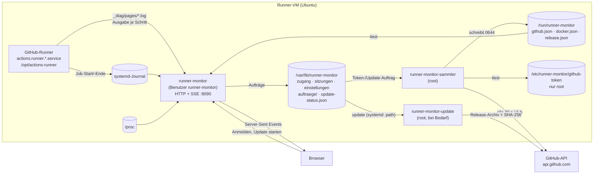

# Wie der Runner-Monitor funktioniert

**Stand: 29.10.2026 · Version 0.7.0 (Runner-Erkennung aus 0.8.0 in Arbeit)**

Diese Seite erklärt den Aufbau: welche Teile es gibt, woher jede Zahl im Dashboard kommt,
welche Dateien wo liegen und wer was lesen und schreiben darf. Bedienung: [Handbuch](handbuch/README.md).

## Überblick



Drei systemd-Dienste, alle in Python 3 nur mit der Standardbibliothek ([ADR-0001](adr/0001-python-standardbibliothek.md)):

| Dienst | Läuft als | Aufgabe |
|---|---|---|
| `runner-monitor` | `runner-monitor` (ohne Anmeldung, Gruppe `systemd-journal`) | Webserver auf Port 8090: Seiten, Anmeldung, Server-Sent Events. Misst die VM, liest Journal und Schritt-Logs des Runners. |
| `runner-monitor-sammler` | root | Fragt GitHub (mit dem Token, das nur root lesen kann) und Docker ab, prüft auf neue Releases, erkennt die Runner auf der VM (beim Start und alle 6 h), übernimmt Aufträge der Oberfläche. |
| `runner-monitor-update` | root, nur bei Bedarf | Installiert ein Update ([ADR-0004](adr/0004-update-hilfsdienst.md)). Startet über `runner-monitor-update.path`, sobald ein Auftrag liegt. |

**Warum zwei Benutzer?** Der Webserver ist das, was aus dem Netz erreichbar ist. Er läuft
ohne Rechte und kann weder das GitHub-Token lesen noch Software installieren. Was root-Rechte
braucht, erledigen die beiden root-Dienste – sie nehmen von der Oberfläche nur eng umrissene
Aufträge an (ein Token zum Ablegen, eine Versionsnummer zum Aktualisieren, `release-pruefen` für
„Jetzt prüfen“ – der Sammler fragt dann sofort, höchstens einmal je Minute) und prüfen sie selbst.

## Woher die Daten kommen

| Bereich im Dashboard | Quelle | Takt |
|---|---|---|
| CPU gesamt, je Kern | `/proc/stat` (Differenz zweier Messungen, iowait zählt als frei) | 1 s |
| RAM, Swap | `/proc/meminfo` (belegt = gesamt − verfügbar) | 1 s |
| Last | `/proc/loadavg` | 1 s |
| Netz | `/proc/net/dev`, Bytes je Sekunde summiert über alle echten Schnittstellen (ohne `lo`, Docker-Brücken, `veth`, VPN-Tunnel – deren Verkehr läuft ohnehin über die echte Schnittstelle) | 1 s |
| Laufzeit der VM | `/proc/uptime` | 1 s |
| Verlauf 10 Minuten | die letzten 600 Sekundenwerte im Speicher des Dienstes | 1 s |
| Prozesse (Top 6) | `/proc/<pid>/stat`, `status`, `cmdline` | 2 s |
| Platten | `/proc/mounts` + `statvfs`; nur echte Dateisysteme ab 1 GiB, ohne Snap/Docker-Overlays. Netzlaufwerke (NFS, CIFS) mit 2 s Frist in eigenem Thread; antwortet eines nicht, fehlt es, bis es wieder antwortet (Journal: „Netzlaufwerk … antwortet nicht“) | 10 s |
| Runner-Dienst aktiv/gestoppt | `systemctl show actions.runner.*` | 2 s |
| Runner-Name, Version | `/opt/actions-runner/.runner`, `bin/Runner.Listener.deps.json` (Eintrag `Runner.Listener/x.y.z`; Rückfall `bin/Runner.Listener --version`) | gefunden: 10 min, nicht gefunden: nach 30 s erneut |
| Job gestartet/beendet, Ergebnis | Journal des Runner-Dienstes: „Running job: …“, „Job … completed with result: …“ | sofort |
| Live-Log | `/opt/actions-runner/_diag/pages/*.log` – der Runner schreibt je Schritt eine neue Datei; der Monitor liest sie wie `tail -f` | sofort |
| Repository, Workflow, Schritte des Jobs | GitHub-API: Läufe der Repositories, Jobs mit `runner_name` dieses Runners | 30 s |
| Online bei GitHub | GitHub-API `orgs/{org}/actions/runners` (Recht „Self-hosted runners: Read“, optional) | 30 s |
| Workflows je Repository | GitHub-API `orgs/{org}/repos`, dann je Repository `actions/runs?per_page=30`; bedingt mit ETag (304 kostet kein Kontingent), ruhige Repositories (über 1 Std. kein Push, nichts läuft oder wartet) nur alle 5 Min. | 30 s |
| Token-Ablauf, API-Kontingent | Antwort-Header `github-authentication-token-expiration`, `x-ratelimit-*` | 30 s |
| Neue Version | GitHub-API `repos/<release-repo>/releases/latest` | 6 h |
| Docker-Container | `docker ps --format json` (wird gesammelt, in Version 0.1 nicht angezeigt) | 10 s |

**Ohne Token** laufen Runner-Status, Auslastung, Prozesse, Platten und Live-Log normal; Job-
Name und Ergebnis kommen dann allein aus dem Journal, Repository und Schrittnamen fehlen.

**Fällt GitHub aus**, behält der Sammler den letzten erfolgreichen Stand und markiert ihn; die
Oberfläche zeigt „Stand von hh:mm:ss“ und die Zeit bis zum nächsten Versuch.

## Runner erkennen (seit Design 0.8.0, #91)

`runner_monitor/erkennung.py` findet selbst, welche Runner auf der VM laufen – auch mehrere und
auch andere als GitHub. Der Sammler (root) startet sie **beim Start und alle 6 Stunden** als
**eigenen Prozess** (`python3 -m runner_monitor.erkennung --json`), schaut in seinen folgenden
Takten (2 s) nach und beendet ihn nach 60 s – ein hängender DNS-Server oder ein tröpfelnder Server
hält so weder GitHub- noch Docker-Abfrage auf. Die Ausgabe landet in einer temporären Datei, wird
geprüft (`erkennung.pruefe_ergebnis`: Form, Werte, höchstens 2 MB, nur bekannte Felder) und erst
dann nach `/run/runner-monitor/erkennung.json` geschrieben (0644, ohne Geheimnisse); Takt und Frist
laufen mit `time.monotonic()`, die Fehlerausgabe (höchstens 2000 Zeichen) geht ins Journal; ein
abgebrochener oder ungültiger Lauf lässt die alte Datei stehen. `einrichten.sh` zeigt dieselbe
Erkennung in „System prüfen“ › „Runner auf dieser VM“ (`timeout --foreground 60 python3 -m
runner_monitor.erkennung --text`, Rückgabe 3 = kein Runner). Das Dashboard zeigt bis zu den
Anbieter-Adaptern (#92, #93, #99) weiter nur den GitHub-Runner wie bisher.

| Quelle | Was gelesen wird | Merkmal (Beispiel) |
|---|---|---|
| systemd-Units | Unit-Dateien in `/etc/systemd/system`, `/run/systemd/system`, `/usr/local/lib/systemd/system`, `/usr/lib/systemd/system`, `/lib/systemd/system` samt Drop-ins; `ExecStart`, `WorkingDirectory`; aktiviert über `*.wants/`, aktiv über `systemctl is-active` | „systemd-Unit forgejo-runner.service“ |
| Prozesse | `/proc/<pid>/cmdline`, `cgroup` (welche Unit, Container?), `cwd` – nur bekannte Programme (`Runner.Listener`, `forgejo-runner`, `act_runner`, `gitlab-runner`) | „Prozess forgejo-runner daemon“ |
| Registrierungen | `.runner` (GitHub: `agentName`, `gitHubUrl`; Forgejo/Gitea: `name`, `address`) neben Unit und Prozess, laut `config.yml` (`runner.file`) und an üblichen Orten (`/opt/*`, `/srv/*`, `/var/lib/*`, `/home/*`, `/root`); GitLab: `config.toml` (`name`, `url`) | „/opt/actions-runner/.runner mit gitHubUrl“ |
| Server-API ohne Zugangsdaten | nur für Funde mit systemd-Unit (E-17): Forgejo `/api/forgejo/v1/version`, Gitea `/api/v1/version`, GitLab-Anmeldeseite, GitHub Enterprise `/api/v3/meta` (github.com gilt als bekannt) | „/api/forgejo/v1/version antwortet: 13.0“ |
| Runner-Version | GitHub aus `bin/Runner.Listener.deps.json`, sonst aus dem Journal der Unit („with version: v9.1.0“, „version=17.5.2“) | – |

**Grad:** `sicher` – eindeutige Merkmale (Registrierung und systemd-Unit) **und** Server
bestätigt; `wahrscheinlich` – Dienst erkannt, aber Server nicht erreichbar, ohne Netz, nicht geprüft
(Fund ohne Unit, E-17), ohne Registrierung oder mit widersprüchlichen Merkmalen; `unklar` – nur allgemeine Hinweise (Name der
Unit enthält „runner“, „agent“, „build“ …, startet Container). Bekannte Nicht-Runner
(`qemu-guest-agent`, `runner-monitor*` …) zählen nicht; unbekannte Units nur, wenn sie aktiviert
oder aktiv sind. Zwischen Forgejo und Gitea entscheidet die Antwort des Servers.

**Einstufung und Fähigkeiten** richten sich nach dem, was diese Version liefern kann (Tabelle
`FAEHIG` in `erkennung.py`): GitHub `voll` (Status, Jobs, Schritte, Logs); Forgejo, Gitea, GitLab
`teil` (erkannt, noch ohne Adapter: Dienst und Journal); unbekannt `unbekannt` (Grundüberwachung).
`updates` ist überall `false` (E-16). Ein Fund ohne Unit hat weder `status` noch `logs`.

Ergebnis je Fund (`erkennung.json` › `runner[]`, Format aus dem Design-README):

```json
{ "id": "runner-vm-02", "name": "runner-vm-02", "dienst": "forgejo", "server": "https://git.example.org",
  "version": "13.0 / Runner 9.1", "grad": "sicher", "merkmale": ["systemd-Unit forgejo-runner.service", "…"],
  "einstufung": "teil", "stand": "offen", "unit": "forgejo-runner.service", "log": null,
  "faehig": { "status": true, "jobs": false, "schritte": false, "logs": true, "updates": false },
  "aktiv": true, "grund": null }
```

`dienst`: `github|forgejo|gitea|gitlab|unbekannt`; `stand`: `angebunden|grund|ignoriert|offen`
(GitHub mit Unit und vorhandenem Token: `angebunden`, sonst `offen`, bis eine Zuordnung etwas
anderes sagt; ein Fund ohne Unit ist nie `angebunden`, E-18); `log`: Pfad oder `null` (= Journal der
Unit; GitHub mit Unit: `<runner>/_diag`, ohne Unit `null`). Zusätzlich zum Design: `aktiv` (Unit
läuft: `true`/`false`/`null` unbekannt; bei einer zugeordneten anderen Unit deren Zustand) und
`grund` (warum nur „wahrscheinlich“). Die Datei hat außerdem `zeit` und `geprueft`.

**IDs (E-18):** aus dem Namen, eindeutig (gleicher Name → `-2`, `-3`) und **zuerst an Funde mit
Unit** vergeben – ein nachgemachter Fund (z. B. eine `.runner` in `/home`) bekommt so nie die ID
eines echten Runners und damit nie dessen Zuordnung. Für die Adapter (#92, #93, #99) gilt: Server
und Log-Pfad kommen nur aus `runner.json` bzw. den Zugangsdaten (`zugang/`), nie aus dem Fund – der
Fund ist nur ein Vorschlag für die Einrichtung.

**Spalte „Version“** in `einrichten.sh` wie im Design: bei GitHub die Runner-Version, sonst die
Server-Version; ist nur die Runner-Version bekannt, steht dort „–“ (sie bleibt im JSON).

**Zuordnung und Ignorieren** stehen dauerhaft in `/etc/runner-monitor/runner.json`
(root:runner-monitor, 0640). Gelesen wird sie schon (`erkennung.lies_zuordnung`), schreiben wird
sie der Sammler auf Auftrag der Oberfläche (POST-Endpunkt mit #96/#97):

```json
{ "version": 1,
  "runner": {
    "buildagent":   { "stand": "grund", "dienst": "unbekannt", "name": "Build-Agent",
                      "unit": "buildagent.service", "log": "/var/log/buildagent/agent.log" },
    "runner-vm-03": { "stand": "ignoriert" } } }
```

Schlüssel ist die `id` des Funds; jedes Feld ist freiwillig. Ungültige Einträge oder Felder werden
verworfen. Ein Eintrag mit `unit`, der nicht gefunden wurde, erscheint als „von Hand zugeordnet“.

**Sicherheit (S-ERK-01):** Bei Funden mit Unit-Datei kommen Name, Server und Dienst nur aus Registrierungen, die die Unit vorgibt
(`--config` im ExecStart, Programmordner, WorkingDirectory); was nur ein Prozess in der cgroup nennt
(argv[0], `--config`, cwd – frei wählbar) ist nur Merkmal und Widerspruch und senkt den Grad (#109). Die Erkennung führt nichts aus, was in einem Fund steht (kein
`ExecStart`, kein Runner-Programm, keine Shell); aufgerufen werden nur `systemctl is-active -- <unit>`
und `journalctl -u <unit>` mit geprüftem Namen. **Keinem Symlink wird gefolgt** außer bei
Unit-Dateien in den root-eigenen systemd-Verzeichnissen – also nicht bei `.runner`, `config.toml`,
`config.yml`, `deps.json`, `runner.json` und `/proc`. Vor dem Öffnen prüft `lstat`, dass es eine
reguläre Datei ist (keine FIFO, kein Gerät); geöffnet wird mit `O_NOFOLLOW`, `O_NONBLOCK` und
`O_NOCTTY`, danach muss es dieselbe Datei sein; gelesen wird bis zu einer Grenze (64 KB, `deps.json`
4 MB). Registrierungen nur unter festen Dateinamen (`.runner`, `config.toml`). `token` aus
`.runner`/`config.toml` wird nie übernommen, `.credentials` nie gelesen, vom GitHub-Token wird nur
geprüft, ob die Datei da ist. Namen, Unit-Namen, Pfade und Adressen werden streng geprüft (Adressen
ohne Zugangsdaten, Abfrage und Anker); die Textausgabe ersetzt Steuerzeichen. Die Server-Probe
(nur Funde mit Unit) ist ein GET auf feste Pfade ohne Zugangsdaten und ohne Weiterleitungen, mit
**harten** Fristen von 3 s je Anfrage und 10 s insgesamt, höchstens 8 Server: Sie läuft in einem
eigenen Faden, der zur Frist zurückgelassen wird – das deckt auch DNS und tröpfelnde Antworten ab.
Darüber liegt die Grenze des Prozesses (Sammler 60 s, `einrichten.sh` `timeout --foreground 60`). Fehler in einer
Quelle beenden die Erkennung nie.

`PrivateDevices=yes` für den Sammler wäre nach Prüfung möglich (Docker über `/run/docker.sock`,
`systemctl` über D-Bus, `journalctl` über `/var/log/journal` brauchen keine Geräte) – ist aber nicht
gesetzt, weil es auf einer echten VM noch nicht erprobt ist; Vorschlag für ein eigenes Issue.

## Vom Server in den Browser

Der Browser öffnet nach der Anmeldung **eine** Verbindung `GET /events` (Server-Sent Events).
Zuerst kommt der komplette aktuelle Stand, danach nur noch Änderungen. Jeder Bereich hat ein
eigenes Ereignis und ein eigenes Datenobjekt:

| Ereignis | Inhalt (Auszug) |
|---|---|
| `status` | `vm`, `runner`, `labels`, `version` (Runner), `monitorVersion`, `system` (z. B. „Ubuntu 24.04.1 LTS, Python 3.12“, für Fehlermeldungen), `dienst{zustand: aktiv\|gestoppt\|fehlt, seit, grund}` (`grund`: systemd-`Result` bei gestopptem Dienst, z. B. `oom-kill`, sonst `null`), `github{zustand: online\|offline\|unbekannt, seit}`, `job{repo, workflow, name, ref, start, schritt{nr, von, name}, schritte[]}`, `letzteJobs[]` |
| `system` | `kerne[]` (%), `cpu`, `last[3]`, `ram{belegt, gesamt}`, `swap{…}`, `netz{empfangen, gesendet, schnittstellen[]}` (B/s), `start`; beim ersten Mal zusätzlich `verlauf{cpu[], ram[], netz[[empfangen, gesendet]], start}` (bis 600 Sekundenwerte, `start` = Zeit des ältesten Werts) |
| `prozesse` | `[{pid, benutzer, cpu, ram, befehl}]` |
| `platten` | `[{pfad, gesamt, frei, belegt, schwelleFrei}]` (Bytes; `schwelleFrei` nur für „/“) |
| `workflows` | `org`, `abfrage: ok\|kein-token\|token-ungueltig\|keine-rechte\|nicht-erreichbar\|kontingent\|fehler`, `abgefragt`, `naechste`, `tokenAblauf`, `kontingent{}`, `repos[{name, privat, laeuft, wartet}]` |
| `update` | `installiert`, `neueste{version, veroeffentlicht, notizen[], aenderungen[{version, url, neu[], einmalig}], …}` (`aenderungen`: alle Releases nach der installierten bis zur neuesten, aus den Abschnitten „Was ist neu“ und „Einmalig nach dem Update“ der Release-Notiz), `status{zustand: laeuft\|fehler\|erfolg, schritt, meldung}`, `auto` |
| `container` | `[{name, image, zustand, seit}]` |
| `log` | `neu` (Ansicht leeren), `ereignisse[{art, zeit, repo, workflow, name, ergebnis, dauer}]`, `zeilen[{art: zeile\|schritt, zeit, text \| nr, von, name}]` (gebündelt, bis 1500 je Nachricht) |

Zeiten sind Unix-Sekunden. Alle 15 s kommt ein Kommentar `: lebt`, damit Proxys die Verbindung
offen lassen. Nach 5 s ohne Daten zeigt der Browser „Getrennt“ und den letzten Stand; nach 10 s
ohne Daten baut er die Verbindung selbst neu auf (Wartezeit wächst bis 30 s). Ist die Sitzung
abgelaufen (`GET /api/sitzung` → 401), geht es zur Anmeldung.

**Job-Schritt aus einer Quelle (seit 0.4.0):** Der Server rechnet `job.schritt = {nr, von, name}` und
nutzt es für die Karte, die Schritt-Pille im Log und die Trennzeilen. `nr` ist das Maximum aus der
lokalen Zahl der Seitendateien in `_diag/pages` und dem Schritt laut GitHub (alle 30 s) und wird im
selben Job nie kleiner. `von` ist `max(Zahl der Schritte, nr)` oder `null`, solange GitHub noch keine
Schrittliste geliefert hat; `name` kommt nur von GitHub. Ohne `von` zeigt die Oberfläche „3 von –“.
Der GitHub-Job zählt nur, wenn Name **und** Startzeit zum lokalen Job passen (GitHubs `started_at`
höchstens 120 s vor dem lokalen Start) – so übernimmt ein gleichnamiger Folgejob nicht die bis zu
30 s alte Abfrage des vorigen. Die Oberfläche baut den Schrittblock nur bei geänderter Segmentzahl
neu; Zahl, Name, Segmente und Laufzeit werden direkt gesetzt.

**Verlauf über Neustarts (seit 0.4.0):** Der Monitor sichert CPU-, RAM- und Netz-Verlauf alle 10 s
atomar nach `verlauf.json` (temp + rename). Beim Start übernimmt er ihn, wenn er jünger als 10 Minuten
ist und die Pause höchstens 60 s dauerte; die Lücke füllt der erste neue Messwert. Sonst beginnt der
Verlauf leer. Die Oberfläche streckt die vorhandenen Werte über die ganze Breite und schreibt links
„seit hh:mm“, bis der gewählte Zeitraum voll ist („vor 10 Min.“).

**Zeitfenster der Verläufe (seit Design 0.8.0, #89):** Die Karte „Auslastung“ hat im Kopf ein Segment
„30 s | 2 Min. | 5 Min. | 10 Min.“, das für CPU, RAM und Netz gemeinsam gilt. Die Wahl steht in
`localStorage["runner-monitor.zeitraum"]` (Sekunden; ungültig oder Speicher gesperrt → 10 Min.).
Die Rechenlogik liegt in `web/verlauf.js` (ohne DOM, mit `node --test tests/js/*.test.mjs` geprüft):
Die Werte werden in Eimer fester Größe gruppiert (30 s und 2 Min. → 1 s, 5 Min. → 3 s,
10 Min. → 5 s), deren Grenzen an der **absoluten** Sekunde hängen (Eimer = `floor(t / Eimergröße)`).
Die absolute Sekunde des letzten Werts ist `round(system.zeit)` der Momentaufnahme, jeder neue Wert
zählt eins weiter. `dashboard.js` gruppiert also nicht mehr vom Listenende aus: Der letzte Wert liegt bei
x = 100 % („jetzt“), die Kurve wandert je Sekunde um eine Messung nach links, und nur der rechte Rand
ändert sich. CPU und RAM zeigen den Mittelwert je Eimer, das Netz das Maximum (Spitzen bleiben
sichtbar). Die Netz-Skala richtet sich nach der Spitze im gewählten Zeitraum, mindestens 64 KB/s.
Der Server schickt weiter 600 Sekundenwerte; `/api/zustand` und `verlauf.json` bleiben unverändert.

**Höchstens 6 Live-Verbindungen je Sitzung:** Ein weiteres Fenster derselben Anmeldung bekommt 429 und
versucht es mit wachsender Wartezeit erneut; sobald ein anderes Fenster zu ist, verbindet es sich.
Abgelehnt wird die neue Verbindung, nicht die älteste – sonst würden sich offene Fenster im Wechsel
verdrängen.

**Warteschlange je Browserfenster (seit 0.3.1):** Der Verteiler hält je Fenster eine Schlange mit
höchstens 2000 Nachrichten. Log-Zeilen gehen gebündelt raus: Der Log-Leser meldet je gelesenem Stück
(alle 0,3 s, bis 512 KB) **eine** Nachricht mit höchstens 1500 Zeilen. Läuft eine Schlange trotzdem
über, weil der Browser nicht hinterherkommt, wird sie geleert und der Server beendet den Strom
(Journal: „Live-Verbindung beendet …“). Der Browser verbindet sich dann neu und bekommt den
kompletten Stand. Ein `write()` an einen hängenden Browser bricht nach 60 s ab.
Bis 0.3.0 blieb ein übergelaufener Strom stumm offen, und das Dashboard stand bis zum Neustart des
Dienstes auf „Getrennt“.

Die Oberfläche (`web/`) ist statisches HTML, CSS und JavaScript ohne Framework. Federnde
Balken, ANSI-Farben im Log und alle Texte entstehen im Browser. Mit `?demo` erzeugt `demo.js`
dieselben Daten ohne Server (Entwicklung, Bildschirmfotos).

## Anmeldung und Sitzungen

- **Texte vom Server** (Fehler, Prüfergebnisse der Einrichtung) sind deutsch und zugleich der
  Schlüssel für die Übersetzung in `web/i18n.js`. Mit Platzhaltern schickt der Server zusätzlich
  `vorlage` und `werte`, z. B. `{"fehler": "Version 1.2.3 wird noch bereitgestellt …", "vorlage":
  "Version {v} wird noch bereitgestellt …", "werte": {"v": "1.2.3"}}`; `RM.serverText()` übersetzt.
- **Ohne Anmeldung** antwortet nur `/api/health` mit `{ok, version, vm}` – für Prüfungen und für
  die Anmeldeseite (VM-Name unter dem Titel, Version im Fuß).
- **Ersteinrichtung:** Das Skript legt einen Einrichtungscode `XXXX-XXXX` an (60 min gültig,
  10 Versuche, nur als SHA-256 gespeichert). Wer ihn im Browser eingibt, darf einmalig den
  Zugang anlegen. Abgeschlossen ist die Einrichtung erst mit „Zum Monitor anmelden“ in Schritt 4; danach ist `/einrichtung` gesperrt.
- **Passwort:** 12 bis 128 Zeichen, keine Zusammensetzungsregeln. Gesperrt sind die 10 000 häufigsten
  Passwörter (`runner_monitor/daten/haeufige-passwoerter.txt`, SecLists, MIT), dieselben mit
  angehängten Ziffern oder Zeichen und der Benutzername. Gespeichert als scrypt-Hash (N = 2¹⁵, r = 8, p = 1).
- **Sitzung:** Cookie `rm_sitzung` (HttpOnly, SameSite=Strict), 12 Stunden oder mit
  „Angemeldet bleiben“ 30 Tage; nach 7 Tagen ohne Nutzung beendet. Gespeichert wird nur der
  Hash des Tokens.
- **Sperre:** 5 Fehlversuche je Konto oder 30 je IP in 15 Minuten → 5 Minuten gesperrt.
- **Schutz der Anfragen:** Jede POST-Anfrage muss JSON sein und vom selben Host kommen
  (`Origin`). Strenge Content-Security-Policy ohne Inline-Skripte und -Styles, `X-Frame-Options: DENY`,
  `no-store`.
- Zwei-Faktor-Anmeldung gibt es bewusst nicht ([ADR-0003](adr/0003-nur-passwort.md)).

## Update

1. Der Sammler fragt alle 6 Stunden `releases/latest` ab und legt das Ergebnis in
   `/run/runner-monitor/release.json` (nur root kann es schreiben). Hängen Archiv und Prüfsumme
   noch nicht am Release (der Release-Workflow lädt sie erst nach dem Veröffentlichen hoch), steht
   dort `bereit: false`; der Sammler fragt dann nach 2 Minuten erneut, die Oberfläche zeigt
   „wird gerade bereitgestellt“ statt des Knopfs, und es gibt kein automatisches Update (#63).
2. Klick auf „Jetzt aktualisieren“ → der Webserver legt `auftraege/update` mit der Versionsnummer ab.
3. `runner-monitor-update.path` startet den root-Hilfsdienst. Er nimmt Archiv- und
   Prüfsummen-Adresse **nur** aus `release.json` und nur von
   `https://github.com/<release-repo>/releases/download/…`, prüft SHA-256 und – mit GitHub-CLI – die
   Herkunft per `gh attestation verify` (ADR-0005), entpackt nach
   `/opt/runner-monitor/versionen/X.Y.Z`, hängt `aktuell` um und startet beide Dienste neu.
4. Meldet `/api/health` binnen 30 s nicht die neue Version, hängt er zurück auf die alte und
   meldet „Update fehlgeschlagen“. Drei Versionen bleiben liegen (`./einrichten.sh zurueck`).

Automatisch aktualisieren (Schalter in „Info“): Ab 3 Uhr ist ein neues Update vorgemerkt. Der
Sammler startet es, sobald kein Job läuft (`pgrep Runner.Worker`), spätestens bis 7 Uhr, sonst in
der nächsten Nacht. Höchstens ein Versuch je Nacht. Der Stand (`vorgemerkt`, `verschoben`,
`gestartet`) liegt in `/run/runner-monitor/auto-update.json` und übersteht den Neustart durch das
Update selbst (#77). Das Update startet nur die Monitor-Dienste neu, der Runner bleibt unberührt.

## Dateien und Rechte

| Pfad | Besitzer, Rechte | Inhalt |
|---|---|---|
| `/opt/runner-monitor/versionen/X.Y.Z/` | root, 0755 | Programm je Version |
| `/opt/runner-monitor/aktuell` | root | Verweis auf die laufende Version |
| `/etc/runner-monitor/konfig.env` | root:runner-monitor, 0640 | Einstellungen ([Vorlage](../deploy/konfig.env.example)) |
| `/etc/runner-monitor/github-token` | root, 0600 | GitHub-Token (nur der Sammler liest es) |
| `/etc/runner-monitor/runner.json` | root:runner-monitor, 0640 | Zuordnung und Ignorieren erkannter Runner (siehe „Runner erkennen“) |
| `/var/lib/runner-monitor/` | runner-monitor, 0750 | `zugang.json` (scrypt-Hash), `sitzungen.json`, `sperren.json`, `einstellungen.json` (Organisation, Auto-Update), `einrichtungscode.json`, `systempruefung.json`, `update-status.json`, `verlauf.json` (Verlauf der letzten 10 Min., alle 10 s gesichert), `auftraege/` |
| `/run/runner-monitor/` | root, 0755 (Dateien 0644) | `github.json`, `docker.json`, `release.json`, `erkennung.json` (erkannte Runner) – Ergebnisse des Sammlers |
| `/etc/systemd/system/runner-monitor*.{service,path}` | root | Dienste ([deploy/systemd](../deploy/systemd/)) |

## Was der Monitor nicht kann

- Nichts verändern: kein Neustart des Runners, kein Abbrechen von Jobs (nur anschauen).
- Kein HTTPS von sich aus – gedacht für das lokale Netz. Wer von außen zugreifen will, setzt
  einen Reverse-Proxy mit TLS davor ([Sicherheitsbericht](sicherheit/bericht.md), S-01).
- Ein Runner je VM im Dashboard (der erste gefundene `actions.runner.*`-Dienst). Die Erkennung findet
  schon alle Runner; mehrere im Dashboard kommen mit #94.

## Quellcode

| Datei | Aufgabe |
|---|---|
| `runner_monitor/__main__.py` | Start der Oberfläche |
| `runner_monitor/konfig.py` | Einstellungen aus `konfig.env` und `MONITOR_*` |
| `runner_monitor/system.py` | Messungen aus `/proc` |
| `runner_monitor/runner.py` | Runner-Registrierung, Dienststatus, Journal- und Schritt-Logs |
| `runner_monitor/erkennung.py` | Erkennung aller Runner auf der VM (Units, Prozesse, Registrierungen, Server-Probe), Zuordnung aus `runner.json`, Ausgabe für `einrichten.sh` |
| `runner_monitor/github.py` | GitHub-API: Läufe, Jobs, Runner, Releases |
| `runner_monitor/zustand.py` | Gesamtstand, Verlauf, Verteilung an alle Browserfenster |
| `runner_monitor/server.py` | HTTP, Anmeldung, Einrichtung, SSE |
| `runner_monitor/zugang.py` | Passwörter, Sitzungen, Sperren, Einrichtungscode |
| `runner_monitor/sammler.py` | root-Sammler (GitHub, Docker, Releases, Aufträge) |
| `runner_monitor/aktualisierer.py` | root-Update-Hilfsdienst |
| `web/` | Oberfläche: `dashboard.*`, `anmelden.*`, `einrichtung.*`, `demo.js`, `stil.css`, `gemeinsam.js`, `verlauf.js` (Eimer und Pfade der Verläufe), `mail.js` (Vorlagen der `mailto:`-Links für Fehler, Idee und Update-Fehler), `i18n.js` (Sprache: deutscher Text als Schlüssel, englische Fassung in `EN`; Wahl `auto|de|en` je Browser in `localStorage["runner-monitor.sprache"]`, „auto“ folgt `navigator.languages[0]` (`de…` → Deutsch, sonst Englisch), der alte Schlüssel `rm-sprache` wird einmal übernommen; Entscheidung E-14: kein Umbau auf `de.json`/`en.json`). Anmeldung und Einrichtung setzen die Sprache über ihren Knopf fest auf `de` oder `en`; „Automatisch“ ist nur im Info-Blatt des Dashboards wählbar. Bei gesperrtem Speicher bleibt die Wahl wirkungslos |
| `einrichten.sh` | Installation, Wartung, Entfernen |
