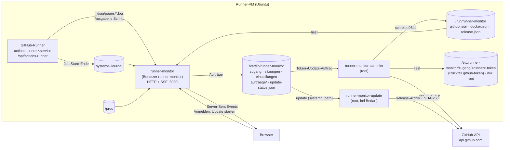

# Wie der Runner-Monitor funktioniert

**Stand: 29.10.2026 · Version 0.7.0 (Runner-Erkennung, Anbieter-Adapter und Einrichtung aus 0.8.0 in Arbeit)**

Diese Seite erklärt den Aufbau: welche Teile es gibt, woher jede Zahl im Dashboard kommt,
welche Dateien wo liegen und wer was lesen und schreiben darf. Bedienung: [Handbuch](handbuch/README.md).

## Überblick



Drei systemd-Dienste, alle in Python 3 nur mit der Standardbibliothek ([ADR-0001](adr/0001-python-standardbibliothek.md)):

| Dienst | Läuft als | Aufgabe |
|---|---|---|
| `runner-monitor` | `runner-monitor` (ohne Anmeldung, Gruppe `systemd-journal`) | Webserver auf Port 8090: Seiten, Anmeldung, Server-Sent Events. Misst die VM, liest Journal und Schritt-Logs des Runners. |
| `runner-monitor-sammler` | root | Fragt GitHub (mit dem Token, das nur root lesen kann) und Docker ab, prüft auf neue Releases, erkennt die Runner auf der VM (beim Start und alle 6 h), übernimmt Aufträge der Oberfläche. |
| `runner-monitor-update` | root, nur bei Bedarf | Installiert ein Update ([ADR-0004](adr/0004-update-hilfsdienst.md)). Startet über `runner-monitor-update.path`, sobald ein Auftrag liegt. |

**Warum zwei Benutzer?** Der Webserver ist das, was aus dem Netz erreichbar ist. Er läuft
ohne Rechte und kann weder das GitHub-Token lesen noch Software installieren. Was root-Rechte
braucht, erledigen die beiden root-Dienste – sie nehmen von der Oberfläche nur eng umrissene
Aufträge an (ein Token zum Ablegen, eine Versionsnummer zum Aktualisieren, `release-pruefen` für
„Jetzt prüfen“ – der Sammler fragt dann sofort, höchstens einmal je Minute; seit #96 Zuordnung und Ignorieren
für `runner.json`, „Neu erkennen“ und „Verbindung prüfen“) und prüfen sie selbst.

## Woher die Daten kommen

| Bereich im Dashboard | Quelle | Takt |
|---|---|---|
| CPU gesamt, je Kern | `/proc/stat` (Differenz zweier Messungen, iowait zählt als frei) | 1 s |
| RAM, Swap | `/proc/meminfo` (belegt = gesamt − verfügbar) | 1 s |
| Last | `/proc/loadavg` | 1 s |
| Netz | `/proc/net/dev`, Bytes je Sekunde summiert über alle echten Schnittstellen (ohne `lo`, Docker-Brücken, `veth`, VPN-Tunnel – deren Verkehr läuft ohnehin über die echte Schnittstelle) | 1 s |
| Laufzeit der VM | `/proc/uptime` | 1 s |
| Verlauf 10 Minuten | die letzten 600 Sekundenwerte im Speicher des Dienstes | 1 s |
| Prozesse (Top 6) | `/proc/<pid>/stat`, `status`, `cmdline` | 2 s |
| Platten | `/proc/mounts` + `statvfs`; nur echte Dateisysteme ab 1 GiB, ohne Snap/Docker-Overlays. Netzlaufwerke (NFS, CIFS) mit 2 s Frist in eigenem Thread; antwortet eines nicht, fehlt es, bis es wieder antwortet (Journal: „Netzlaufwerk … antwortet nicht“) | 10 s |
| Runner-Dienst aktiv/gestoppt | `systemctl show actions.runner.*` | 2 s |
| Runner-Name, Version | `/opt/actions-runner/.runner`, `bin/Runner.Listener.deps.json` (Eintrag `Runner.Listener/x.y.z`; Rückfall `bin/Runner.Listener --version`) | gefunden: 10 min, nicht gefunden: nach 30 s erneut |
| Job gestartet/beendet, Ergebnis | Journal des Runner-Dienstes: „Running job: …“, „Job … completed with result: …“. „Dienst gestartet/gestoppt“ gilt nur für Meldungen von systemd selbst (`_COMM=systemd` und `_PID=1`), nie nach dem `SYSLOG_IDENTIFIER`, den ein Job setzen kann | sofort |
| Live-Log | `/opt/actions-runner/_diag/pages/*.log` – der Runner schreibt je Schritt eine neue Datei; der Monitor liest sie wie `tail -f` | sofort |
| Repository, Workflow, Schritte des Jobs | GitHub-API: Läufe der Repositories, Jobs mit `runner_name` dieses Runners | 30 s |
| Online bei GitHub | GitHub-API `orgs/{org}/actions/runners` (Recht „Self-hosted runners: Read“, optional) | 30 s |
| Workflows je Repository | GitHub-API `orgs/{org}/repos`, dann je Repository `actions/runs?per_page=30`; bedingt mit ETag (304 kostet kein Kontingent), ruhige Repositories (über 1 Std. kein Push, nichts läuft oder wartet) nur alle 5 Min. | 30 s |
| Token-Ablauf, API-Kontingent | Antwort-Header `github-authentication-token-expiration`, `x-ratelimit-*` | 30 s |
| Forgejo-/Gitea-Runner: Online, Jobs je Repository, aktueller Job mit Schritten, letzte Jobs | API des Servers aus `runner.json` (`/api/v1`, Token aus `zugang/<id>.token`), siehe „Fähigkeiten je Anbieter“ | 30 s |
| Neue Version | GitHub-API `repos/<release-repo>/releases/latest` | 6 h |
| Docker-Container | `docker ps --format json` (wird gesammelt, in Version 0.1 nicht angezeigt) | 10 s |

**Ohne Token** laufen Runner-Status, Auslastung, Prozesse, Platten und Live-Log normal; Job-
Name und Ergebnis kommen dann allein aus dem Journal, Repository und Schrittnamen fehlen.

**Fällt GitHub aus**, behält der Sammler den letzten erfolgreichen Stand und markiert ihn; die
Oberfläche zeigt „Stand von hh:mm:ss“ und die Zeit bis zum nächsten Versuch.

## Runner erkennen (seit Design 0.8.0, #91)

`runner_monitor/erkennung.py` findet selbst, welche Runner auf der VM laufen – auch mehrere und
auch andere als GitHub. Der Sammler (root) startet sie **beim Start und alle 6 Stunden** als
**eigenen Prozess** (`python3 -m runner_monitor.erkennung --json`), schaut in seinen folgenden
Takten (2 s) nach und beendet ihn nach 60 s – ein hängender DNS-Server oder ein tröpfelnder Server
hält so weder GitHub- noch Docker-Abfrage auf. Die Ausgabe landet in einer temporären Datei, wird
geprüft (`erkennung.pruefe_ergebnis`: Form, Werte, höchstens 2 MB, nur bekannte Felder) und erst
dann nach `/run/runner-monitor/erkennung.json` geschrieben (0644, ohne Geheimnisse); Takt und Frist
laufen mit `time.monotonic()`, die Fehlerausgabe (höchstens 2000 Zeichen) geht ins Journal; ein
abgebrochener oder ungültiger Lauf lässt die alte Datei stehen. `einrichten.sh` zeigt dieselbe
Erkennung in „System prüfen“ › „Runner auf dieser VM“ (`timeout --foreground 60 python3 -m
runner_monitor.erkennung --text`, Rückgabe 3 = kein Runner). Seit den Anbieter-Adaptern (#92) stehen
alle nicht ignorierten Funde in `runner[]` (siehe „Anbieter-Adapter“); das Dashboard zeigt sie seit
#94 als Reiter (siehe „Mehrere Runner im Dashboard“).

| Quelle | Was gelesen wird | Merkmal (Beispiel) |
|---|---|---|
| systemd-Units | Unit-Dateien in `/etc/systemd/system`, `/run/systemd/system`, `/usr/local/lib/systemd/system`, `/usr/lib/systemd/system`, `/lib/systemd/system` samt Drop-ins; `ExecStart`, `WorkingDirectory`; aktiviert über `*.wants/`, aktiv über `systemctl is-active` | „systemd-Unit forgejo-runner.service“ |
| Prozesse | `/proc/<pid>/cmdline`, `cgroup` (welche Unit, Container?), `cwd` – nur bekannte Programme (`Runner.Listener`, `forgejo-runner`, `act_runner`, `gitlab-runner`) | „Prozess forgejo-runner daemon“ |
| Registrierungen | `.runner` (GitHub: `agentName`, `gitHubUrl`; Forgejo/Gitea: `name`, `address`) neben Unit und Prozess, laut `config.yml` (`runner.file`) und an üblichen Orten (`/opt/*`, `/srv/*`, `/var/lib/*`, `/home/*`, `/root`); GitLab: `config.toml` (`name`, `url`) | „/opt/actions-runner/.runner mit gitHubUrl“ |
| Server-API ohne Zugangsdaten | nur für Funde mit systemd-Unit (E-17): Forgejo `/api/forgejo/v1/version`, Gitea `/api/v1/version`, GitLab-Anmeldeseite, GitHub Enterprise `/api/v3/meta` (github.com gilt als bekannt) | „/api/forgejo/v1/version antwortet: 13.0“ |
| Runner-Version | GitHub aus `bin/Runner.Listener.deps.json`, sonst aus dem Journal der Unit („with version: v9.1.0“, „version=17.5.2“) | – |

**Grad:** `sicher` – eindeutige Merkmale (Registrierung und systemd-Unit) **und** Server
bestätigt; `wahrscheinlich` – Dienst erkannt, aber Server nicht erreichbar, ohne Netz, nicht geprüft
(Fund ohne Unit, E-17), ohne Registrierung oder mit widersprüchlichen Merkmalen; `unklar` – nur allgemeine Hinweise (Name der
Unit enthält „runner“, „agent“, „build“ …, startet Container). Bekannte Nicht-Runner
(`qemu-guest-agent`, `runner-monitor*` …) zählen nicht; unbekannte Units nur, wenn sie aktiviert
oder aktiv sind. Zwischen Forgejo und Gitea entscheidet die Antwort des Servers.

**Einstufung und Fähigkeiten** richten sich nach dem, was diese Version liefern kann (Tabelle
`FAEHIG` in `erkennung.py`): GitHub `voll` (Status, Jobs, Schritte, Logs); Forgejo, Gitea und GitLab
`teil` (ausgeliefert als Dienst und Journal – ihre Adapter können mehr, die Tabelle hebt erst mit der
Anbindung in Einrichtung und Sammler an, E-20, E-23); unbekannt `unbekannt` (Grundüberwachung).
`updates` ist überall `false` (E-16). Ein Fund ohne Unit hat weder `status` noch `logs`.

Ergebnis je Fund (`erkennung.json` › `runner[]`, Format aus dem Design-README):

```json
{ "id": "runner-vm-02", "name": "runner-vm-02", "dienst": "forgejo", "server": "https://git.example.org",
  "version": "13.0 / Runner 9.1", "grad": "sicher", "merkmale": ["systemd-Unit forgejo-runner.service", "…"],
  "einstufung": "teil", "stand": "offen", "unit": "forgejo-runner.service", "log": null,
  "faehig": { "status": true, "jobs": false, "schritte": false, "logs": true, "updates": false },
  "aktiv": true, "grund": null }
```

`dienst`: `github|forgejo|gitea|gitlab|unbekannt`; `stand`: `angebunden|grund|ignoriert|offen`
(GitHub mit Unit und vorhandenem Token: `angebunden`, sonst `offen`, bis eine Zuordnung etwas
anderes sagt; ein Fund ohne Unit ist nie `angebunden`, E-18); `log`: Pfad oder `null` (= Journal der
Unit; GitHub mit Unit: `<runner>/_diag`, ohne Unit `null`). Zusätzlich zum Design: `aktiv` (Unit
läuft: `true`/`false`/`null` unbekannt; bei einer zugeordneten anderen Unit deren Zustand) und
`grund` (warum nur „wahrscheinlich“). Die Datei hat außerdem `zeit` und `geprueft`.

**IDs (E-18):** aus dem Namen, eindeutig (gleicher Name → `-2`, `-3`) und **zuerst an Funde mit
Unit** vergeben – ein nachgemachter Fund (z. B. eine `.runner` in `/home`) bekommt so nie die ID
eines echten Runners und damit nie dessen Zuordnung. Für die Adapter (#92, #93, #99) gilt: Server
und Log-Pfad kommen nur aus `runner.json` bzw. den Zugangsdaten (`zugang/`), nie aus dem Fund – der
Fund ist nur ein Vorschlag für die Einrichtung.

**Spalte „Version“** in `einrichten.sh` wie im Design: bei GitHub die Runner-Version, sonst die
Server-Version; ist nur die Runner-Version bekannt, steht dort „–“ (sie bleibt im JSON).

**Zuordnung und Ignorieren** stehen dauerhaft in `/etc/runner-monitor/runner.json`
(root:runner-monitor, 0640). Gelesen wird sie mit `erkennung.lies_zuordnung`; schreiben darf sie nur der
Sammler, auf Auftrag der Einrichtung (seit #96, siehe „Einrichtung im Browser: Runner, Anbinden, Fertig“; Info ›
Runner folgt mit #97) oder von Hand auf der VM:

```json
{ "version": 1,
  "runner": {
    "buildagent":   { "stand": "grund", "dienst": "unbekannt", "name": "Build-Agent",
                      "unit": "buildagent.service", "log": "/var/log/buildagent/agent.log" },
    "runner-vm-02": { "server": "https://git.example.org", "org": "beispiel-org" },
    "runner-vm-03": { "stand": "ignoriert" },
    "runner-vm-04": { "http_erlaubt": true } } }
```

Schlüssel ist die `id` des Funds; jedes Feld ist freiwillig. `http_erlaubt` (nur `true` gilt) erlaubt einem
Adapter, das Token dieses Runners über `http://` zu senden (E-21, GitLab); ohne dieses Feld nur `https://`. Ungültige Einträge oder Felder werden
verworfen. Ein Eintrag mit `unit`, der nicht gefunden wurde, erscheint als „von Hand zugeordnet“.
`server` (`http(s)://host[:port][/pfad]`, ohne Zugangsdaten, Abfrage und Anker – sonst verworfen)
und `org` (Organisation oder Benutzer beim Dienst, `A-Z a-z 0-9 . _ -`) binden einen Forgejo- oder
Gitea-Runner an (#93); sie sind die **einzige** Quelle, wohin der Sammler mit Token fragt (E-18).
Mit Token nur `https://`; `http://` nur mit `"http_erlaubt": true` beim selben Runner (E-21).
Die Oberfläche setzt `server`, `org` und `http_erlaubt` nie (E-22). Gesetzt werden sie auf der VM mit
`sudo einrichten.sh zugang <runner>` (#120) oder von Hand.

**`einrichten.sh zugang <runner>` für Forgejo, Gitea, GitLab (#120, E-26):** Das Skript fragt nur ab;
geprüft und geschrieben wird in `runner_monitor/anbieter/anbindung.py`, nach denselben Regeln, mit denen
Erkennung und Sammler lesen:

- Den Dienst bestimmt `runner.json` (`dienst`) bzw. der Fund in `erkennung.json`. Nur für `forgejo`,
  `gitea` und `gitlab` fragt das Skript nach dem Server. Für den GitHub-Runner und alle anderen bleibt es
  beim Token.
- **Server** (`anbindung.pruefe_server`): wie `erkennung.pruefe_url`, dazu abgelehnt statt still gekürzt:
  Zugangsdaten (`@`), Abfrage, Anker, Pfadteile `.`/`..`, `%`-Kodierung und `/api…` am Ende. `http://`
  nur nach ausdrücklicher Rückfrage → `"http_erlaubt": true`. Steht dieselbe `http://`-Adresse schon mit
  `http_erlaubt` in der Datei, bleibt die Erlaubnis ohne neue Rückfrage. Als Vorgabe (Enter) gilt der
  bisherige Server. Ohne bisherigen Server wird die Adresse aus dem Fund nur vorgeschlagen, und das nur
  bei einem Fund mit Unit (E-17).
- **Organisation** nur, wenn der Adapter sie braucht (`BRAUCHT_ORG`: Forgejo, Gitea), geprüft mit
  `erkennung.pruefe_org`.
- **Token** verdeckt von `/dev/tty`. An Python geht es über die Standardeingabe (`printf` ist eingebaut,
  steht also in keiner Prozessliste); abgelegt wird es mit `token.schreibe` (`zugang/` 0700,
  Datei 0600). **Neue Adresse:** Ändert sich der Server eines Runners, der schon ein Token hat, ist ein
  neues Token Pflicht. Das gilt auch für das erste Eintragen eines Servers und für `https` → `http`.
  Nur bei gleicher Adresse darf das Token bleiben (Enter). Ohne Token wird nichts geändert.
- **Schreiben** (`anbindung.setze`, nur als root): `runner.json` wird gelesen wie in der Einrichtung
  (`einrichtung.lies_roh`). Ist die Datei kaputt oder ein Symlink, wird nichts geschrieben. Geschrieben
  wird mit `einrichtung.schreibe_zuordnung` (atomar, 0640, root, Gruppe des Ordners, der Ordner muss ein
  echtes Verzeichnis von root sein). Geändert werden nur `server`, `org`, `http_erlaubt` und, auf Wunsch,
  `stand: "grund"` dieses Runners. Bei `grund` fragt der Monitor den Dienst nicht ab, und die Einrichtung
  im Browser setzt diesen Stand als Vorgabe für „erkannt, noch nicht unterstützt“. Alle anderen Felder
  und Runner bleiben. Reihenfolge bei neuer Adresse: altes Token löschen → `runner.json` → neues Token.
  Scheitert ein Schritt, bleibt höchstens „kein Token“, nie das alte Token an der neuen Adresse. Der
  Sammler ruht während des Schreibens (`systemctl stop`/`start`), damit keine Runde Adresse und Token aus
  verschiedenen Ständen liest. Der Neustart löst zugleich eine neue Erkennung aus.
- **Verbindung prüfen** (`anbindung.pruefe_verbindung`): eine Abfrage des vorhandenen Adapters mit
  Server, Organisation und Token aus der Konfiguration. Sie ist nur lesend: nur GET, keine Weiterleitung,
  Fristen des Adapters, dazu insgesamt 40 s in einem eigenen Faden und 60 s `timeout` im Skript.
  Ausgabe: „Server erreichbar · Forgejo 13.0“, „Token gültig, Organisation … gefunden“,
  „Token ungültig“, „Keine Rechte“, „Server nicht erreichbar“ oder „Server nicht gefunden“. Letzteres
  kommt nur aus dem Feld `ursache` der Adapter, nie aus einem Fehlertext: `kein-dienst` (unter der
  Adresse antwortet kein Forgejo/Gitea/GitLab, z. B. `/api/v1/version` fehlt oder keine JSON-Antwort)
  bzw. `weiterleitung` (3xx). Dazu kommt ein Hinweis, falls der Monitor den Runner trotzdem nicht
  abfragt (Stand `grund`/`ignoriert`, keine Unit).
- **Grenzen:** Wartet im Browser noch ein nicht abgeholter Auftrag `runner-zuordnung` mit
  `stand: "grund"` für diesen Runner, übernimmt der Sammler ihn nach dem Neustart und setzt den eben
  aufgehobenen Stand wieder; das Skript weist darauf hin. Ein Token, das vor #120 ohne Server abgelegt
  wurde (alter Weg „erst Token, dann runner.json“), zählt als Token ohne Adresse: Beim ersten Lauf mit
  Server verlangt das Skript ein neues Token und verwirft das alte (E-26). Ist ein Runner weder erkannt
  noch in `runner.json` eingetragen, ist sein Dienst unbekannt; das Skript sagt das und legt nur nach
  Rückfrage allein ein Token ab.

**Sicherheit (S-ERK-01):** Bei Funden mit Unit-Datei kommen Name, Server und Dienst nur aus Registrierungen, die die Unit vorgibt
(`--config` im ExecStart, Programmordner, WorkingDirectory); was nur ein Prozess in der cgroup nennt
(argv[0], `--config`, cwd – frei wählbar) ist nur Merkmal und Widerspruch und senkt den Grad (#109). Die Erkennung führt nichts aus, was in einem Fund steht (kein
`ExecStart`, kein Runner-Programm, keine Shell); aufgerufen werden nur `systemctl is-active -- <unit>`
und `journalctl -u <unit>` mit geprüftem Namen. **Keinem Symlink wird gefolgt** außer bei
Unit-Dateien in den root-eigenen systemd-Verzeichnissen – also nicht bei `.runner`, `config.toml`,
`config.yml`, `deps.json`, `runner.json` und `/proc`. Vor dem Öffnen prüft `lstat`, dass es eine
reguläre Datei ist (keine FIFO, kein Gerät); geöffnet wird mit `O_NOFOLLOW`, `O_NONBLOCK` und
`O_NOCTTY`, danach muss es dieselbe Datei sein; gelesen wird bis zu einer Grenze (64 KB, `deps.json`
4 MB). Registrierungen nur unter festen Dateinamen (`.runner`, `config.toml`). `token` aus
`.runner`/`config.toml` wird nie übernommen, `.credentials` nie gelesen, vom GitHub-Token wird nur
geprüft, ob die Datei da ist. Namen, Unit-Namen, Pfade und Adressen werden streng geprüft (Adressen
ohne Zugangsdaten, Abfrage und Anker); die Textausgabe ersetzt Steuerzeichen. Die Server-Probe
(nur Funde mit Unit) ist ein GET auf feste Pfade ohne Zugangsdaten und ohne Weiterleitungen, mit
**harten** Fristen von 3 s je Anfrage und 10 s insgesamt, höchstens 8 Server: Sie läuft in einem
eigenen Faden, der zur Frist zurückgelassen wird – das deckt auch DNS und tröpfelnde Antworten ab.
Darüber liegt die Grenze des Prozesses (Sammler 60 s, `einrichten.sh` `timeout --foreground 60`). Fehler in einer
Quelle beenden die Erkennung nie.

`PrivateDevices=yes` für den Sammler wäre nach Prüfung möglich (Docker über `/run/docker.sock`,
`systemctl` über D-Bus, `journalctl` über `/var/log/journal` brauchen keine Geräte) – ist aber nicht
gesetzt, weil es auf einer echten VM noch nicht erprobt ist; Vorschlag für ein eigenes Issue.

## Anbieter-Adapter (seit Design 0.8.0, #92)

Status, Jobs, Schritte und Logs kommen über eine gemeinsame Schnittstelle, egal welcher Dienst
dahintersteht ([ADR-0006](adr/0006-anbieter-adapter-und-zustand.md), E-19). Paket
`runner_monitor/anbieter/`:

| Datei | Inhalt |
|---|---|
| `__init__.py` | Basisklasse `Anbieter` (zugleich Grundüberwachung), `RunnerKonfig`, Registry (`registriere`, `klasse_fuer`, `faehigkeiten_tabelle`) |
| `github.py` | GitHub-Adapter: Abfrage einer Runde (bisher `github.abfrage`), Jobs je Repository, aktueller Job mit Schritten, Online-Status, Log-Quelle `_diag/pages` |
| `gitlab.py` | GitLab-Adapter (#99): REST-Klient (`/api/v4`, nur lesend, ohne Weiterleitungen), Runner-Status, aktueller Job, letzte Jobs, Jobs je Projekt; ohne Schritte |
| `forgejo.py` | Forgejo- und Gitea-Adapter (#93): eigener REST-Klient (nur GET, ohne Weiterleitungen), Online-Status, Jobs je Repository, aktueller Job mit Schritten, letzte Jobs; Log aus dem Journal der Unit |
| `token.py` | Zugangsdaten je Runner, Übernahme des alten Tokens, Kommandozeile für `einrichten.sh` |

Schnittstelle je Runner: `faehig()`, `abfrage(speicher, …)` (nur im Sammler, root, mit Token),
`dienst_status()`, `beim_dienst()`, `jobs_je_repository()`, `api_job()`, `log_quelle()` und
`eintrag()` (ein Eintrag in `runner[]`). Ein Dienst ohne eigenen Adapter bekommt die
**Grundüberwachung** (Dienst über systemd, Journal). `runner_monitor/github.py` bleibt der
REST-Klient (auch für Releases und die Prüfung in der Einrichtung) und reicht die alten Namen
(`github.abfrage`, `job_fuer_runner` …) an den Adapter weiter, bis das Altformat entfällt.

**Fähigkeiten je Dienst** (Spalten: was der Adapter kann; **ausgeliefert** wird `erkennung.FAEHIG`, die nie mehr verspricht als der Adapter kann, aber bis der Sammler einen Adapter aufruft weniger – E-20; ein Test prüft das):

| Dienst | Adapter | status | jobs | schritte | logs | updates |
|---|---|---|---|---|---|---|
| GitHub | `GitHub` | ✓ | ✓ | ✓ | ✓ | – |
| Forgejo | `Forgejo` (#93), ausgeliefert als Grundüberwachung bis #96/#115 (E-23); von Hand angebunden: | ✓ | ✓ (ausgeliefert: –) | ✓ ab Forgejo 17 (ausgeliefert: –) | ✓ (Journal) | – |
| Gitea | `Gitea` (#93, nur nach OpenAPI), ausgeliefert als Grundüberwachung (E-23) | ✓ | ✓ (ausgeliefert: –) | ✓ (ausgeliefert: –) | ✓ (Journal) | – |
| GitLab | `GitLab` (#99, im Sammler seit #115), ausgeliefert als Grundüberwachung bis #96 (E-20); von Hand angebunden: | ✓ | ✓ (ausgeliefert: –) | – | ✓ | – |
| unbekannt | Grundüberwachung | ✓ | – | – | ✓ | – |

Ohne Unit gibt es weder `status` noch `logs` (außer beim GitHub-Runner aus `MONITOR_RUNNER_VERZ`,
dessen Status wie bisher „fehlt“ zeigt und dessen Live-Log aus `_diag/pages` kommt). Weitere
GitHub-Runner neben dem aus `MONITOR_RUNNER_VERZ` laufen bis #94 in der Grundüberwachung.
**Angebunden** ist ein Forgejo-, Gitea- oder GitLab-Runner, wenn er eine Unit hat, `runner.json` Server
(mit `https://`, `http://` nur mit `http_erlaubt`) und – nur Forgejo/Gitea – Organisation nennt und sein
Stand nicht `grund`/`ignoriert` ist (`anbieter.angebunden`, `ANBINDUNG`, `BRAUCHT_ORG`; GitLab seit
#115). Sonst gilt die Grundüberwachung. Ausgeliefert ist die Einstufung bis zur Anbindung in der
Einrichtung (#96) `teil` (E-20, E-23); ein von Hand angebundener Runner meldet in `runner[]` die
Fähigkeiten seines Adapters. Liefert der Server keine Schritte (Forgejo vor 17), meldet der Eintrag
`faehig.schritte: false` – die Oberfläche zeigt dann „Schritte nicht verfügbar“ (Design ›
„Teilweise“). **Ehrlich statt „Bereit“:** Ist der Runner beim Dienst beschäftigt, der Job aber in
keinem Repository der Organisation zu finden, ist der Zustand `job` mit `job.zuordenbar: false`
(„Job nicht zuordenbar“); ist die Runner-Liste oder sind die Läufe eines Repositorys nicht lesbar
(`laeufeNichtLesbar`, z. B. 404 auf `/actions/runs`) oder schlug die Abfrage fehl, ist er
`unbekannt`.

### Fähigkeiten je Anbieter (API-Prüfung, #93)

Geprüft am 29.10.2026 nur lesend gegen **Forgejo 17.0.1** (`17.0.1+gitea-1.22.0`) und anhand der
OpenAPI-Beschreibungen (`/swagger.v1.json`) von Forgejo 17, Forgejo 16 (Entwicklungsstand) und
Gitea (Entwicklungsstand nach 1.24). **Gitea ist nur nach der Beschreibung umgesetzt**, nicht gegen
einen laufenden Server geprüft. Alle Pfade unter `/api/v1`, Anmeldung `Authorization: token …`.

| Was | Forgejo | Gitea | Monitor nutzt |
|---|---|---|---|
| Version | `/version` → `17.0.1+gitea-1.22.0` (nennt die Gitea-Basis) | `/version` → z. B. `1.24.6` | Art des Servers (Forgejo/Gitea), Anzeige |
| Runner-Status | `/orgs/{org}/actions/runners?visible=true` (auch globale Runner), `/user/actions/runners`, `/repos/{o}/{r}/actions/runners`, `/admin/actions/runners`; Liste `[{name, uuid, status: offline/idle/active, labels: ["…"], version}]` | gleiche Pfade; `{runners: [{name, status: online/offline, busy, labels: [{name}]}]}` | Online/Offline, beschäftigt, Labels; braucht **Besitzerrechte** an der Organisation (sonst „unbekannt“ mit Grund) |
| Läufe je Repository | `/repos/{o}/{r}/actions/runs` → `{workflow_runs: [{id, status: running/waiting/blocked/success/failure/cancelled/skipped, workflow_id, prettyref, trigger_event, title, started}]}` | `/repos/{o}/{r}/actions/runs` wie GitHub (`in_progress`, `queued`, `completed` + `conclusion`, `head_branch`, `pull_requests`, `path`); zusätzlich `/orgs/{org}/actions/runs` und `/orgs/{org}/actions/jobs` | Jobs je Repository (läuft/wartet), ruhige Repositories seltener |
| Jobs eines Laufs | `/repos/{o}/{r}/actions/runs/{id}/jobs` → `[{id, name, status, task_id, attempt, html_url}]` – **ohne Runner, ohne Schritte, ohne Zeiten** | `{jobs: [{id, name, status, conclusion, runner_name, runner_id, started_at, completed_at, steps}]}` | aktueller Job dieses Runners |
| Welcher Runner hat den Job? | nur in der **ersten Log-Zeile**: „Runner <uuid> (version:…) received task …“ (Forgejo Runner) bzw. „<name>(version:…) received task …“ (act_runner) | `runner_name` im Job | Forgejo: Log-Anfang (`Range: bytes=0-4095`), Vergleich mit der UUID aus der Runner-Liste, je Job einmal |
| Schritte | `/repos/{o}/{r}/actions/jobs/{id}` (**ab Forgejo 17**) → `steps: [{number, name, status: success/failure/running/waiting/skipped/cancelled, started, stopped}]`, von Anfang an vollständig von „Set up job“ bis „Complete job“; Forgejo 16 hat den Pfad nicht | `steps` im Job (`status` + `conclusion`) | Schritt `{nr, von, name}`; ohne Pfad `faehig.schritte: false` |
| Logs | `/repos/{o}/{r}/actions/jobs/{id}/logs` – Text, ab 17 mit `?step=N`, `?format=ndjson`, `Range`; `/runs/{id}/logs` als ZIP | `/repos/{o}/{r}/actions/jobs/{id}/logs` (Text) | nur der Anfang (Runner-Zuordnung). Live-Log weiter aus dem Journal der Unit; ein Log über die API mit Schritt-Trennern wäre möglich (eigenes Issue) |
| Letzte Jobs | `/actions/jobs/{id}` (Ergebnis, Ende des letzten Schritts); vor 17 nur `status` in der Job-Liste | `/actions/jobs/{id}` (`conclusion`, `completed_at`) | Jobs, die der Sammler laufen sah (bis 5); kurze Jobs zwischen zwei Runden (30 s) fehlen |
| Kontingent, Token-Ablauf | keine Kopfzeilen (ohne eigene Einstellung kein Kontingent; Ablauf nicht abfragbar) | ebenso | `kontingent: {}`, `tokenAblauf: null`; 429 → „Kontingent“ |
| Updates des Runners | – | – | `updates: false` |

**Ohne Anmeldung** antwortet eine Instanz mit `REQUIRE_SIGNIN_VIEW` auch auf `/api/v1/version` und
`/api/forgejo/v1/version` nur mit „Only signed in user is allowed“ – die Erkennung kann Forgejo und
Gitea dann nicht unterscheiden (Grad „wahrscheinlich“). Der Adapter braucht das nicht: Er erkennt
die Art an der Version und richtet sich nach der **Form** jeder Antwort.

**Token-Rechte** (Forgejo und Gitea, Einstellungen › Anwendungen › „Zugriffstoken“): `read:repository`
(Repositories, Läufe, Jobs, Schritte, Logs) und `read:organization` (Organisation; die Runner-Liste
nur für Besitzer der Organisation), bei einem Benutzer statt einer Organisation `read:user`. Kein
Schreibrecht. Ohne Recht auf die Runner-Liste bleibt „beim Dienst“ unbekannt und Forgejo kann
Jobs keinem Runner zuordnen (die UUID fehlt) – Jobs je Repository gibt es trotzdem. Die Bereiche
stammen aus der Beschreibung; mit einem eingeschränkten Token sind sie noch nicht geprüft.

**Eine Runde** (Sammler, alle 30 s, **je Runner ein eigener Faden** – siehe „Abfrage im Sammler“ unten;
eine Runde je Runner höchstens 25 s, je Anfrage eine harte Frist von 10 s in einem
Daemon-Faden, die auch DNS und tröpfelnde Antworten abdeckt; Antworten werden stückweise gelesen, `NaN`
und `Infinity` abgelehnt, eine Antwort in unerwarteter Form wird „unerwartete Antwort“ mit dem letzten
guten Stand): Version → Organisation oder
Benutzer (einmal je Token) → Runner-Liste → Repositories (ohne archivierte und ohne Actions, 50 je
Seite) → Läufe je Repository (ruhige Repositories nur alle 5 Min., wie bei GitHub) → Jobs der
laufenden Läufe → bei Forgejo Log-Anfang je neuem Job → Schritte des eigenen Jobs → Ergebnis der
Jobs, die seit der letzten Runde fertig sind. Bei einer Instanz mit 7 Repositories ohne laufende
Jobs waren das 11 Anfragen in 0,2 s, in der Runde danach 6.

Ergebnis je Runner in `/run/runner-monitor/anbieter.json` (0644, ohne Token):

```json
{ "zeit": 1761730000,
  "runner": { "runner-vm-02": {
    "org": "beispiel-org", "abfrage": "ok", "abgefragt": 1761730000, "letzterErfolg": 1761730000,
    "art": "forgejo", "serverVersion": "17.0.1", "tokenAblauf": null, "kontingent": {},
    "runner": { "zustand": "online", "beschaeftigt": true, "labels": ["ubuntu-latest"] },
    "repos": [ { "name": "web-portal", "privat": false, "laeuft": 1, "wartet": 0 } ],
    "job": { "repo": "web-portal", "privat": false, "workflow": "ci", "name": "build",
             "ref": { "art": "Branch", "name": "main", "titel": "…" }, "schritte": ["Set up job", "…"],
             "schritt": { "nr": 3, "von": 5, "name": "Tests" }, "start": 1761729601, "url": "https://git.example.org/…" },
    "letzteJobs": [ { "name": "lint", "ergebnis": "erfolg", "dauer": 42, "ende": 1761729500, "repo": "web-portal", "workflow": "ci" } ],
    "schritte": true, "fehler": "", "anfragen": { "anfragen": 9 } } } }
```

`abfrage`: `ok`, `kein-token`, `token-ungueltig` (401), `keine-rechte` (403, Organisation nicht
gefunden), `nicht-erreichbar` (Verbindung, Frist, 5xx), `kontingent` (429), `fehler` (Weiterleitung,
keine JSON-Antwort, zu groß, kein Forgejo/Gitea, Server oder Organisation fehlt). Passt die Adresse nicht,
steht zusätzlich `ursache`: `kein-dienst` (kein Forgejo/Gitea, keine JSON-Antwort) bzw. `weiterleitung` (#120). Bei einem Fehler
bleibt der letzte gute Stand (Repositories, Runner, Job, letzte Jobs) stehen; `stand` ist nur bei
`ok`, `nicht-erreichbar` und `kontingent` „angebunden“. Die Meldungen (`token`, `abfrage`) entstehen
wie beim GitHub-Runner. Ist der Runner beim Dienst „beschäftigt“, der Job aber keinem Repository der
Organisation zuzuordnen (z. B. ein globaler Runner arbeitet für eine andere Organisation), zeigt der
Eintrag `job` mit `zuordenbar: false` (siehe oben).

**Abfrage im Sammler (#115).** Alle 30 s werden die angebundenen Runner (Forgejo, Gitea, GitLab;
höchstens 20) fällig. Je Runner läuft die Runde in einem **eigenen Faden** (`anbieter-<id>`), höchstens
**4 zugleich** (`MAX_GLEICHZEITIG`); weitere warten der Reihe nach und kommen im nächsten Takt (2 s)
dran. `ein_takt` startet nur und wartet nie – ein hängender oder tröpfelnder Server hält weder
GitHub, Docker, Erkennung und Updates noch die **anderen Runner** auf (Test: ein Server, der ein Byte je
Sekunde sendet, verzögert den zweiten Runner nicht). Die Adapter begrenzen eine Runde selbst auf 25 s;
als Sicherheitsnetz gilt je Runner `RUNDENFRIST` = 35 s: Läuft eine Runde länger, wird sie
„nicht erreichbar“ („Keine Antwort innerhalb der Frist“, letzter guter Stand bleibt), einmal ins Journal
geschrieben und zählt nicht mehr gegen die Grenze von 4. **Keine Fadenlecks:** Je Runner gibt es
höchstens einen Faden – ist der Runner wieder fällig, während seine Runde noch läuft, wird er
übersprungen; eine neue Runde beginnt erst, wenn die alte zu Ende ist (eine späte Antwort zählt dann
noch). Zurückgelassene Anfrage-Fäden der Klienten enden spätestens mit ihrer Frist (nur ein hängendes DNS
kann länger brauchen, begrenzt durch die Wartezeit des Resolvers). Das Ergebnis jedes Runners landet
sofort in `anbieter.json`; Runner, die nicht mehr angebunden sind, verschwinden daraus, und nach einem
Neustart des Sammlers bleibt der letzte Stand aus der Datei der „letzte gute Stand“.

**Letzter guter Stand und „ausstehend“ (E-25):** Jedes Ergebnis nennt sein `ziel` (`server`, `org`,
`name`, nie das Token). Bei einem Fehler bleiben Repositories, Runner (mit Labels und Version), Job,
letzte Jobs, Art, Server-Version und Token-Ablauf aus der letzten guten Runde stehen und `letzterErfolg`
kommt aus ihr – aber nur, wenn es eine gab (`letzterErfolg`, auch ohne laufenden Job) und sie zum
selben Ziel gehört; nach einem Wechsel von Server, Organisation oder Token beginnt der Runner ohne
Altstand. Einträge ohne `ziel` (älterer Stand) gelten nie als guter Stand. Wechselt der Server, während
eine Runde zum alten Server läuft, wird deren Ergebnis verworfen (auch die Meldung „hängt“) und der
Runner sofort neu eingeplant; der Monitor zeigt ein Ergebnis, dessen `ziel` nicht zur aktuellen
`runner.json` passt, als „ausstehend“. Ein neu angebundener Runner (oder einer mit neuem Ziel) steht bis zu seiner ersten Runde auf
`abfrage: "ausstehend"` (Platzhalter in `anbieter.json`; der Monitor nimmt ihn auch ohne Eintrag an):
keine Meldung, die Karte „Jobs je Repository“ zeigt „Wird abgefragt …“, der Zustand ist `unbekannt`.

**Fehler als Meldung mit Runner:** Aus `jobsJeRepository.abfrage` jedes Runners entstehen in
`meldungen[]` `token` (`token-ungueltig`, `keine-rechte`: Stufe Fehler; `kein-token`: neutral; Ablauf in
14 Tagen: Warnung) und `abfrage` (`nicht-erreichbar`, `kontingent`, `fehler`: Warnung), jeweils mit
`runner` und `dienst`. Das Dashboard nennt dann den Dienst („GitLab nicht erreichbar“,
„Forgejo-Token ungültig oder abgelaufen“), bei mehreren Runnern davor den Runner. Ein bei GitLab
pausierter Runner meldet `pausiert` (Warnung, `daten.job`: läuft noch ein Job) statt `offline`
(„Pausiert bei GitLab · nimmt keine neuen Jobs an“). `ausstehend` erzeugt keine Meldung.

**Woher ein Adapter seine Werte nimmt (E-18):** Server, Organisation, Log-Pfad und Token-Datei nur
aus der Konfiguration – GitHub: Server fest `https://github.com`, Organisation aus
`einstellungen.json` bzw. `MONITOR_ORG`, Token aus `zugang/<id>.token` (Rückfall `github-token`);
Forgejo/Gitea: Server und Organisation aus `runner.json`, Token aus `zugang/<id>.token`
(`anbieter.konfig_aus`); Log-Datei anderer Runner nur aus `/etc/runner-monitor/runner.json`, sonst
Journal der Unit. Der Runner-Name (aus dem Fund) dient nur als Filter in der Antwort des Servers. Vom Fund
der Erkennung kommen nur ID, Anzeigename, Unit (geprüft), Version, Einstufung und Stand – zum
Anzeigen, nie als Ziel einer Anfrage. Der Monitor prüft `erkennung.json` beim Lesen noch einmal
(`erkennung.pruefe_ergebnis`), nimmt höchstens 20 Runner auf und fragt den Dienststatus von Runnern in
Grundüberwachung höchstens alle 10 s ab.

### GitLab-Adapter (#99)

Token mit dem Bereich **`read_api`** (persönliches, Projekt- oder Gruppen-Zugriffstoken), abgelegt
in `zugang/<id>.token`; der **Server** kommt nur aus der Konfiguration (nicht aus dem Fund, E-18) und
muss `https://` sein. `http://` nur, wenn `runner.json` für diesen Runner ausdrücklich
`"http_erlaubt": true` setzt (E-21); dann geht die Anfrage auch nie über einen Proxy aus der Umgebung
(`HTTP_PROXY`), bei `https://` bleibt ein Proxy-Tunnel möglich. Der Klient folgt **keiner Weiterleitung**, sendet das
Token nur in der Kopfzeile `PRIVATE-TOKEN` an `<Server>/api/v4/…`, liest höchstens 4 MB je Antwort
und fragt nur mit `GET`. Jede Anfrage hat eine **harte Gesamtfrist** von 15 s (eigener Daemon-Faden, stückweises Lesen mit Frist), die ganze Runde höchstens 25 s (#115). Alle 30 s eine Runde:

| Anfrage | Zweck | wenn sie fehlschlägt |
|---|---|---|
| `GET /personal_access_tokens/self` (höchstens stündlich) | Bereiche (`read_api` oder `api` nötig) und Ablaufdatum → Meldung „Token läuft ab“ | 403/404 (ältere GitLab-Version, andere Token-Art): übersprungen |
| `GET /runners` (nur beim ersten Mal und wenn die gemerkte Nummer nicht mehr passt; 100 je Seite, höchstens 5 Seiten) | den Runner finden: `description` = `name` in `config.toml` (bzw. der Anzeigename); ist der Name nicht genau einmal vorhanden, bleibt der Status „unbekannt“ mit Grund | 401/403/404: Token ungültig bzw. keine Rechte |
| `GET /runners/:id` | Status (`online`, `offline`, `stale`, `never_contacted`; ältere Versionen nur das Feld `online`), **Pause** (`paused`, früher `active: false`: ein pausierter Runner nimmt keine Jobs an und gilt als `offline`, mit `pausiert: true`, nie als „bereit“), Labels (`tag_list`), Version | 403/404: Labels und Version fehlen, der Status kommt aus der Liste |
| `GET /runners/:id/jobs?status=running` | aktueller Job (Projekt, Pipeline, Job, Stage, Ref, Start, Link) und „Jobs je Repository“ (laufend) | wie oben |
| `GET /runners/:id/jobs?order_by=id&sort=desc` | die letzten fünf beendeten Jobs (`erfolg`, `fehler`, `abgebrochen`, Dauer, Ende) | wie oben |

Ergebnis (öffentlich, ohne Token) im selben Format wie `github.json`, dazu `letzteJobs` und
`wartetUnbekannt: true`. Die Fehlerarten sind die von GitHub: `nicht-erreichbar` (Netz, Zeitlimit,
5xx, keine JSON-Antwort, Weiterleitung, zu große Antwort), `token-ungueltig` (401),
`keine-rechte` (403, 404 oder Token ohne `read_api`), `kontingent` (429; `RateLimit-*` werden gezeigt,
wenn der Server sie sendet), `kein-token`, `fehler` (Server fehlt, keine Adresse, nicht `https://` ohne
Erlaubnis, oder „unerwartete Antwort“: Felder in falscher Form, `NaN`/`Infinity`, ungültige Daten – die Runde zeigt dann
nichts Halbes). Passt die Adresse nicht, steht zusätzlich `ursache`: `kein-dienst` (keine JSON-Antwort) bzw.
`weiterleitung` (#120). Fremde Antworten werden Feld für Feld geprüft (Typ, Wertebereich, Länge); Nummer und Name des
Runners bleiben die aus der Liste, auch wenn die Einzelantwort etwas anderes behauptet.

**Was GitLab nicht hergibt (steht so in der Oberfläche als „nicht verfügbar“):**
- **Schritte:** Die REST-API kennt Pipelines → Stages → Jobs, aber keine Schrittliste innerhalb eines
  laufenden Jobs; das Job-Protokoll (`/trace`) ist Rohtext. Darum `schritte: false`, `job.schritt`
  ist `null`, der Job zeigt Pipeline, Stage und Name.
- **Wartende Jobs je Projekt:** Die Runner-API kennt nur `running`, `success`, `failed`, `canceled`.
  `wartet` ist immer 0 und `jobsJeRepository.wartetUnbekannt` ist `true` – die Oberfläche soll die Zahl
  dann nicht zeigen (Umsetzung #94). `privat` ist immer `false` (die Sichtbarkeit steht nicht in der Antwort).
- **Live-Log:** aus dem Journal der Unit (`gitlab-runner.service`) bzw. einer Datei aus `runner.json`.
- **Updates des Runners:** `updates: false` wie bei allen Diensten.

**Unsicherheiten (nach GitLab-Dokumentation, ohne Test gegen einen echten Server geschrieben):**
(1) Welche Rolle `GET /runners` und `GET /runners/:id/jobs` verlangen – laut Dokumentation reichen
`read_api` und Zugriff auf den Runner (Gruppe/Projekt, mindestens Maintainer, bei **Gruppen-Runnern ggf. Owner**); bei zu
geringer Rolle antwortet GitLab mit 403/404 und der Monitor zeigt „keine Rechte“. **Instanz-Runner** (von der
Verwaltung der GitLab-Instanz angelegt, `is_shared`) lassen sich nicht über `/runners` abfragen: dafür gäbe es
`/runners/all`, das nur Administratoren erlaubt ist – der Monitor sucht dort nicht und zeigt „nicht gefunden“. Ab
GitLab 16/17 steht die **Version** eines Runners ggf. nicht mehr in `/runners/:id`, sondern in `/runners/:id/managers`
(Runner mit mehreren Rechnern); der Monitor liest sie dort nicht, die Version fehlt dann. (2) Ob `project.name` in den Jobs der
Runner-API steht (bei fehlendem Namen steht „Projekt <Nummer>“). (3) `GET /personal_access_tokens/self` gibt es
ab GitLab 15.5. (4) Der Runner wird über den Namen gefunden, nicht über die Runner-Nummer, weil die
Nummer in `config.toml` nicht steht und das Runner-Token nie gelesen wird. Diese Punkte sind mit einem
echten GitLab-Server zu bestätigen, bevor GitLab als „vollständig unterstützt“ eingestuft wird
(`erkennung.EINSTUFUNG["gitlab"]` bleibt bis dahin und bis zur Anbindung im Sammler/in der Einrichtung
(#96) auf „teil“, `erkennung.FAEHIG["gitlab"]` auf Grundüberwachung – E-20).

**Anbindung im Sammler (#115):** Ein GitLab-Runner mit Unit und `server` in `runner.json` (keine
Organisation nötig) wird wie Forgejo/Gitea in seinem eigenen Faden abgefragt (siehe „Abfrage im
Sammler“); `runner[]` bekommt Job (ohne Schritte), letzte Jobs und Labels aus der Abfrage. Ehrlich wie
bei Forgejo: ist der Runner bei GitLab nicht zu finden oder schlug die Abfrage fehl, ist der Zustand
`unbekannt` statt „bereit“; ein pausierter Runner mit laufendem Job zeigt `job`. Ein `status` eines Jobs,
der kein Text ist (Liste, Objekt), kostet nur diesen Job, nicht die Runde. Die Server-Eingabe der
Einrichtung folgt mit #96; erst dann hebt `erkennung.FAEHIG["gitlab"]` an (E-20).

### Momentaufnahme `GET /api/zustand` (E-19, additiv)

Nur angemeldet (sonst 401 bzw. Weiterleitung zur Einrichtung), `no-store`. Bis 0.7 gab es die
Momentaufnahme nur als ersten Schwall von `/events`; jetzt auch als ein JSON-Objekt:

```json
{ "format": 2,
  "status": { … wie bisher … }, "system": { …, "verlauf": {…} }, "prozesse": […], "platten": […],
  "container": […], "workflows": { … wie bisher … }, "update": { … },
  "vm": { "name": "runner-vm", "system": "Ubuntu 24.04.1 LTS, Python 3.12", "monitorVersion": "0.7.0",
          "auslastung": { …Bereich system… }, "verlauf": { "cpu": [], "ram": [], "netz": [], "start": 0 },
          "prozesse": […], "platten": […], "container": […] },
  "runner": [ …Einträge… ],
  "meldungen": [ …Meldungen… ] }
```

Die bisherigen Bereiche bleiben **unverändert**, die Oberfläche nutzt sie weiter, bis #94 sie auf
`vm`/`runner[]`/`meldungen[]` umstellt; danach kann das Altformat in einem eigenen Issue entfallen.
Das Live-Log bleibt allein in `/events`. Seit #94 baut das Dashboard daraus seine Ansicht (Abschnitt
„Mehrere Runner im Dashboard“); fehlt `runner` (Altformat), zeigt es `status` und `workflows` wie bisher. Über `/events` kommen zusätzlich die Ereignisse `runner`
(die Liste) und `meldungen`, nur wenn sie sich ändern; `vm` gibt es nur in `/api/zustand`, weil
`system`, `prozesse`, `platten` und `container` schon einzeln kommen.

Ein Eintrag in `runner[]`:

```json
{ "id": "runner-vm-01", "name": "runner-vm-01", "dienst": "github", "server": "https://github.com",
  "org": "beispiel-org", "unit": "actions.runner.beispiel-org.runner-vm-01.service",
  "stand": "angebunden", "einstufung": "voll", "version": "2.338.1", "labels": ["self-hosted", "linux"],
  "faehig": { "status": true, "jobs": true, "schritte": true, "logs": true, "updates": false },
  "status": { "zustand": "job",
              "dienst": { "zustand": "aktiv", "seit": 1761700000, "grund": null, "neustarts": 0, "letzterStopp": null },
              "beimDienst": { "zustand": "online", "seit": null } },
  "job": { "repo": "web-portal", "workflow": "CI", "name": "test", "start": 1761700100,
           "schritt": { "nr": 3, "von": 8, "name": "Abhängigkeiten" }, "schritte": ["…"] },
  "letzteJobs": [ { "name": "build", "ergebnis": "erfolg", "dauer": 274, "ende": 1761699000, "repo": "api-dienst", "workflow": "CI" } ],
  "jobsJeRepository": { …wie der Bereich workflows… },
  "log": { "art": "seiten", "unit": "actions.runner.beispiel-org.runner-vm-01.service" } }
```

- `status.zustand`: `job|bereit|offline|gestoppt|fehlt` (mit Jobs), `aktiv|gestoppt|fehlt`
  (Grundüberwachung: „Dienst aktiv“). Ohne Unit (Fähigkeit `status` fehlt) ist er seit #95 `fehlt` – Reiter
  und Karte zeigen beide „Kein Dienst“ (Review #114); `unbekannt` heißt: der Dienst liefert keinen lesbaren
  Stand (Forgejo/Gitea, #93) oder der Adapter kann gar keinen Status. `beimDienst` ist `null` ohne Anbindung.
- `status.dienst`: `zustand`, `seit` (aktiv seit bzw. gestoppt seit), `grund` (systemd-`Result`),
  `neustarts` (`NRestarts`: automatische Neustarts durch `Restart=` seit dem letzten Start von Hand, sonst
  `null`) und `letzterStopp` (`InactiveEnterTimestamp`, `null`, wenn die Unit seit dem Booten nie beendet
  wurde) – alles aus `systemctl show` (#95).
- `job` und `letzteJobs` sind `null` ohne Fähigkeit `jobs`; `job.schritt` ist `{nr, von|null, name}`,
  `von` ist `null`, solange der Dienst keine Schrittliste geliefert hat, und `job.schritt` ist `null`
  ohne Fähigkeit `schritte` („Schritte nicht verfügbar“).
- `jobsJeRepository` ist `null` ohne Fähigkeit `jobs`; `log` ist `null` ohne Fähigkeit `logs`, sonst
  `{art, unit}` mit `art` = `seiten` (GitHub, `_diag/pages`, mit Schritt-Trennern), `journal` oder
  `datei` (Pfad nur aus `runner.json`). Pfade der VM stehen bewusst nicht in `/api/zustand` (Review #111);
  der Monitor kennt sie intern (`log_quelle()`).
- `stand`, `einstufung`, `version` kommen aus der Erkennung. Beim GitHub-Runner gilt `angebunden` nur,
  wenn die letzte Abfrage `ok`, `nicht-erreichbar` oder `kontingent` war (Token gültig, Dienst evtl.
  kurz weg); ohne Token, mit ungültigem Token, ohne Rechte, ohne Organisation oder vor der ersten
  Abfrage ist er `offen` – auch wenn die Erkennung „angebunden“ meldet (sie sieht nur, dass eine
  Token-Datei da ist). `grund` aus `runner.json` bleibt. Ignorierte Funde fehlen.

Eine Meldung in `meldungen[]` (Texte entstehen wie bisher im Browser, hier nur Art und Werte; nach
Schwere `fehler` → `warn` → `neutral` sortiert):

```json
{ "id": "gestoppt", "stufe": "fehler", "runner": "runner-vm-02", "dienst": "forgejo",
  "daten": { "seit": 1761700000, "grund": "oom-kill" } }
```

| `id` | Stufe | Wann | `daten` |
|---|---|---|---|
| `gestoppt` | fehler | Dienst des Runners gestoppt | `seit`, `grund` |
| `fehlt` | warn | kein Runner (`runner: null`) oder Dienst des Runners fehlt | – |
| `offline` | fehler | Dienst aktiv, beim Dienst offline | `seit` |
| `abfrage` | warn | Dienst nicht erreichbar, Kontingent erschöpft, Fehler | `abfrage`, `abgefragt`, `naechste` |
| `token` | fehler / neutral / warn | Token ungültig oder ohne Rechte / kein Token / läuft in ≤ 14 Tagen ab | `abfrage` bzw. `tokenAblauf` |
| `platte` | warn | `/` unter der Schwelle (`runner: null`) | `pfad`, `frei`, `schwelleFrei` |

Meldungen zur Verbindung und zu Updates des Monitors bleiben bis #94 allein im Browser.

### Mehrere Runner im Dashboard (#94, Design 0.8.0 Variante C)

Die Oberfläche liest `runner[]` und `meldungen[]` (Ereignisse `runner`, `meldungen`) und zeigt je VM
einen Satz Bereiche für alle (Auslastung, Prozesse, Platten) und je gewähltem Runner die Karten
„Runner-Status“, „Jobs je Repository“ und das Live-Log. Fehlt `runner` oder ist die Liste leer
(Altformat, ältere Server), bleibt sie bei `status` und `workflows` wie bisher.

- **Reiter** (`web/dashboard.js`, Logik in `web/runner.js`, geprüft mit `tests/js/runner.test.mjs`) stehen
  über „Runner-Status“: gleich breite Spalten, Zustandspunkt, Name, Zustand als Text (`Job läuft`, `Bereit`,
  `Gestoppt`, `Offline`, `Dienst aktiv`). Ab 4 Runnern stehen drei Reiter (Index 0, 1 und der gewählte, sonst 2)
  und „+N“ (64 px) mit den Punkten der übrigen; der Klick öffnet eine Liste (320 px) mit Punkt, Name,
  Dienst-Plakette und Zustand. Bedienung per Tastatur: Pfeile links/rechts, Pos1/Ende (die Wahl folgt dem
  Fokus), Enter, Leertaste oder Pfeil nach unten auf „+N“ öffnen die Liste und setzen den Fokus auf die erste
  Option (Pfeile, Enter wählt), Esc schließt sie und gibt den Fokus an „+N“ zurück, Tab aus der Liste schließt
  sie ebenfalls. Mit einem Runner gibt es keine Reiter.
- **Wahl** je Browser in `localStorage["runner-monitor.runner"]` (Runner-ID). Gibt es den Runner nicht
  mehr (oder kommt `runner` erst nach `status`), gilt vorläufig der erste, die gemerkte Wahl bleibt
  gespeichert und greift wieder; ist der Speicher gesperrt, gilt die Wahl nur für die Sitzung. Info und
  Fehler-Mail nennen alle Runner mit Dienst und Version.
- **Kopfzeile:** Name des gewählten Runners, bei mehreren Runnern die Dienst-Plakette (`GitHub`, `Forgejo`,
  `Gitea`, `GitLab`, `unbekannt`) als erstes Label; im Live-Log steht der Runner-Name neben dem Titel.
- **Meldungen** aus `meldungen[]` (`gestoppt`, `fehlt`, `offline`, `abfrage`, `token`) nennen bei mehreren
  Runnern den Runner im Titel; betrifft eine Meldung einen anderen als den gewählten Runner, wechselt der
  Knopf „Anzeigen“ zu ihm. Platte, Verbindung und Updates des Monitors entstehen weiter im Browser.
- **Grundüberwachung und „teilweise“** (#95) siehe den nächsten Abschnitt.
- **Demo:** `?demo&runner=N` mit N = 1 bis 5 (GitHub-Job, Forgejo und unbekannter Runner in
  Grundüberwachung, Gitea bereit, GitLab offline); `&gewaehlt=N` wählt Runner N (z. B. `runner=3&gewaehlt=3`
  = buildagent in Grundüberwachung), `&faehig=teilweise` lässt runner-vm-01 Jobs ohne Schritte melden.

### Grundüberwachung und „teilweise“ (#95, Design 0.8.0 › „Nicht verfügbar“ ehrlich zeigen)

Die Oberfläche richtet sich allein nach `faehig{…}` und `log` des Runners, nie nach dem Namen des Dienstes
(`RUNNER.ansicht()` in `web/runner.js`; Tests in `tests/js/runner.test.mjs` und `tests/test_anbieter.py`
prüfen, dass gleiche Fähigkeiten bei jedem Dienst dieselbe Ansicht ergeben). Der Name dient nur der Anzeige
(Plakette, „Online bei GitHub“).

| Fähigkeiten | Runner-Status | Jobs je Repository | Live-Log |
|---|---|---|---|
| `jobs` und `schritte` | wie bisher | wie bisher | Ausgabe der Schritte mit Trennern und Schritt-Chip |
| `jobs` ohne `schritte` („teilweise“) | Job und Laufzeit; statt Schrittbalken „Aktueller Schritt / Schritte nicht verfügbar“ (gedämpft) und „Der Dienst meldet keine Schritte – Job und Laufzeit bleiben sichtbar.“; „Letzte Jobs“ bleiben | wie bisher | ohne Trenner und ohne Schritt-Chip (Trenner, die vor `runner[]` kamen, werden entfernt) |
| ohne `jobs` (Grundüberwachung) | „Dienst aktiv“/„Dienst gestoppt“, Text „Nur Grundüberwachung: …“, kv Dienst (Unit · aktiv seit …), Neustarts („keine“ bzw. „3 automatisch“), Letzter Stopp; ohne „Online bei …“ und ohne „Letzte Jobs“ | ruhiger Leerzustand „Jobs nicht verfügbar“ mit Unit und „Runner zuordnen ›“ (öffnet vorerst Info & Hilfe, Zuordnung ändern kommt mit #97), Fuß „Abfrage aus“ | Journal der Unit, Chip „Journal · buildagent.service“, ohne Trenner |
| ohne `status` (keine Unit) | „Kein Dienst“ (neutral), wie der Reiter | – | Hinweis „Ohne Dienst gibt es für diesen Runner kein Log.“ |

Ohne Labels vom Dienst steht in der Kopfzeile die Unit als Label (wie im Design). Log-Quelle `datei`
(Log-Pfad aus `runner.json`) zeigt das Dashboard noch nicht an; dort steht ein Hinweis.

**Journal je Unit** (`runner_monitor/journal.py`): Ist das Live-Log des gewählten Runners das Journal
(`faehig.logs` und `log.art = journal`), verbindet das Dashboard seinen Live-Strom als
`GET /events?journal=<runner-id>` (nur angemeldet, wie `/events`; beim Wechsel des Runners verbindet es
sich mit dem neuen Ziel neu, ein Strom je Fenster bleibt). Die Anfrage nennt nur die Runner-ID; welche
Unit gelesen wird, steht allein in `runner[]` des Servers (`Zustand.journal_unit()`: Fähigkeit `logs`,
Quelle `journal`, Name nach `erkennung.pruefe_unit`, E-17/E-18). Kommt `runner[]` erst nach dem
Verbinden (Start des Monitors) oder ändert sich die Unit, hängt der Server das Journal beim nächsten
Ereignis `runner` an bzw. um.

- Je Unit läuft höchstens ein `journalctl --unit=<unit> --follow --output=json --lines=200` (ohne Shell,
  `--output-fields` nur Nachricht, Kennung, PID, Zeit), geteilt von allen Fenstern und nur, solange eines
  zusieht; höchstens 4 Units gleichzeitig (sonst Ereignis `journal` mit `hinweis: "grenze"`).
- Grenzen: 4000 Zeichen je Zeile, 64 KiB je Rohzeile (längere werden verworfen), höchstens 200 Zeilen je
  Nachricht (der Rest einer Flut wird als `{art: "luecke", n}` gezählt, auch zwischen zwei Takten bleiben
  höchstens 200 Zeilen im Speicher), die letzten 200 Zeilen für neu verbundene Fenster; Zeilen alle 0,3 s
  gebündelt, höchstens eine Nachricht je 0,3 s – auch bei einer Flut (Review #117).
- Beenden: `terminate()`, nach 2 s `kill()`; endet `journalctl` von selbst, startet es nach 5 s neu ab dem
  letzten Cursor (`--after-cursor`, keine doppelten Zeilen).
- Zeilen von systemd (PID 1) stehen ohne Vorsatz und werden zu den Ereignissen „Dienst gestartet“/„Dienst
  gestoppt“; alle anderen wie im Journal als `kennung[pid]: text`. Bekannte Token-Muster (GitHub, GitLab,
  40 Hex-Zeichen, `Authorization: …`) werden durch `***` ersetzt (S-JOURNAL-01). Die 40-Hex-Regel trifft
  auch vollständige Commit-SHAs – ein bewusster Kompromiss, weil Forgejo/Gitea-Tokens genauso aussehen;
  kurze Hashes bleiben stehen.

Ereignis `journal`: `{unit, neu?, zeilen[{zeit, text} | {zeit, art: "luecke", n}], ereignisse[{zeit, art}], hinweis?}`
– `neu` leert die Ansicht (erst der Stand, dann neue Zeilen).

### Einrichtung im Browser: Runner, Anbinden, Fertig (#96, E-22)

Die Einrichtung hat seit Design 0.8.0 fünf Schritte: **Code → Zugang → Runner → Anbinden → Fertig**
(`web/einrichtung.js`, reine Logik in `web/einrichtung-runner.js`, geprüft mit
`tests/js/einrichtung.test.mjs`; Backend `runner_monitor/einrichtung.py`, Endpunkte in `server.py`).

| Endpunkt | Wer darf | Was geschieht |
|---|---|---|
| `GET /api/einrichtung/runner` | gültiger Einrichtungscode (Cookie `rm_einrichtung`) oder angemeldet | Funde aus `erkennung.json` (noch einmal geprüft, höchstens 50) mit der Zuordnung aus `runner.json` und einem noch nicht abgeholten Auftrag; ohne Pfade der Erkennung (`log`); `primaer` markiert den GitHub-Runner aus `MONITOR_RUNNER_VERZ`; dazu `github` (Organisation, letzte Abfrage, Ergebnisliste aus `github.json`) |
| `POST /api/einrichtung/runner/zuordnung` | wie oben, dazu `Origin` = Host und JSON (CSRF) | `{"runner": [{id, stand, dienst?, name?, unit?, log?}]}`, höchstens 20 Einträge → Auftrag `auftraege/runner-zuordnung` (0600); würde der offene Auftrag größer als 64 KB (die Lesegrenze des Sammlers), antwortet der Server mit 400 statt ihn später still zu verwerfen |
| `POST /api/einrichtung/runner/erkennen` | wie oben | Auftrag `erkennung-neu` → der Sammler erkennt sofort neu (höchstens alle 10 s, läuft gerade eine Erkennung: gleich danach) |
| `POST /api/einrichtung/runner/pruefen` | wie oben | `{"id"}`: beim GitHub-Runner Auftrag `verbindung-pruefen` → der Sammler fragt GitHub sofort mit dem auf der VM hinterlegten Token ab (höchstens alle 10 s), die Oberfläche liest das Ergebnis aus `github.json`; bei einem angebundenen Forgejo-/Gitea-Runner (#93: Adapter, Unit, Server und Organisation in `runner.json`) ebenso, Ergebnis aus `anbieter.json`; fehlen Server oder Organisation, sofort „Server und Organisation fehlen in runner.json“; Runner ohne Adapter: „noch nicht verfügbar“ (ehrlich, nicht grün). Ist der Einrichtungscode abgelaufen, verweist die 401-Antwort auf `einrichten.sh zugang <runner>` |
| `POST /api/einrichtung/github/pruefen`, `…/speichern` | **nur** gültiger Einrichtungscode (nicht mehr angemeldet) | wie seit 0.4.0: Prüfung im Webserver nur gegen `api.github.com`, Token als Auftrag `github-token` für den Sammler |

**Prüfung einer Zuordnung** (`einrichtung.pruefe_eintrag`, im Webserver **und** noch einmal im Sammler):
`id` wie aus der Erkennung (`a-z 0-9 . _ -`, höchstens 64 Zeichen); `stand` muss da sein: `grund`,
`ignoriert` oder `null` (= wie erkannt, das Feld entfällt); `dienst` aus `github|forgejo|gitea|gitlab|unbekannt`;
`name` wie ein Anzeigename der Erkennung; `unit` ein `.service`-Name, keine Systemdienste (`ssh`, `cron`,
`systemd-*`, `getty@*`, `runner-monitor*` …) und **nur aus einer Positivliste** – Unit eines Funds oder vorhandene Unit-Datei in den root-eigenen systemd-Verzeichnissen (bei `name@x.service` auch `name@.service`), im Webserver (400) und im Sammler (Eintrag verworfen); `log` nur eine `*.log`-Datei unter `/var/log`, `/opt` oder `/srv`,
ohne versteckte Bestandteile und nicht in Ordnern des Monitors. `null` oder leer entfernt ein Feld. **Jedes andere
Feld** (`server`, `org`, `http_erlaubt`, Token …) ist ein Fehler – das gehört auf die VM.

**Schreiben von `runner.json`** (nur der Sammler, root): Auftrag streng lesen (regulär, ohne Symlink, höchstens
64 KB), danach löschen; ungültige Einträge verwerfen; `runner.json` mit **allen** vorhandenen Feldern lesen
(auch solchen, die die Oberfläche nicht kennt, etwa `http_erlaubt`) und nur die Felder der Oberfläche ändern;
höchstens 100 Runner und 64 KB; ist die Datei kaputt oder ein Symlink, wird nichts geschrieben (Journal). Atomar
über eine temporäre Datei im selben Ordner, `fsync`, `0640`, Besitzer root, Gruppe die des Ordners
(`root:runner-monitor`); der Ordner muss ein echtes Verzeichnis von root sein. Danach erkennt der Sammler neu,
damit `erkennung.json` (und damit das Dashboard) Ignorieren und Zuordnung übernimmt. Auch der Auftrag
`github-token` wird seit #96 so streng gelesen (vorher folgte er einem Symlink).

**Wahl je Fund im Schritt „Runner“:** *vollständig unterstützt* → „Übernehmen“ (an: Stand wie erkannt, aus:
`ignoriert`); *erkannt, noch nicht unterstützt* → `grund` oder `ignoriert` (Vorgabe Grundüberwachung);
*unbekannt* → offen, „Zuordnen“ (`grund` mit Dienst, Name, Unit, Log) oder `ignoriert`. Gespeichert wird mit
„Weiter“ und nur, was sich gegenüber `runner.json` ändert. „Von Hand zuordnen“ (ohne Fund) legt einen Eintrag
mit Unit an; seine ID entsteht aus Name bzw. Unit wie in der Erkennung.

**Schritt „Anbinden“:** ein Block je übernommenem, vollständig unterstütztem Runner; mit nur einem Runner ohne
Rahmen und mit „{Dienst} anbinden“ / „Ohne Anbindung fortfahren“ wie in 0.4.0. Nur der GitHub-Runner des
Monitors hat Felder für Organisation und Token; alle anderen zeigen den Server als Vorschlag der Erkennung (nur
zum Lesen) und den Befehl `sudo /opt/runner-monitor/aktuell/einrichten.sh zugang <runner>` (E-22). Ein
übersprungener Runner wird nicht gespeichert – er bleibt „noch nicht angebunden“ und lässt sich später auf der
VM anbinden. Der Link zur Token-Seite eines Forgejo-/Gitea-/GitLab-Servers erscheint nur bei Grad „sicher“ (Unit
vorhanden, Server hat geantwortet) und nur für `https://`. Das Token steht nie im Zustand der Seite, nur im
Feld, und wird nach dem Speichern geleert.

**Schritt „Fertig“:** Zugang, Firewall und „Runner auf <vm>“ mit Stand je Runner (angebunden mit Organisation
und Ablauf des Tokens, Grundüberwachung, ignoriert); offene Funde fehlen wie im Entwurf.

### Zugangsdaten je Runner und Übernahme des Tokens (E-19)

| Pfad | Besitzer, Rechte | Inhalt |
|---|---|---|
| `/etc/runner-monitor/zugang/` | root:root, 0700 | ein Token je Runner, Dateiname `<id>.token` (ID aus der Erkennung: `a-z 0-9 . _ -`, höchstens 64 Zeichen) |
| `/etc/runner-monitor/zugang/<id>.token` | root, 0600 | Token; nur der Sammler liest es (regulär, ohne Symlink, höchstens 4 KB) |
| `/etc/runner-monitor/github-token` | root, 0600 | bisheriger Ort, bleibt als **Rückfall** bis #94/#96 |

- **Übernahme:** Bei jedem Start des Sammlers (und bei `einrichten.sh`) wird das bestehende
  GitHub-Token nach `zugang/<id>.token` **kopiert**, wenn es dort fehlt; `<id>` ist die ID des
  GitHub-Runners aus `MONITOR_RUNNER_VERZ/.runner` (`agentName`, wie die Erkennung sie bildet). Gibt
  es noch keinen registrierten Runner, versucht es der Sammler im nächsten Takt. Eine vorhandene
  Kopie bleibt – außer der alte Ort ist **neuer und anders** (z. B. Token mit einer älteren Version
  nach `einrichten.sh zurueck` erneuert): dann wird sie atomar ersetzt.
- **Schreibfehler** (Platte voll, Rechte): Die dann veraltete Kopie wird entfernt, es gilt der alte
  Ort. Der Sammler schreibt eine Warnung ins Journal, `einrichten.sh` einen Hinweis – beide ohne Token.
- **Lesen:** zuerst `zugang/<id>.token`, sonst der alte Ort.
- **Erneuern:** `sudo /opt/runner-monitor/aktuell/einrichten.sh zugang <runner>` (ohne Angabe: Liste
  der erkannten Runner); beim GitHub-Runner schreibt es auch den alten Ort. Die alten Wege
  (Einrichtung im Browser, `einrichten.sh token`) schreiben ebenfalls beide Orte – sonst gälte eine
  ältere Kopie weiter. Ältere Versionen (`einrichten.sh zurueck`) und der Update-Hilfsdienst
  (`gh attestation verify`) lesen nur den alten Ort.
- Im Dashboard lassen sich Zugangsdaten weder ansehen noch ändern (nur auf der VM, Design › Info ›
  „Zugangsdaten ändern“); nur die Ersteinrichtung im Browser (gültiger Einrichtungscode, nicht mit einer
  Anmeldung, #96/E-22) legt wie bisher das Token des GitHub-Runners als
  Auftrag für den Sammler ab. Tokens landen nie in `/run/runner-monitor`, `/api/zustand` oder `/events`.

## Vom Server in den Browser

Der Browser öffnet nach der Anmeldung **eine** Verbindung `GET /events` (Server-Sent Events) – mit einem
Runner, dessen Live-Log das Journal ist, `GET /events?journal=<runner-id>` (#95).
Zuerst kommt der komplette aktuelle Stand, danach nur noch Änderungen. Jeder Bereich hat ein
eigenes Ereignis und ein eigenes Datenobjekt:

| Ereignis | Inhalt (Auszug) |
|---|---|
| `status` | `vm`, `runner`, `labels`, `version` (Runner), `monitorVersion`, `system` (z. B. „Ubuntu 24.04.1 LTS, Python 3.12“, für Fehlermeldungen), `dienst{zustand: aktiv\|gestoppt\|fehlt, seit, grund}` (`grund`: systemd-`Result` bei gestopptem Dienst, z. B. `oom-kill`, sonst `null`), `github{zustand: online\|offline\|unbekannt, seit}`, `job{repo, workflow, name, ref, start, schritt{nr, von, name}, schritte[]}`, `letzteJobs[]` |
| `system` | `kerne[]` (%), `cpu`, `last[3]`, `ram{belegt, gesamt}`, `swap{…}`, `netz{empfangen, gesendet, schnittstellen[]}` (B/s), `start`; beim ersten Mal zusätzlich `verlauf{cpu[], ram[], netz[[empfangen, gesendet]], start}` (bis 600 Sekundenwerte, `start` = Zeit des ältesten Werts) |
| `prozesse` | `[{pid, benutzer, cpu, ram, befehl}]` |
| `platten` | `[{pfad, gesamt, frei, belegt, schwelleFrei}]` (Bytes; `schwelleFrei` nur für „/“) |
| `workflows` | `org`, `abfrage: ok\|kein-token\|token-ungueltig\|keine-rechte\|nicht-erreichbar\|kontingent\|fehler`, `abgefragt`, `naechste`, `tokenAblauf`, `kontingent{}`, `repos[{name, privat, laeuft, wartet}]` |
| `update` | `installiert`, `neueste{version, veroeffentlicht, notizen[], aenderungen[{version, url, neu[], einmalig}], …}` (`aenderungen`: alle Releases nach der installierten bis zur neuesten, aus den Abschnitten „Was ist neu“ und „Einmalig nach dem Update“ der Release-Notiz), `status{zustand: laeuft\|fehler\|erfolg, schritt, meldung}`, `auto` |
| `container` | `[{name, image, zustand, seit}]` |
| `log` | `neu` (Ansicht leeren), `ereignisse[{art, zeit, repo, workflow, name, ergebnis, dauer}]`, `zeilen[{art: zeile\|schritt, zeit, text \| nr, von, name}]` (gebündelt, bis 1500 je Nachricht) |
| `runner` | seit #92: Liste der Runner wie `runner[]` in `/api/zustand` (siehe „Anbieter-Adapter“), nur bei Änderung; das Dashboard nutzt sie seit #94 |
| `meldungen` | seit #92: Liste wie `meldungen[]` in `/api/zustand`, nur bei Änderung |
| `journal` | seit #95, nur mit `/events?journal=<runner-id>`: `unit`, `neu`, `zeilen[]`, `ereignisse[]`, `hinweis` (siehe „Grundüberwachung und ‚teilweise‘“) |

Zeiten sind Unix-Sekunden. Alle 15 s kommt ein Kommentar `: lebt`, damit Proxys die Verbindung
offen lassen. Nach 5 s ohne Daten zeigt der Browser „Getrennt“ und den letzten Stand; nach 10 s
ohne Daten baut er die Verbindung selbst neu auf (Wartezeit wächst bis 30 s). Ist die Sitzung
abgelaufen (`GET /api/sitzung` → 401), geht es zur Anmeldung.

**Job-Schritt aus einer Quelle (seit 0.4.0):** Der Server rechnet `job.schritt = {nr, von, name}` und
nutzt es für die Karte, die Schritt-Pille im Log und die Trennzeilen. `nr` ist das Maximum aus der
lokalen Zahl der Seitendateien in `_diag/pages` und dem Schritt laut GitHub (alle 30 s) und wird im
selben Job nie kleiner. `von` ist `max(Zahl der Schritte, nr)` oder `null`, solange GitHub noch keine
Schrittliste geliefert hat; `name` kommt nur von GitHub. Ohne `von` zeigt die Oberfläche „3 von –“.
Der GitHub-Job zählt nur, wenn Name **und** Startzeit zum lokalen Job passen (GitHubs `started_at`
höchstens 120 s vor dem lokalen Start) – so übernimmt ein gleichnamiger Folgejob nicht die bis zu
30 s alte Abfrage des vorigen. Die Oberfläche baut den Schrittblock nur bei geänderter Segmentzahl
neu; Zahl, Name, Segmente und Laufzeit werden direkt gesetzt.

**Verlauf über Neustarts (seit 0.4.0):** Der Monitor sichert CPU-, RAM- und Netz-Verlauf alle 10 s
atomar nach `verlauf.json` (temp + rename). Beim Start übernimmt er ihn, wenn er jünger als 10 Minuten
ist und die Pause höchstens 60 s dauerte; die Lücke füllt der erste neue Messwert. Sonst beginnt der
Verlauf leer. Die Oberfläche streckt die vorhandenen Werte über die ganze Breite und schreibt links
„seit hh:mm“, bis der gewählte Zeitraum voll ist („vor 10 Min.“).

**Zeitfenster der Verläufe (seit Design 0.8.0, #89):** Die Karte „Auslastung“ hat im Kopf ein Segment
„30 s | 2 Min. | 5 Min. | 10 Min.“, das für CPU, RAM und Netz gemeinsam gilt. Die Wahl steht in
`localStorage["runner-monitor.zeitraum"]` (Sekunden; ungültig oder Speicher gesperrt → 10 Min.).
Die Rechenlogik liegt in `web/verlauf.js` (ohne DOM, mit `node --test tests/js/*.test.mjs` geprüft):
Die Werte werden in Eimer fester Größe gruppiert (30 s und 2 Min. → 1 s, 5 Min. → 3 s,
10 Min. → 5 s), deren Grenzen an der **absoluten** Sekunde hängen (Eimer = `floor(t / Eimergröße)`).
Die absolute Sekunde des letzten Werts ist `round(system.zeit)` der Momentaufnahme, jeder neue Wert
zählt eins weiter. `dashboard.js` gruppiert also nicht mehr vom Listenende aus: Der letzte Wert liegt bei
x = 100 % („jetzt“), die Kurve wandert je Sekunde um eine Messung nach links, und nur der rechte Rand
ändert sich. CPU und RAM zeigen den Mittelwert je Eimer, das Netz das Maximum (Spitzen bleiben
sichtbar). Die Netz-Skala richtet sich nach der Spitze im gewählten Zeitraum, mindestens 64 KB/s.
Der Server schickt weiter 600 Sekundenwerte; der Verlauf in der Momentaufnahme und `verlauf.json`
bleiben unverändert.

**Höchstens 6 Live-Verbindungen je Sitzung:** Ein weiteres Fenster derselben Anmeldung bekommt 429 und
versucht es mit wachsender Wartezeit erneut; sobald ein anderes Fenster zu ist, verbindet es sich.
Abgelehnt wird die neue Verbindung, nicht die älteste – sonst würden sich offene Fenster im Wechsel
verdrängen.

**Warteschlange je Browserfenster (seit 0.3.1):** Der Verteiler hält je Fenster eine Schlange mit
höchstens 2000 Nachrichten. Log-Zeilen gehen gebündelt raus: Der Log-Leser meldet je gelesenem Stück
(alle 0,3 s, bis 512 KB) **eine** Nachricht mit höchstens 1500 Zeilen. Läuft eine Schlange trotzdem
über, weil der Browser nicht hinterherkommt, wird sie geleert und der Server beendet den Strom
(Journal: „Live-Verbindung beendet …“). Der Browser verbindet sich dann neu und bekommt den
kompletten Stand. Ein `write()` an einen hängenden Browser bricht nach 60 s ab.
Bis 0.3.0 blieb ein übergelaufener Strom stumm offen, und das Dashboard stand bis zum Neustart des
Dienstes auf „Getrennt“.

Die Oberfläche (`web/`) ist statisches HTML, CSS und JavaScript ohne Framework. Federnde
Balken, ANSI-Farben im Log und alle Texte entstehen im Browser. Mit `?demo` erzeugt `demo.js`
dieselben Daten ohne Server (Entwicklung, Bildschirmfotos).

## Anmeldung und Sitzungen

- **Texte vom Server** (Fehler, Prüfergebnisse der Einrichtung) sind deutsch und zugleich der
  Schlüssel für die Übersetzung in `web/i18n.js`. Mit Platzhaltern schickt der Server zusätzlich
  `vorlage` und `werte`, z. B. `{"fehler": "Version 1.2.3 wird noch bereitgestellt …", "vorlage":
  "Version {v} wird noch bereitgestellt …", "werte": {"v": "1.2.3"}}`; `RM.serverText()` übersetzt.
- **Ohne Anmeldung** antwortet nur `/api/health` mit `{ok, version, vm}` – für Prüfungen und für
  die Anmeldeseite (VM-Name unter dem Titel, Version im Fuß).
- **Ersteinrichtung:** Das Skript legt einen Einrichtungscode `XXXX-XXXX` an (60 min gültig,
  10 Versuche, nur als SHA-256 gespeichert). Wer ihn im Browser eingibt, darf einmalig den
  Zugang anlegen. Abgeschlossen ist die Einrichtung erst mit „Zum Monitor anmelden“ in Schritt 5; danach ist `/einrichtung` gesperrt.
- **Passwort:** 12 bis 128 Zeichen, keine Zusammensetzungsregeln. Gesperrt sind die 10 000 häufigsten
  Passwörter (`runner_monitor/daten/haeufige-passwoerter.txt`, SecLists, MIT), dieselben mit
  angehängten Ziffern oder Zeichen und der Benutzername. Gespeichert als scrypt-Hash (N = 2¹⁵, r = 8, p = 1).
- **Sitzung:** Cookie `rm_sitzung` (HttpOnly, SameSite=Strict), 12 Stunden oder mit
  „Angemeldet bleiben“ 30 Tage; nach 7 Tagen ohne Nutzung beendet. Gespeichert wird nur der
  Hash des Tokens.
- **Sperre:** 5 Fehlversuche je Konto oder 30 je IP in 15 Minuten → 5 Minuten gesperrt.
- **Schutz der Anfragen:** Jede POST-Anfrage muss JSON sein und vom selben Host kommen
  (`Origin`). Strenge Content-Security-Policy ohne Inline-Skripte und -Styles, `X-Frame-Options: DENY`,
  `no-store`.
- Zwei-Faktor-Anmeldung gibt es bewusst nicht ([ADR-0003](adr/0003-nur-passwort.md)).

## Update

1. Der Sammler fragt alle 6 Stunden `releases/latest` ab und legt das Ergebnis in
   `/run/runner-monitor/release.json` (nur root kann es schreiben). Hängen Archiv und Prüfsumme
   noch nicht am Release (der Release-Workflow lädt sie erst nach dem Veröffentlichen hoch), steht
   dort `bereit: false`; der Sammler fragt dann nach 2 Minuten erneut, die Oberfläche zeigt
   „wird gerade bereitgestellt“ statt des Knopfs, und es gibt kein automatisches Update (#63).
2. Klick auf „Jetzt aktualisieren“ → der Webserver legt `auftraege/update` mit der Versionsnummer ab.
3. `runner-monitor-update.path` startet den root-Hilfsdienst. Er nimmt Archiv- und
   Prüfsummen-Adresse **nur** aus `release.json` und nur von
   `https://github.com/<release-repo>/releases/download/…`, prüft SHA-256 und – mit GitHub-CLI – die
   Herkunft per `gh attestation verify` (ADR-0005), entpackt nach
   `/opt/runner-monitor/versionen/X.Y.Z`, hängt `aktuell` um und startet beide Dienste neu.
4. Meldet `/api/health` binnen 30 s nicht die neue Version, hängt er zurück auf die alte und
   meldet „Update fehlgeschlagen“. Drei Versionen bleiben liegen (`./einrichten.sh zurueck`).

Automatisch aktualisieren (Schalter in „Info“): Ab 3 Uhr ist ein neues Update vorgemerkt. Der
Sammler startet es, sobald kein Job läuft (`pgrep Runner.Worker`), spätestens bis 7 Uhr, sonst in
der nächsten Nacht. Höchstens ein Versuch je Nacht. Der Stand (`vorgemerkt`, `verschoben`,
`gestartet`) liegt in `/run/runner-monitor/auto-update.json` und übersteht den Neustart durch das
Update selbst (#77). Das Update startet nur die Monitor-Dienste neu, der Runner bleibt unberührt.

## Dateien und Rechte

| Pfad | Besitzer, Rechte | Inhalt |
|---|---|---|
| `/opt/runner-monitor/versionen/X.Y.Z/` | root, 0755 | Programm je Version |
| `/opt/runner-monitor/aktuell` | root | Verweis auf die laufende Version |
| `/etc/runner-monitor/konfig.env` | root:runner-monitor, 0640 | Einstellungen ([Vorlage](../deploy/konfig.env.example)) |
| `/etc/runner-monitor/zugang/` | root:root, 0700 (Dateien `<runner>.token` 0600) | Zugangsdaten je Runner (#92, nur der Sammler liest sie; siehe „Anbieter-Adapter“) |
| `/etc/runner-monitor/github-token` | root, 0600 | bisheriger Ort des GitHub-Tokens, Rückfall bis #94/#96 (Update-Hilfsdienst und ältere Versionen lesen nur ihn) |
| `/etc/runner-monitor/runner.json` | root:runner-monitor, 0640 | Zuordnung und Ignorieren erkannter Runner, Server und Organisation für Forgejo/Gitea (siehe „Runner erkennen“) |
| `/var/lib/runner-monitor/` | runner-monitor, 0750 | `zugang.json` (scrypt-Hash), `sitzungen.json`, `sperren.json`, `einstellungen.json` (Organisation, Auto-Update), `einrichtungscode.json`, `systempruefung.json`, `update-status.json`, `verlauf.json` (Verlauf der letzten 10 Min., alle 10 s gesichert), `auftraege/` |
| `/run/runner-monitor/` | root, 0755 (Dateien 0644) | `github.json`, `docker.json`, `release.json`, `erkennung.json` (erkannte Runner), `anbieter.json` (Forgejo/Gitea #93, GitLab #115) – Ergebnisse des Sammlers, ohne Token |
| `/etc/systemd/system/runner-monitor*.{service,path}` | root | Dienste ([deploy/systemd](../deploy/systemd/)) |

## Was der Monitor nicht kann

- Nichts verändern: kein Neustart des Runners, kein Abbrechen von Jobs (nur anschauen). Auch bei
  Forgejo und Gitea nur GET-Anfragen.
- Kein HTTPS von sich aus – gedacht für das lokale Netz. Wer von außen zugreifen will, setzt
  einen Reverse-Proxy mit TLS davor ([Sicherheitsbericht](sicherheit/bericht.md), S-01).
- Das Dashboard zeigt alle Runner der VM als Reiter (ab #94); das Live-Log zeigt beim GitHub-Runner die
  Ausgabe der Schritte, bei den anderen das Journal ihrer Unit (#95). Eine Log-Datei aus `runner.json`
  zeigt es noch nicht an.

## Quellcode

| Datei | Aufgabe |
|---|---|
| `runner_monitor/__main__.py` | Start der Oberfläche |
| `runner_monitor/konfig.py` | Einstellungen aus `konfig.env` und `MONITOR_*` |
| `runner_monitor/system.py` | Messungen aus `/proc` |
| `runner_monitor/runner.py` | Runner-Registrierung, Dienststatus, Journal- und Schritt-Logs |
| `runner_monitor/erkennung.py` | Erkennung aller Runner auf der VM (Units, Prozesse, Registrierungen, Server-Probe), Zuordnung aus `runner.json`, Ausgabe für `einrichten.sh` |
| `runner_monitor/github.py` | GitHub-REST-Klient (ETag, Fehlerarten), Releases, Versionen; alte Namen der Runner-Auswertung leiten an den Adapter weiter |
| `runner_monitor/anbieter/` | Anbieter-Adapter: Basisklasse, Grundüberwachung, Registry und Fähigkeiten (`__init__.py`), GitHub-Adapter (`github.py`), Forgejo-/Gitea-Adapter (`forgejo.py`), Zugangsdaten je Runner und Token-Übernahme (`token.py`) |
| `runner_monitor/journal.py` | Journal je Unit fürs Live-Log (ein `journalctl` je Unit, Grenzen, Token-Filter) |
| `runner_monitor/zustand.py` | Gesamtstand, Verlauf, `runner[]` und `meldungen[]`, Momentaufnahme, Verteilung an alle Browserfenster |
| `runner_monitor/server.py` | HTTP, Anmeldung, Einrichtung, SSE, `GET /api/zustand` |
| `runner_monitor/zugang.py` | Passwörter, Sitzungen, Sperren, Einrichtungscode |
| `runner_monitor/sammler.py` | root-Sammler (GitHub, Forgejo/Gitea, Docker, Releases, Aufträge) |
| `runner_monitor/einrichtung.py` | Runner-Schritte der Einrichtung: Prüfung einer Zuordnung, Aufträge, Schreiben von `runner.json` (Sammler), Funde und Ergebnis „Verbindung prüfen“ für die Oberfläche |
| `runner_monitor/aktualisierer.py` | root-Update-Hilfsdienst |
| `web/` | Oberfläche: `dashboard.*`, `anmelden.*`, `einrichtung.*`, `einrichtung-runner.js` (Wahl je Fund, Zusammenfassung, Einträge für `runner.json`), `demo.js`, `stil.css`, `gemeinsam.js`, `verlauf.js` (Eimer und Pfade der Verläufe), `runner.js` (Reiter, „+N“, gemerkte Wahl, Ansicht eines Runners nach Fähigkeiten, Log-Quelle und Journal-Ziel), `mail.js` (Vorlagen der `mailto:`-Links für Fehler, Idee und Update-Fehler), `i18n.js` (Sprache: deutscher Text als Schlüssel, englische Fassung in `EN`; Wahl `auto|de|en` je Browser in `localStorage["runner-monitor.sprache"]`, „auto“ folgt `navigator.languages[0]` (`de…` → Deutsch, sonst Englisch), der alte Schlüssel `rm-sprache` wird einmal übernommen; Entscheidung E-14: kein Umbau auf `de.json`/`en.json`). Anmeldung und Einrichtung setzen die Sprache über ihren Knopf fest auf `de` oder `en`; „Automatisch“ ist nur im Info-Blatt des Dashboards wählbar. Bei gesperrtem Speicher bleibt die Wahl wirkungslos |
| `einrichten.sh` | Installation, Wartung, Entfernen |
