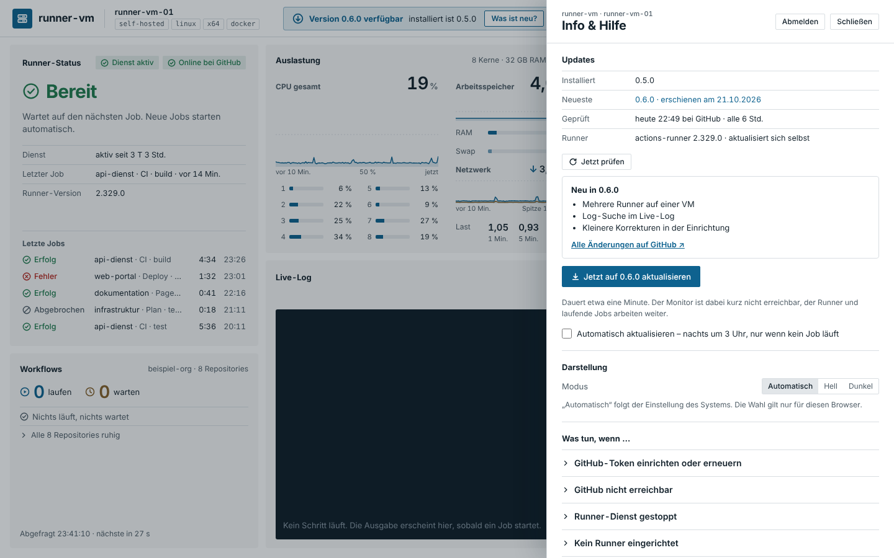

# Update und Rückweg

**Stand: 23.10.2026 · Version 0.5.0**

Der Monitor prüft alle 6 Stunden, ob es auf GitHub ein neueres Release gibt – sofort geht es mit
**Info › Updates › „Jetzt prüfen“** (höchstens einmal je Minute, auf der VM alternativ
`sudo systemctl restart runner-monitor-sammler`). Gibt es eins, erscheint
oben die Meldung **„Version X.Y.Z verfügbar“**. Vorher die Release-Notiz lesen
(`docs/releases/vX.Y.Z.md` oder „Was ist neu?“). Steht dort ein einmaliger Schritt, kommt er
nach dem Update dran.

## Im Browser (empfohlen)

1. Meldung „Was ist neu?“ oder **Info › Updates** öffnen.
2. **„Jetzt auf X.Y.Z aktualisieren“**. Die Schritte erscheinen live:
   herunterladen → Prüfsumme prüfen → installieren → neu starten → Funktion prüfen.
3. Nach etwa einer Minute meldet der Monitor „Aktualisiert auf X.Y.Z“.

Der Runner und laufende Jobs arbeiten währenddessen weiter, nur der Monitor ist kurz nicht
erreichbar.



**Automatisch:** In Info › Updates „Automatisch aktualisieren“ einschalten – dann nachts um
3 Uhr, aber nur, wenn gerade kein Job läuft.

## Per SSH

```bash
sudo /opt/runner-monitor/aktuell/einrichten.sh aktualisieren
```

Ohne Internet: das neue Paket wie bei der [Einrichtung](EINRICHTUNG.md) herunterladen, prüfen,
entpacken und darin `sudo ./einrichten.sh` aufrufen. Zugang, Token und Einstellungen bleiben.

## Prüfen

```bash
curl -s http://127.0.0.1:8090/api/health                 # neue Versionsnummer
journalctl -u runner-monitor-update -n 50               # Protokoll des Updates
sudo /opt/runner-monitor/aktuell/einrichten.sh status
```

Danach im Browser einmal durchklicken: Anmeldung, Dashboard füllt sich, Live-Log.

## Was bei einem Fehler passiert

Antwortet die neue Version nach dem Neustart nicht binnen 30 Sekunden, stellt der
Hilfsdienst die alte Version **automatisch** wieder her. Oben steht dann „Update fehlgeschlagen
– Version X wurde wiederhergestellt“ mit dem Grund. Stimmt die Prüfsumme nicht, wird das
Archiv verworfen und nichts installiert. Runbook: [update-fehlgeschlagen](runbooks/update-fehlgeschlagen.md).

## Zurück auf die vorige Version

```bash
sudo /opt/runner-monitor/aktuell/einrichten.sh zurueck
```

Die drei zuletzt installierten Versionen liegen unter `/opt/runner-monitor/versionen/`.
Ältere: das Paket der gewünschten Version herunterladen und darin `sudo ./einrichten.sh` aufrufen.
Die Daten in `/var/lib/runner-monitor` sind zwischen den Versionen verträglich; wo nicht, sagt
es die Release-Notiz.
