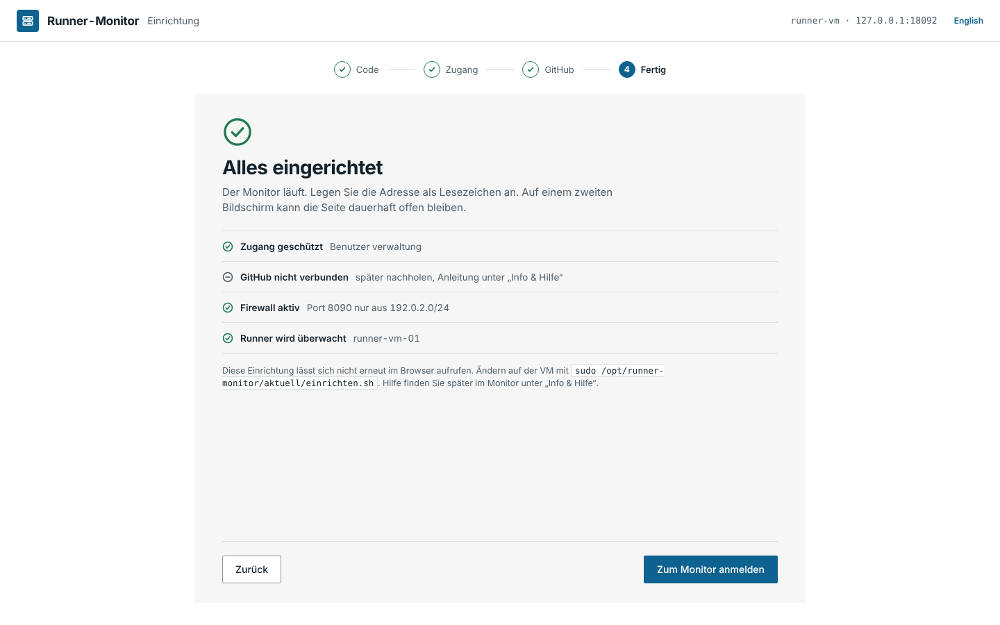

# 1 Einrichtung und Anmeldung

**Stand: 25.10.2026 · Version 0.6.1**

## Erster Aufruf

Nach `sudo ./einrichten.sh` auf der VM ([Einrichtung](../EINRICHTUNG.md)) die angezeigte
Adresse öffnen, z. B. `http://192.0.2.20:8090`. Solange kein Zugang besteht, führt jede
Adresse zur Einrichtung in vier Schritten.

| Schritt | Bild |
|---|---|
| **1 Code** – den achtstelligen Code aus dem Skript eingeben. Darüber steht, was auf der VM erkannt wurde (Monitor, Runner, Firewall). |  |
| **2 Zugang** – Benutzername und Passwort. Mindestens 12 Zeichen, sonst keine Regeln; der Balken zeigt die Länge. |  |
| **3 GitHub** (optional) – Organisation und Fine-grained Token, „Verbindung prüfen“ zeigt die Rechte. „Überspringen“ ist erlaubt. |  |
| **4 Fertig** – Zusammenfassung, „Zum Monitor“ führt zur Anmeldung. |  |

## Anmelden

- **Angemeldet bleiben** hält die Sitzung 30 Tage (sonst 12 Stunden). Nach 7 Tagen ohne
  Aufruf ist man immer abgemeldet.
- Nach **5 Fehlversuchen** ist die Anmeldung 5 Minuten gesperrt; die Seite zählt herunter.
- **Passwort vergessen:** auf der VM `sudo /opt/runner-monitor/aktuell/einrichten.sh passwort` – danach den Zugang im
  Browser neu anlegen. GitHub-Token und Einstellungen bleiben erhalten.
- Abmelden: Info › „Abmelden“.

Die Anmeldung funktioniert auch auf dem Telefon (ab 390 px Breite); das Dashboard selbst ist
für Bildschirme ab 1440 × 900 gebaut.
