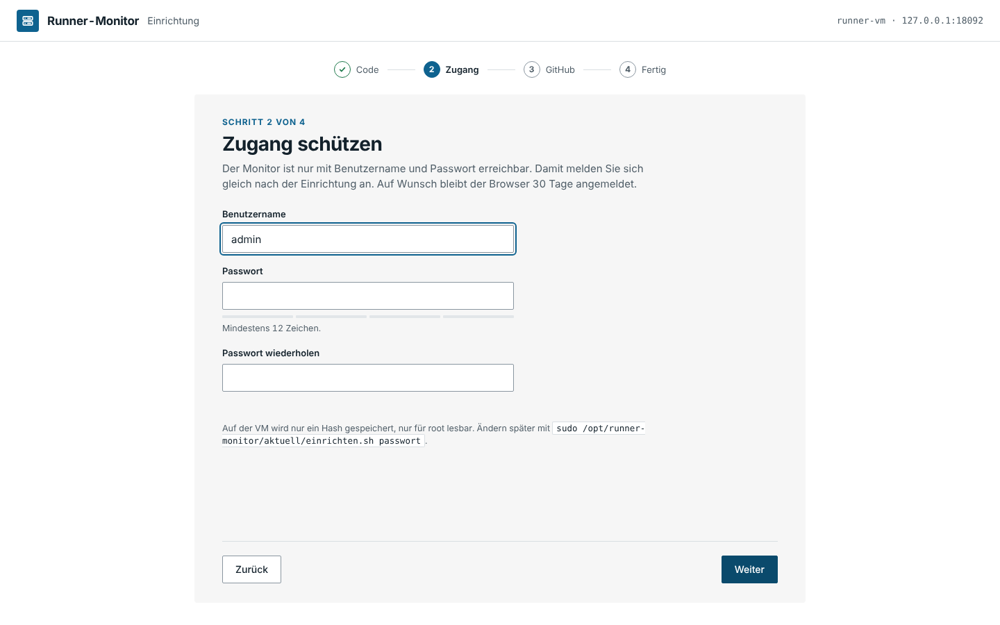
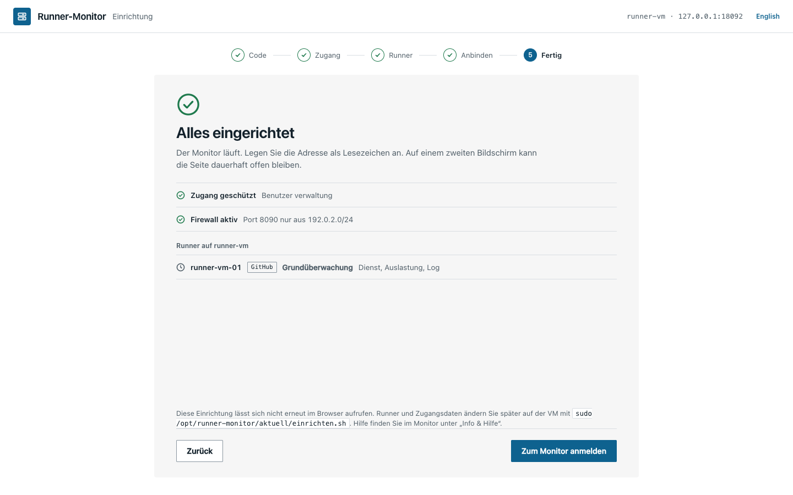
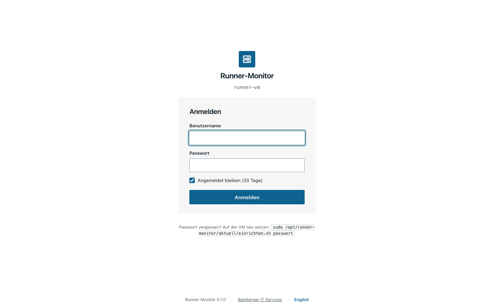
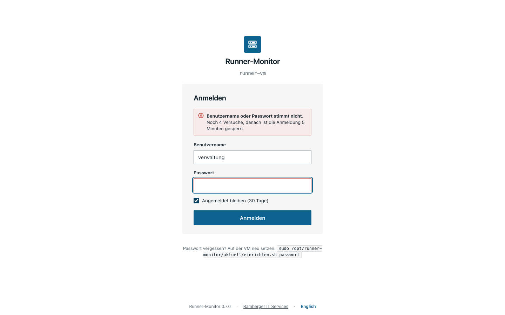

# 1 Einrichtung und Anmeldung

**Stand: 29.10.2026 · Version 0.8.0 (in Arbeit)**

## Erster Aufruf

Nach `sudo ./einrichten.sh` auf der VM ([Einrichtung](../EINRICHTUNG.md)) die angezeigte
Adresse öffnen, z. B. `http://192.0.2.20:8090`. Solange kein Zugang besteht, führt jede
Adresse zur Einrichtung in fünf Schritten. Oben rechts lässt sich die Sprache wechseln
(Deutsch/English, Vorgabe nach Browser); auf der Anmeldeseite sitzt der Umschalter unten.

| Schritt | Bild |
|---|---|
| **1 Code** – den achtstelligen Code aus dem Skript eingeben. Darüber steht, was auf der VM erkannt wurde (Monitor, Runner, Firewall). |  |
| **2 Zugang** – Benutzername und Passwort. Mindestens 12 Zeichen, sonst keine Regeln; der Balken zeigt die Länge. |  |
| **3 Runner** – alle Runner, die der Monitor auf der VM gefunden hat, mit Dienst, Sicherheitsgrad und Begründung. Je Fund: übernehmen (GitHub, Forgejo, GitLab), Grundüberwachung oder ignorieren (noch nicht unterstützte Dienste), zuordnen oder ignorieren (unbekannte Dienste). „Neu erkennen“ sucht sofort neu. Ohne Fund: Runner einrichten, von Hand zuordnen oder nur die VM überwachen. |  |
| **4 Anbinden** (optional) – je übernommenem Runner ein nur lesendes Token. Für den GitHub-Runner Organisation und Fine-grained Token wie bisher; für Forgejo und GitLab tragen Sie Server, Organisation (nicht bei GitLab) und Token nicht im Browser, sondern auf der VM ein: `sudo /opt/runner-monitor/aktuell/einrichten.sh zugang <runner>` (ohne Angabe zeigt der Befehl die erkannten Runner). Das Skript fragt nach Server, Organisation (nicht bei GitLab) und Token und prüft die Verbindung (siehe [Einrichtung](../EINRICHTUNG.md)). „Verbindung prüfen“ zeigt, was ankommt; jeder Runner lässt sich überspringen. |  |
| **5 Fertig** – Zusammenfassung mit Zugang, Firewall und Stand je Runner, „Zum Monitor anmelden“ führt zur Anmeldung. |  |

## Anmelden

- **Angemeldet bleiben** hält die Sitzung 30 Tage (sonst 12 Stunden). Nach 7 Tagen ohne
  Aufruf ist man immer abgemeldet.
- Nach **5 Fehlversuchen** ist die Anmeldung 5 Minuten gesperrt; die Seite zählt herunter.
- **Passwort vergessen:** auf der VM `sudo /opt/runner-monitor/aktuell/einrichten.sh passwort` – danach den Zugang im
  Browser neu anlegen. GitHub-Token und Einstellungen bleiben erhalten.
- Abmelden: Info › „Abmelden“.

Die Anmeldung funktioniert auch auf dem Telefon (ab 390 px Breite); das Dashboard selbst ist
für Bildschirme ab 1440 × 900 gebaut.
