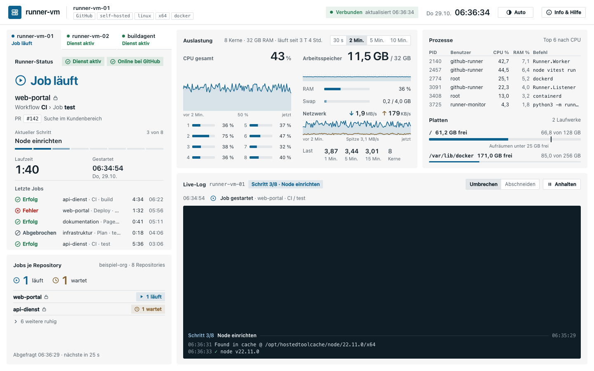
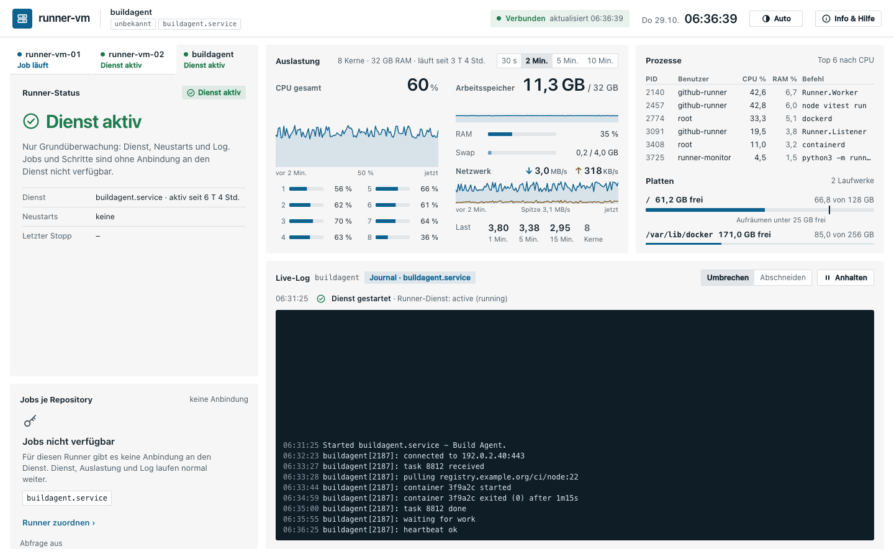
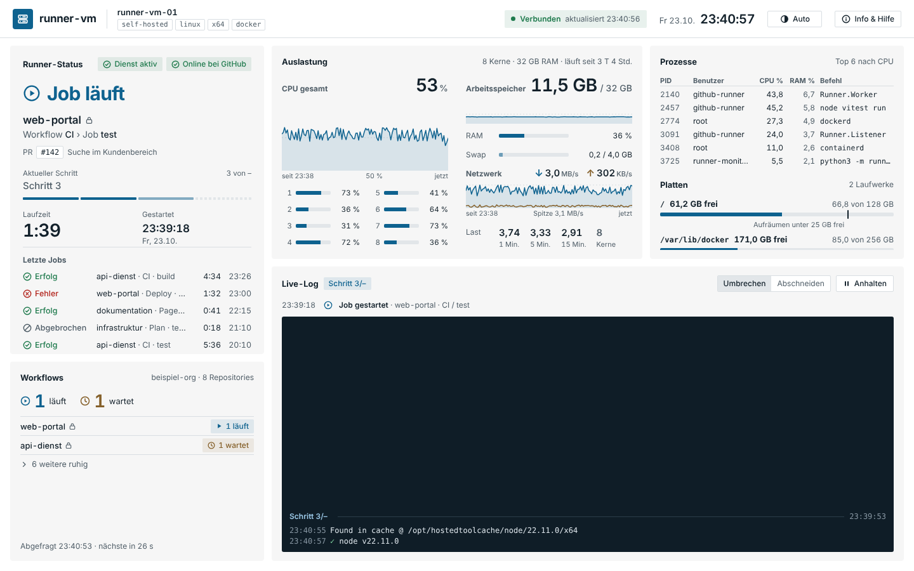
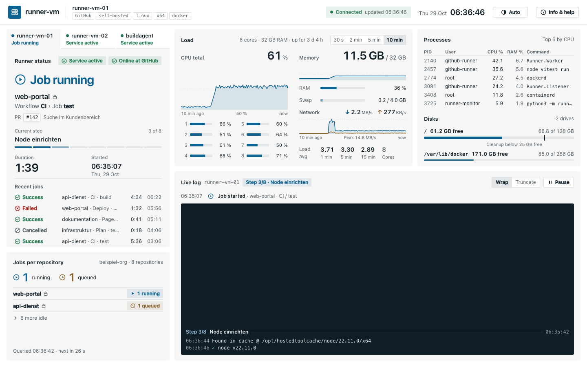

# 2 Das Dashboard

**Stand: 29.10.2026 · Version 0.8.1**

Eine Seite ohne Scrollen (1440 × 900 bis 1920 × 1080). Systemwerte kommen jede Sekunde,
Daten der Anbieter (GitHub, Forgejo, Gitea, GitLab) alle 30 Sekunden. Nichts lässt sich hier verändern – die Seite ist nur zum Anschauen.

## Kopfzeile

- links **Name der VM**, **gewählter Runner** und seine Labels; bei mehreren Runnern steht die Dienst-Plakette (GitHub, Forgejo, Gitea, GitLab, unbekannt) als erstes Label
- Mitte die wichtigste **Meldung** ([Kapitel 3](03-meldungen.md)), „+n weitere“, wenn es mehrere gibt
- rechts **Verbunden** (grüner Punkt, Zeit der letzten Daten) oder **Getrennt**, Datum und Uhrzeit,
  Umschalter **Auto / Hell / Dunkel** und **Info**

## Mehrere Runner

Läuft mehr als ein Runner auf der VM (der Monitor erkennt sie selbst, [Kapitel 1](01-einrichtung-und-anmeldung.md)),
stehen über „Runner-Status“ **Reiter**: je Runner Name, Zustandspunkt und Zustand als Text
(Job läuft, Bereit, Gestoppt, Offline, bei Grundüberwachung „Dienst aktiv“). Ab vier Runnern zeigt
die Leiste drei Reiter und **„+N“**; ein Klick darauf öffnet eine Liste der übrigen. Die Reiter lassen sich mit der
Tastatur bedienen (Pfeiltasten, Tab).

- **Zum gewählten Runner** gehören „Runner-Status“, „Jobs je Repository“ und das Live-Log (neben dem Titel steht sein Name).
- **Zur VM** gehören Auslastung, Prozesse und Platten – sie ändern sich beim Wechsel nicht.
- Die Wahl merkt sich der Browser (`runner-monitor.runner`); mit einem Runner gibt es weder Reiter noch Bedienelemente.
- Meldungen nennen den Runner („runner-vm-02: Dienst gestoppt“). Betrifft eine Meldung einen anderen als den gewählten Runner, wechselt **Anzeigen** zu ihm.

### Grundüberwachung und „nicht verfügbar“

Was ein Dienst liefert, richtet sich nach seinen Fähigkeiten (Status, Jobs, Schritte, Logs, Updates), nicht nach dem Namen.
Für unbekannte oder noch nicht angebundene Dienste gilt die **Grundüberwachung**: „Dienst aktiv“ oder „Dienst gestoppt“,
Neustarts und Journal der Unit als Live-Log (Chip „Journal · Unit“, ohne Schritt-Trenner). „Jobs je Repository“ zeigt „Jobs nicht verfügbar“
mit „Runner zuordnen ›“, das Info-Blatt öffnet. Kennt ein Dienst Jobs, aber keine Schritte, steht „Schritte nicht verfügbar“ statt des Schrittbalkens.

## Runner-Status

Das Wichtigste zuerst: groß der Zustand (hier am Beispiel GitHub; bei Forgejo, Gitea und GitLab steht entsprechend „Online/Offline bei {Dienst}“).

| Zustand | Bedeutung |
|---|---|
| **Job läuft** (blau) | Repository, Workflow und Job, Pull Request oder Branch, aktueller Schritt „3 von 8“ mit Fortschritt, Laufzeit, Startzeit. Kennt GitHub die Schrittliste noch nicht (die ersten Sekunden eines Jobs), steht „3 von –“ mit gedämpftem Namen „Schritt 3“ und gestricheltem Rest; Name und Anzahl kommen nach. Die Zahl springt nie zurück. |
| **Bereit** (grün) | Dienst läuft, GitHub sieht den Runner, kein Job |
| **Dienst gestoppt** (rot) | der systemd-Dienst des Runners läuft nicht – Jobs warten. Hat systemd ihn wegen eines Fehlers beendet, steht die Ursache unter **Grund**, z. B. „Speicher voll (OOM-Killer)“ oder „mit Fehlercode beendet“. Link „Runner-Logs abrufen“ |
| **Offline bei GitHub** (orange) | Dienst läuft, GitHub sieht ihn aber nicht |
| **Kein Runner** | auf der VM ist keiner eingerichtet |

Darunter die **letzten fünf Jobs** mit Ergebnis (Erfolg, Fehler, Abgebrochen), Dauer und Endzeit.
Oben rechts zwei Plaketten: Dienst aktiv/gestoppt und Online/Offline bei GitHub
(„unbekannt“ ohne Token oder ohne das Recht „Self-hosted runners“).

### Wenn der Dienst nicht antwortet

Fällt die Abfrage bei einem Dienst aus, zeigt der Monitor den letzten guten Stand mit seinem Alter („Stand von 14:02:11 (vor 12 Min.)“). Nach zehn Minuten Ausfall steht in „Runner-Status“ „Zustand unbekannt“ statt eines Jobs, der angeblich noch läuft; derselbe Reiter über der Karte zeigt dann ebenfalls „Unbekannt“.

## Jobs je Repository

Summe **läuft / wartet** über alle Repositories der Organisation bzw. des Servers, darunter nur die Repositories,
in denen gerade etwas läuft oder wartet. „n weitere ruhig“ klappt die übrigen auf. Ein Schloss
markiert private Repositories. Unten: Zeit der letzten Abfrage und der nächsten.

Ohne Token zeigt die Karte, wie man eines einrichtet:

## Auslastung

CPU gesamt mit Verlauf (Zeitraum wählbar, siehe unten), jeder Kern als Balken, Arbeitsspeicher mit
Verlauf, RAM und Swap, **Netz** und Last (1, 5, 15 Minuten) im Vergleich zur Zahl der Kerne.
Bei 16 und mehr Kernen werden die Balken schmaler.

**Zeitraum:** Rechts im Kopf der Karte wählt ein Umschalter **30 s · 2 Min. · 5 Min. · 10 Min.** (Standard 10 Min.) das Fenster aller Verläufe; die Wahl merkt der Browser (`runner-monitor.zeitraum`).
Die Werte sind in feste Zeitfenster gruppiert (Eimer von 1 s bzw. 3 s und 5 s bei 5 und 10 Min.), deren Grenzen an der Uhrzeit hängen: Die Kurve wandert ruhig nach links,
nur der rechte Rand ändert sich. CPU, RAM und Last zeigen den Mittelwert je Eimer, das Netz die Spitze, damit kurze Lastspitzen sichtbar bleiben.
Beschriftung der Diagramme für Screenreader nennt den Zeitraum („CPU-Verlauf der letzten 2 Minuten“).

Die Verläufe füllen immer die ganze Breite. Sind noch keine 10 Minuten (bzw. der gewählte Zeitraum) gemessen – etwa kurz nach
einem Update –, steht links unter dem Verlauf, seit wann gemessen wird („seit 14:02“), sonst
„vor 10 Min.“ (oder „vor 30 s“, „vor 2 Min.“, „vor 5 Min.“). Der Monitor sichert den Verlauf alle 10 Sekunden; nach einem kurzen Neustart (Update,
`systemctl restart`) geht es nahtlos weiter.

**Netzwerk** (eigener Block unter RAM und Swap) zeigt, was die VM gerade empfängt (↓) und sendet
(↑), summiert über alle echten Netzwerkschnittstellen. Darunter der Verlauf im gewählten Zeitraum: empfangen als blaue Fläche, gesendet als goldene Linie; die Skala richtet sich nach
der Spitze im Fenster (mindestens 64 KB/s), die unter dem Verlauf steht. Verkehr von Docker-
Containern und VPN-Tunneln steckt schon in der echten Schnittstelle und wird nicht doppelt
gezählt. Einheiten dezimal: 1 MB/s = 1 000 000 Byte je Sekunde (≈ 8 Mbit/s). Viel Empfang
während eines Jobs ist normal – der Runner lädt dann Docker-Images und Pakete.

## Prozesse und Platten

Die sechs Prozesse mit der meisten CPU (PID, Benutzer, CPU %, RAM %, Befehl in Kurzform; die
volle Befehlszeile steht im Tooltip). Darunter jedes Laufwerk mit freiem Platz (ein Netzlaufwerk, das
nicht antwortet, fehlt, bis es wieder erreichbar ist). Für „/“ zeigt
eine Marke die **Aufräumschwelle** (25 GB frei): Darunter räumt der Runner vor jedem Job auf, der
Teil über der Schwelle wird orange.

## Live-Log

- Oben die letzten **Ereignisse** (Job gestartet, beendet mit Ergebnis und Dauer, Dienst gestoppt). Das Log gehört zum gewählten Runner; bei Grundüberwachung zeigt es das Journal seiner Unit.
- Darunter die **Ausgabe des laufenden Schritts** mit den Farben aus dem Workflow. Jeder neue
  Schritt bekommt eine Trennzeile „Schritt 4/8 · Name“ (ohne Schrittliste von GitHub „Schritt 4/–“). Karte, Schritt-Pille über dem Log und Trennzeilen zeigen immer denselben Schritt. Fehlerzeilen sind rot hinterlegt.
- Die neueste Zeile steht immer unten. **Anhalten** friert die Ansicht ein (neue Zeilen werden
  gezählt), **Weiter** springt wieder nach unten.
- **Hochscrollen** (Mausrad oder Trackpad) hält das Mitlaufen ebenfalls an, um ältere Zeilen
  des Schritts zu lesen. Unten steht „Mitlaufen angehalten · n neue Zeilen“ mit **Zum Ende ↓**.
  Wer wieder ganz nach unten scrollt oder „Zum Ende“ klickt, sieht die gesammelten Zeilen und es
  läuft wieder mit.
  Im Log stehen die letzten 1 500 Zeilen.
- **Umbrechen / Abschneiden** für lange Zeilen.
- Ältere Ausgaben stehen im Runner (`_diag/pages`) und bei GitHub („Download log archive“).

## Sprache

Die Oberfläche gibt es auf Deutsch und Englisch. In Info › Darstellung › **Sprache** wählen Sie *Automatisch*, *Deutsch* oder *English*.
„Automatisch“ folgt der ersten Sprache des Browsers: beginnt sie mit `de`, ist es Deutsch, **jede andere Sprache zeigt Englisch**.
Die Wahl gilt nur für diesen Browser (`runner-monitor.sprache`). Log-Ausgaben, Befehle, Release-Notizen und das Handbuch bleiben unübersetzt.

## Getrennt

Bekommt die Seite 5 Sekunden lang keine Daten, steht oben „Getrennt“ mit der Zeit des letzten
Stands, und die Karten werden blasser. Spätestens nach 10 Sekunden ohne Daten verbindet sich die
Seite selbst neu, danach in wachsenden Abständen bis 30 Sekunden. Ein Neuladen der Seite ist nicht nötig.
Mit derselben Anmeldung sind höchstens sechs Fenster gleichzeitig live; ein siebtes bleibt auf
„Getrennt“, bis ein anderes geschlossen wird.
