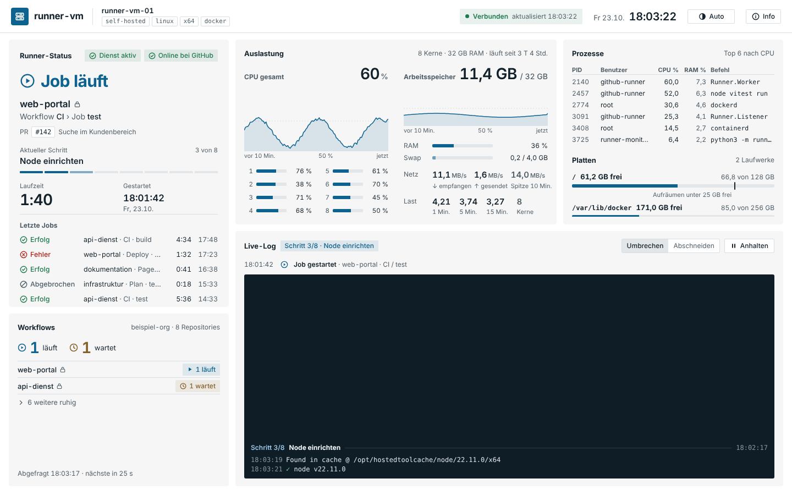
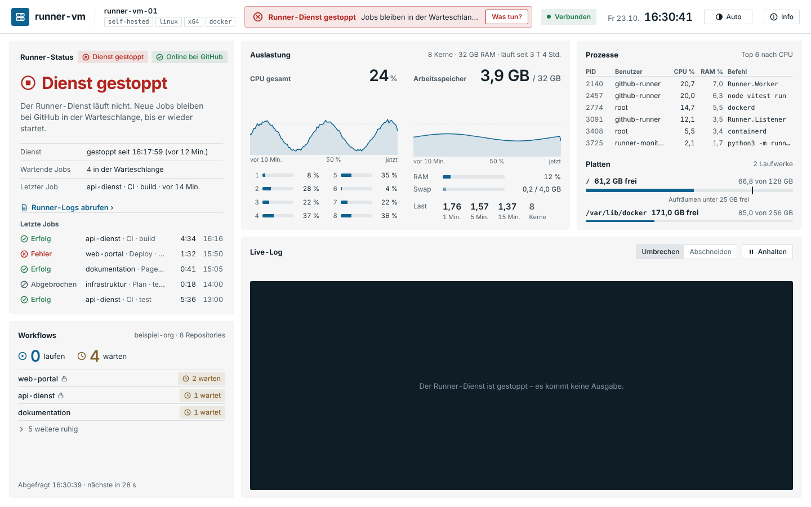
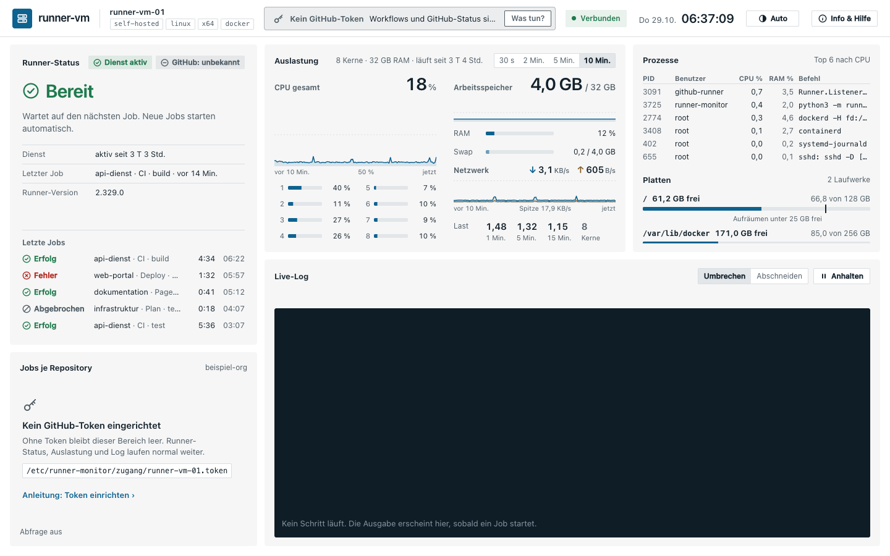
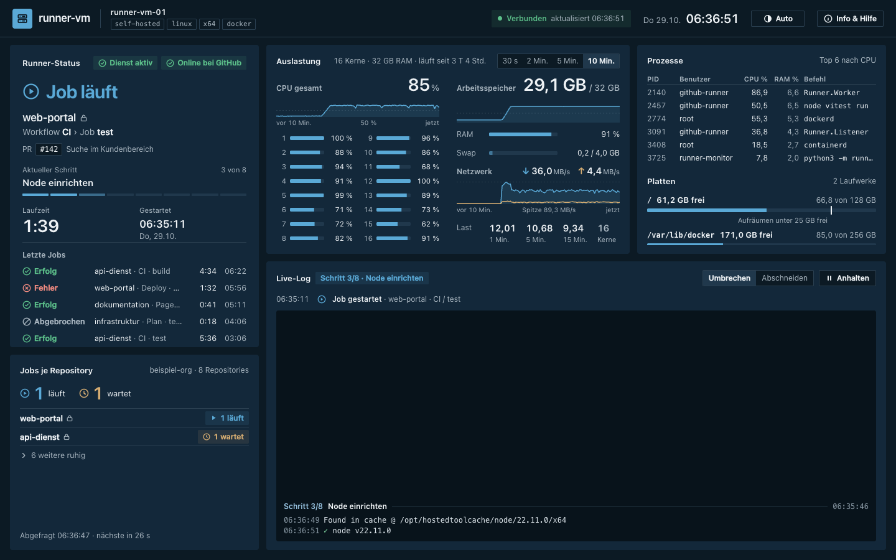
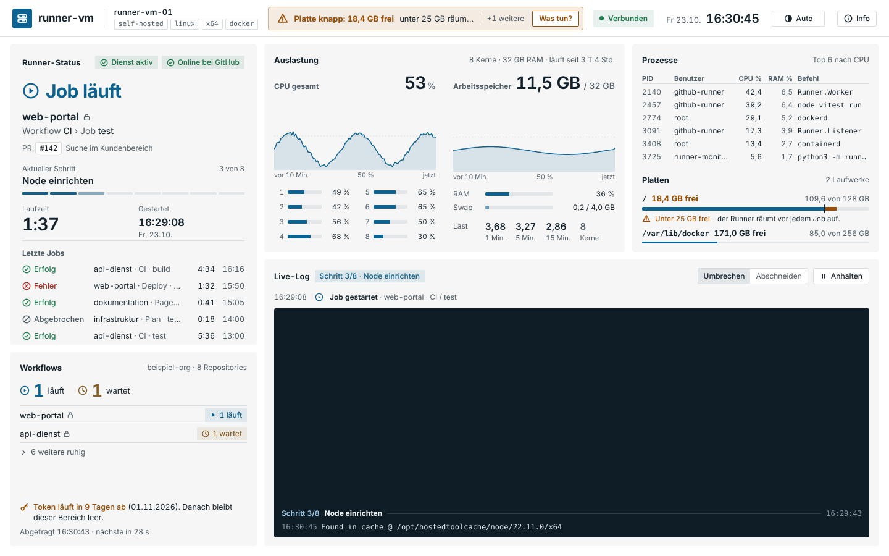

# 2 Das Dashboard

**Stand: 23.10.2026 · Version 0.1.1**

Eine Seite ohne Scrollen (1440 × 900 bis 1920 × 1080). Systemwerte kommen jede Sekunde,
GitHub-Daten alle 30 Sekunden. Nichts lässt sich hier verändern – die Seite ist nur zum Anschauen.

## Kopfzeile

- links **Name der VM**, **Runner** und seine Labels
- Mitte die wichtigste **Meldung** ([Kapitel 3](03-meldungen.md)), „+n weitere“, wenn es mehrere gibt
- rechts **Verbunden** (grüner Punkt, Zeit der letzten Daten) oder **Getrennt**, Datum und Uhrzeit,
  Umschalter **Auto / Hell / Dunkel** und **Info**

## Runner-Status

Das Wichtigste zuerst: groß der Zustand.

| Zustand | Bedeutung |
|---|---|
| **Job läuft** (blau) | Repository, Workflow und Job, Pull Request oder Branch, aktueller Schritt „3 von 8“ mit Fortschritt, Laufzeit, Startzeit |
| **Bereit** (grün) | Dienst läuft, GitHub sieht den Runner, kein Job |
| **Dienst gestoppt** (rot) | der systemd-Dienst des Runners läuft nicht – Jobs warten. Link „Runner-Logs abrufen“ |
| **Offline bei GitHub** (orange) | Dienst läuft, GitHub sieht ihn aber nicht |
| **Kein Runner** | auf der VM ist keiner eingerichtet |

Darunter die **letzten fünf Jobs** mit Ergebnis (Erfolg, Fehler, Abgebrochen), Dauer und Endzeit.
Oben rechts zwei Plaketten: Dienst aktiv/gestoppt und Online/Offline bei GitHub
(„unbekannt“ ohne Token oder ohne das Recht „Self-hosted runners“).

## Workflows

Summe **läuft / wartet** über alle Repositories der Organisation, darunter nur die Repositories,
in denen gerade etwas läuft oder wartet. „n weitere ruhig“ klappt die übrigen auf. Ein Schloss
markiert private Repositories. Unten: Zeit der letzten Abfrage und der nächsten.

Ohne Token zeigt die Karte, wie man eines einrichtet:

## Auslastung

CPU gesamt mit Verlauf der letzten 10 Minuten, jeder Kern als Balken, Arbeitsspeicher mit
Verlauf, RAM und Swap, **Netz** und Last (1, 5, 15 Minuten) im Vergleich zur Zahl der Kerne.
Bei 16 und mehr Kernen werden die Balken schmaler.

**Netz** zeigt, was die VM gerade empfängt (↓) und sendet (↑), summiert über alle echten
Netzwerkschnittstellen, dazu den höchsten Wert der letzten 10 Minuten. Verkehr von Docker-
Containern und VPN-Tunneln steckt schon in der echten Schnittstelle und wird nicht doppelt
gezählt. Einheiten dezimal: 1 MB/s = 1 000 000 Byte je Sekunde (≈ 8 Mbit/s). Viel Empfang
während eines Jobs ist normal – der Runner lädt dann Docker-Images und Pakete.

## Prozesse und Platten

Die sechs Prozesse mit der meisten CPU (PID, Benutzer, CPU %, RAM %, Befehl in Kurzform; die
volle Befehlszeile steht im Tooltip). Darunter jedes Laufwerk mit freiem Platz. Für „/“ zeigt
eine Marke die **Aufräumschwelle** (25 GB frei): Darunter räumt der Runner vor jedem Job auf, der
Teil über der Schwelle wird orange.

## Live-Log

- Oben die letzten **Ereignisse** (Job gestartet, beendet mit Ergebnis und Dauer, Dienst gestoppt).
- Darunter die **Ausgabe des laufenden Schritts** mit den Farben aus dem Workflow. Jeder neue
  Schritt bekommt eine Trennzeile „Schritt 4/8 · Name“. Fehlerzeilen sind rot hinterlegt.
- Die neueste Zeile steht immer unten. **Anhalten** friert die Ansicht ein (neue Zeilen werden
  gezählt), **Weiter** springt wieder nach unten.
- **Hochscrollen** (Mausrad oder Trackpad) hält das Mitlaufen ebenfalls an, um ältere Zeilen
  des Schritts zu lesen. Unten steht „Angehalten · n neue Zeilen“. Wer wieder ganz nach unten
  scrollt oder **Weiter** klickt, sieht die gesammelten Zeilen und es läuft wieder mit.
  Im Log stehen die letzten 1 500 Zeilen.
- **Umbrechen / Abschneiden** für lange Zeilen.
- Ältere Ausgaben stehen im Runner (`_diag/pages`) und bei GitHub („Download log archive“).

## Getrennt

Bekommt die Seite 5 Sekunden lang keine Daten, steht oben „Getrennt“ mit der Zeit des letzten
Stands, die Karten werden blasser und die Seite verbindet sich selbst neu.
