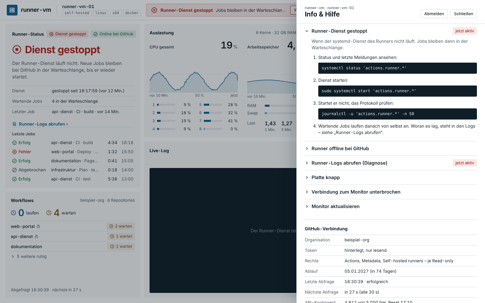

# 3 Meldungen und „Was tun?“

**Stand: 29.10.2026 · Version 0.8.1**

Probleme erscheinen oben in der Mitte der Kopfzeile. Es steht immer nur die wichtigste da,
„+n weitere“ zeigt, dass es mehr gibt. **„Was tun?“** öffnet Info & Hilfe genau bei der
passenden Anleitung; Anleitungen, die gerade zutreffen, tragen dort „jetzt aktiv“.

Bei mehreren Runnern nennt die Meldung den Runner („runner-vm-02: Dienst gestoppt“). Betrifft sie einen anderen als den gewählten, wechselt der Knopf **Anzeigen** zu ihm. Meldungen zum Dienst nennen ihn im Titel („Forgejo nicht erreichbar“); die Anleitung dazu passt zum Dienst. Einige Texte sagen unten „GitHub“, gelten aber sinngemäß für Forgejo, Gitea und GitLab.

| Reihenfolge | Meldung | Farbe | Anleitung |
|---|---|---|---|
| 1 | Verbindung zum Monitor unterbrochen | rot | Verbindung zum Monitor |
| 2 | Update läuft / Update fehlgeschlagen | blau / rot | Monitor aktualisieren |
| 3 | Runner-Dienst gestoppt (bei Speichermangel mit „Speicher voll“ im Text) | rot | Runner-Dienst gestoppt – bei „oom-kill“ mit Schritten zu RAM, Swap und Speicher-Einstellung –, Runner-Logs abrufen |
| 4 | Kein Runner eingerichtet | orange | – (`sudo ./einrichten.sh runner`) |
| 5 | Runner offline bei GitHub | rot | Runner offline, Runner-Logs abrufen |
| 6 | GitHub nicht erreichbar / Kontingent erschöpft | orange | GitHub nicht erreichbar |
| 7 | GitHub-Token ungültig / ohne Zugriff | rot | GitHub-Token einrichten oder erneuern |
| 8 | Kein GitHub-Token | grau | GitHub-Token einrichten |
| 9 | Platte knapp: n GB frei | orange | Platte knapp |
| 10 | GitHub-Token läuft in n Tagen ab (ab 14 Tagen vorher) | orange | GitHub-Token erneuern |
| 11 | Version X verfügbar | blau | Updates |
| 12 | Aktualisiert auf X (eine Stunde lang) | grün | Updates |

Für Störungen, die tiefer gehen, gibt es [Runbooks](../runbooks/README.md).
