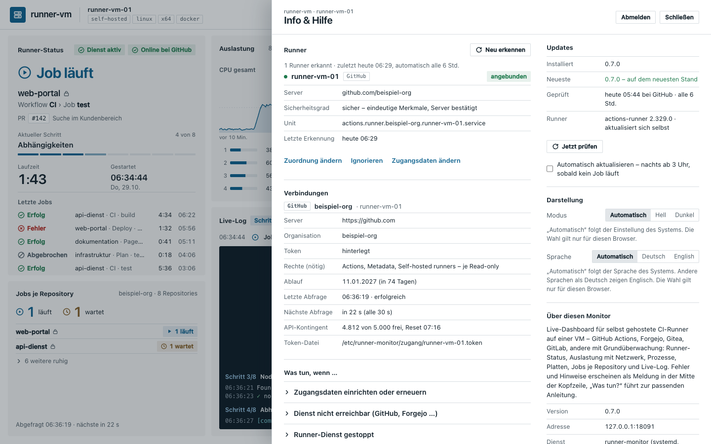
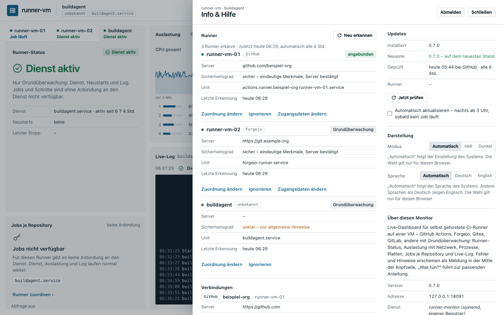

# 4 Info & Hilfe

**Stand: 29.10.2026 · Version 0.8.1**

„Info“ oben rechts öffnet ein Blatt von rechts. Schließen mit „Schließen“, Escape oder einem
Klick daneben.

Das Blatt bleibt beim Lesen ruhig stehen: Nur die Werte darin aktualisieren sich, Position und
aufgeklappte Anleitung bleiben.

Das Blatt ist 890 px breit und hat zwei Spalten. **Links** stehen Runner, Verbindungen und „Was tun, wenn …“, **rechts**
Updates, Darstellung, Über diesen Monitor und „Fehler gefunden oder Idee?“.

| Abschnitt | Inhalt |
|---|---|
| **Runner** | alle Runner dieser VM mit Dienst (GitHub, Forgejo, Gitea, GitLab, unbekannt), Einstufung (angebunden, Grundüberwachung, noch nicht angebunden, neu gefunden, ignoriert), Server, Sicherheitsgrad der Erkennung, Unit und Zeitpunkt der letzten Erkennung. **Neu erkennen** sucht sofort; ein neuer Fund erscheint mit der Leiste „1 neuer Runner gefunden“ (Übernehmen oder Ignorieren). Je Runner: **Zuordnung ändern** (Dienst, Anzeigename, systemd-Unit, Log-Pfad), **Ignorieren** bzw. **Wieder anzeigen** (das setzt den Runner auf „wie erkannt“ zurück; eine frühere Wahl „Grundüberwachung“ geht dabei verloren) und **Zugangsdaten ändern** – das zeigt nur den Befehl `sudo /opt/runner-monitor/aktuell/einrichten.sh zugang <runner>` zum Kopieren; Server, Organisation und Token tragen Sie nie im Browser ein, sondern auf der VM. Änderungen übernimmt der Monitor wenige Sekunden später in `/etc/runner-monitor/runner.json`. |
| **Verbindungen** | je angebundenem Dienst Server, Organisation, Token-Zustand, Rechte, Ablauf, letzte und nächste Abfrage, API-Kontingent und Ort der Token-Datei (`/etc/runner-monitor/zugang/<runner>.token`) – nur zum Anschauen; „Rechte (nötig)“ nennt, was das Token braucht, nicht, was der Dienst ihm tatsächlich erlaubt; was der Dienst nicht liefert, steht als „–“ |
| **Updates** | installierte und neueste Version, wann zuletzt geprüft, Knopf **„Jetzt prüfen“** (fragt GitHub sofort, höchstens einmal je Minute; gesperrt, solange ein Update läuft), Neuerungen seit der installierten Version (je Version „Was ist neu“, einmalige Schritte farbig hervorgehoben, ältere Versionen zum Aufklappen), Knopf „Jetzt aktualisieren“ mit Fortschritt (gleich nach einem neuen Release steht dort kurz „wird gerade bereitgestellt“, bis das Paket am Release hängt), Schalter „Automatisch aktualisieren“ (ab 3 Uhr, sobald kein Job läuft, bis 7 Uhr; darunter steht, ob ein Update vorgemerkt ist) ([UPDATE.md](../UPDATE.md)) |
| **Darstellung** | Automatisch (folgt dem System), Hell, Dunkel – gilt für diesen Browser. Derselbe Umschalter sitzt als Knopf in der Kopfzeile. Darunter **Sprache**: Deutsch oder English (Vorgabe: Sprache des Browsers; die Seite lädt beim Wechsel einmal neu). Release-Notizen und Handbuch bleiben deutsch. |
| **Was tun, wenn …** | Schritt-für-Schritt-Anleitungen für den **gewählten Runner**; jeder Befehl hat einen Knopf **Kopieren** und nennt die Unit dieses Runners: Zugangsdaten einrichten oder erneuern (GitHub · Forgejo / Gitea · GitLab), Dienst nicht erreichbar (GitHub, Forgejo …), Runner-Dienst gestoppt, Runner offline beim Dienst, **Runner-Logs abrufen**, Platte knapp (den Befehl `sudo /usr/local/bin/runner-aufraeumen` nur, wenn das Aufräumen auf der VM eingerichtet ist, sonst `sudo /opt/runner-monitor/aktuell/einrichten.sh aufraeumen`), Verbindung zum Monitor, Monitor aktualisieren. „Was tun?“ in einer Meldung öffnet die Anleitung, die zum Dienst des betroffenen Runners passt. |
| **Über diesen Monitor** | Version, Adresse, Dienst, Aktualisierungstakt, Ersteller und Link zum Repository |
| **Fehler gefunden oder Idee?** | zeigt die technischen Angaben (Version, System, Runner, Browser) und öffnet das E-Mail-Programm mit einer Nachricht an info@bamberger-it-services.de („Fehler melden“, „Idee vorschlagen“), in der Betreff, Vorlage und diese Angaben schon stehen. Gesendet wird erst, wenn Sie die Mail abschicken. **Keine Tokens oder Passwörter mitschicken, Log-Ausschnitte nur gekürzt einfügen.** Beim fehlgeschlagenen Update gibt es daneben einen Link „Fehler melden“ mit Platz für die Ausgabe von `journalctl -u runner-monitor-update -n 50`. |

## Runner-Logs abrufen

Die Anleitung „Runner-Logs abrufen (Diagnose)“ fasst zusammen, wo der Runner protokolliert:

| Was | Wo |
|---|---|
| Start, Stopp, Abstürze, Job-Start/-Ende | `journalctl -u 'actions.runner.*'` |
| Anmeldung bei GitHub, Verbindungsfehler, Updates | `/opt/actions-runner/_diag/Runner_*.log` |
| Ablauf eines Jobs | `/opt/actions-runner/_diag/Worker_*.log` |
| Ausgabe je Schritt | `/opt/actions-runner/_diag/pages/` |
| abgeschlossene Jobs | GitHub › Repository › Actions › Lauf › Job › „Download log archive“ |
